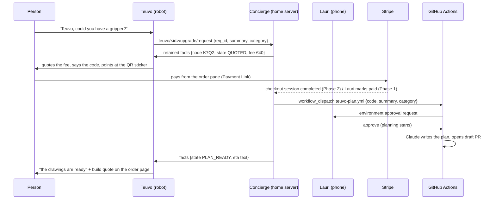

# PRD-014: Teuvo Sponsored Upgrades — Commissioned Feature Planning Through Conversation

**Status**: draft
**Created**: 2026-10-23
**Confidence**: 6/10 (legal points are interpretation, not legal advice; no part of the flow has run)

---

## Overview

A person talking to Teuvo suggests a new feature, either hardware or software.
Teuvo quotes a fixed planning fee. When it is paid, a Claude session on this
repo writes an upgrade plan and opens a draft PR. The plan covers parts, a
schematic where the parts allow one, a cost estimate including JLCPCB and
Lauri's build time, and lead times. Teuvo hands the person a link to the plan
and to a private order page with the invoice. Later he tells them, in his own
manner, when parts are expected and when the build might be done.

Lauri gates every payment confirmation, every planning run and every purchase,
at least at first. To the person talking to Teuvo, the flow looks the way it
would if it were fully automated.

## Problem

None of the pieces exist today:

- **Nothing captures the request.** The voice turn returns free text; its only
  structured output is the `__IGNORE__` sentinel (`voice_turn.c:494-505`). The
  user's words are never transcribed. History replays each user turn as the
  literal "(User spoke to you)" (`voice_history.c:190`), and ESP_LOG lines do
  not reach MQTT. A spoken feature request leaves no text anywhere.
- **Nothing tells Teuvo facts from a server.** The only downlink is
  `robocar/commands`: 63-byte printable-ASCII console lines, so no ä/ö
  (`mqtt_command.h:33`). Nothing puts "order K7Q2: parts shipped" into Teuvo's
  context. The device has no wall clock (no SNTP), so it cannot compute "next
  week" itself.
- **Nothing turns a request into a PR.** `claude.yml` ignores bot senders and
  needs an `@claude` mention (`claude.yml:13-22`). It runs on `ubuntu-slim`,
  where single-CPU jobs are killed at 15 minutes.
- **There is no payment rail and no link channel.** The 128x32 OLED has no
  driver (#780). With the ISO quiet zone it fits only a version-1 QR code (21
  modules), about 17 bytes, far short of a PR or payment URL.

## Constraints that shape the design

These are legal interpretations for planning, not legal advice. Sources were
read on 2026-10-23.

| Constraint | Consequence | Source |
|---|---|---|
| Private MobilePay may not send or receive money for commercial or business purposes | Lauri's personal MobilePay cannot take these payments; every Vipps MobilePay merchant product needs a Y-tunnus and a business account | MobilePay terms v1.10 §4.4 (20.10.2026); developer.vippsmobilepay.com applying-for-services |
| A collection from the public with nothing given in return is a *rahankeräys*, which a single private person may not run | It is sold as a **commissioned design service**: the payer receives the plan. Never called *lahjoitus* (donation) | Rahankeräyslaki 863/2019 §2; Vero guide on pienkeräys (2022) |
| A standing, priced, public offer very likely counts as business activity (*elinkeinotoiminta*) | Lauri is a trader under KSL chapter 6. He owes pre-contract information, a 14-day withdrawal right, and a withdrawal function on the order page (6:14 a, in force 19.6.2026). Planning may start inside the withdrawal period only on the consumer's express request and acknowledgement (6:15–6:16) | Vero VH/8236/00.01.00/2024; KSL 38/1978 (Finlex) |
| No VAT is due while turnover is at most €20,000 in the current and previous year | No VAT on invoices until then; resold parts count toward turnover | Vero VH/1581/00.01.00/2024 |
| The repo is public | No names, contact details, invoices or payment references in issues, PRs, dispatch inputs or Actions logs | REST API: `visibility: public` |
| No direct exhortation to children to buy | Teuvo never pitches upgrades. He answers an explicit request from an adult, and the feature is off unless switched on | UCPD 2005/29/EC Annex I point 28 |
| Gemini API users must be 18+, and an API client may not be "likely to be accessed by" under-18s | Applies to Teuvo whatever this PRD does; an open question below | Gemini API Additional Terms (2026-03-23) |
| Building paid products on a Claude subscription's OAuth credentials is outside "ordinary, individual usage" | Customer-paid planning runs bill to a Console API key, preferably through OIDC federation in Actions | code.claude.com/docs/en/legal-and-compliance |
| Free and open-source software that its manufacturer monetises can count as supplied "in the course of a commercial activity" | The upgrade desk is **off by default** in every published image and enabled per robot over serial. Payment happens on the payer's phone, never on the robot. This also keeps Teuvo outside RED 3(3)(f), which covers equipment that "enables the holder or user to transfer money" (interpretation) | CRA 2024/2847 recital 15; RED Delegated Reg. 2022/30 Art 1(3) |

## Goals

- Turn a spoken request into a quoted, paid, planned upgrade, with a PR as the
  deliverable, and no step that only works in a demo
- Keep Lauri the gate for marking an order paid, starting a planning run and
  any parts purchase. Automating one gate must not automate another
- Never let the model invent a price, a payment state or a date. Every figure
  Teuvo says comes from the server as a fact
- Keep personal data and invoices out of the public repo
- Show the whole experience end to end before any real money moves (Phase 0)

## Non-Goals

- Selling Teuvo units. That is [PRD-015](PRD-015-teuvo-for-other-owners.md),
  which is a separate decision
- Payments made by the robot or on the robot
- Automatic parts purchasing. The `jlcpcb-order` and `aliexpress-parts` skills
  stop at the cart, and Lauri pays
- Merging plan PRs. A plan PR stays a draft until the upgrade is built or
  dropped

## Flow



Order states, held only on the concierge:

```
QUOTED → AWAITING_PAYMENT → PAYMENT_CLAIMED → PAID → APPROVED → PLANNING
  → PLAN_READY → BUILD_QUOTED → BUILD_PAID → PARTS_ORDERED → PARTS_ARRIVED
  → BUILDING → DONE
exits: EXPIRED, WITHDRAWN, REFUNDED, FAILED
```

Only two writers may set `PAID` or `BUILD_PAID`. One is Lauri's authenticated
action. The other, from Phase 2, is a Stripe webhook whose signature verifies
and whose amount, currency and order reference match the order. Nothing the
person says to Teuvo can set them. `PAYMENT_CLAIMED` exists so that Teuvo can
say "thank you, Lauri will confirm" without claiming the money has arrived.

## Features

### FR-024: Upgrade-request capture in the voice turn

When the desk is enabled, the voice-turn system prompt allows a second
sentinel next to `__IGNORE__`. The reply opens with `__REQUEST__`, then one
English line `<category> | <summary ≤160 chars>`, then the spoken Finnish
reply. A pure-C splitter in `voice_history.c` style separates the parts.
The device publishes `{req_id, device_id, category, summary, lang}` to
`teuvo/<device_id>/upgrade/request` at QoS 1.

- The model emits the sentinel only for an explicit request addressed to
  Teuvo. It never volunteers or suggests a paid upgrade.
- Teuvo's reply says that the summary goes to Lauri and that an accepted plan
  is published.
- Probe the reply format live on `gemini-flash-latest` with an audio part
  before building on it (`.claude/rules/gemini-api.md` §1). Function calling
  (option B) or Gemini Live input transcription (#619) can replace the
  sentinel later.
- The broker user for the robot may publish only its request topic and read
  only its own facts topic (ACL). `robocar/commands` is never used for this.

### FR-025: Order facts downlink and gated phrasing

The concierge publishes a retained UTF-8 JSON document to
`teuvo/<device_id>/upgrade/facts`: open orders with code, state (enum), fee or
quote in euros, and a pre-rendered Finnish ETA phrase with its as-of date.
The firmware subscribes to it through `mqtt_logger_subscribe()`, which has 4
slots, one used by OTA. That path has no fragment check yet, so one is added,
as in `mqtt_command_extract_line()`. The firmware validates against a fixed
schema and injects a facts sentence into the voice-turn user prompt, where
telemetry goes today (`voice_history.c:104-145`).

- **Fail closed.** If no facts arrived, or they are stale, Teuvo says he will
  ask Lauri. He never guesses.
- **Teuvo never reads PR text.** Only enums, numbers and the pre-rendered ETA
  phrase reach the prompt, so a PR cannot steer him.
- **A deterministic screen guards payment claims.** While the state is below
  `PAID`, it rewrites any reply that claims payment was received ("maksu
  vastaanotettu", "maksu on tullut", "kiitos maksusta") into a holding line,
  for example: "Kiitoksia! Lauri kuittaa vielä maksun." A spoken quote must
  contain the fee figure from the facts, or the line is replaced with a
  template.
- **Before any of this, two prompt truncations are fixed.** The voice turn cuts
  Teuvo's 758-byte brief to 511 bytes (`voice_turn.c:292-301`). The TTS request
  leaves about 190 bytes of spoken text under the 383-byte style
  (`gemini_tts.c:238-240`). Quotes and status lines would be cut mid-sentence.
  The fix includes a host test that budgets every persona string.

### FR-026: Concierge service

New Python 3.12 + uv project `packages/robocar/concierge/`, using SQLite,
ruff and ty. It runs on Lauri's home server. Its jobs:

- **Requests.** It deduplicates on `req_id` and assigns a 4-character
  Crockford base32 code. It prices from Lauri's fee table (fixed tiers by
  category) and expires quotes after 14 days.
- **Order state.** It owns the order state machine and the two-writer rule
  above.
- **Lauri's phone gate.** It sends a notification with *mark paid*, *reject*
  and *refund* actions. The channel is an open question.
- **Planning runs.** It dispatches `teuvo-plan.yml` with the anonymised
  summary. Then it polls the run and `GET /pulls?head=…:teuvo/plan-<code>`. A
  green run with no PR counts as failed, because the SDK exits 0 on a
  permission denial (reusable-auto-fix.yml).
- **Facts.** It publishes the retained facts for FR-025.
- **The order page.** It serves the private page for FR-030 behind a
  short-link host (Cloudflare Tunnel or similar, since the home server is
  presumably behind NAT).
- **Limits.** It caps requests per device per day and planning sessions per
  month, mirroring ADR-022's spend ceiling.

The concierge holds the only secrets: the dispatch token (fine-grained,
Actions: write on this repo), the Stripe key and the webhook secret. The robot
holds only its broker credentials.

### FR-027: Payment rail

| Phase | Rail | Confirmation |
|---|---|---|
| 0 (demo) | Stripe sandbox: no registration, no money (`stripe sandbox create`) | Lauri taps *mark paid*, or the sandbox webhook |
| 1 (live, gated) | Stripe account as `individual` (FI); per-order Payment Link with `restrictions.completed_sessions.limit = 1`, metadata `order_ref`, `consent_collection` + `custom_text` carrying the KSL 6:15 request and the withdrawal notice | Lauri marks paid after seeing the Stripe notification |
| 2 | Same link | Webhook relay: verifies `Stripe-Signature`, matches amount, currency and `order_ref` on `checkout.session.completed` (plus the async events) |
| fallback | Bank transfer with a Finnish reference number (*viitenumero*) and *virtuaaliviivakoodi* on the order page | Lauri, by hand |

Fees (stripe.com/fi/pricing, 2026-10-23):

- Standard EEA cards: 1.5% + €0.25.
- MobilePay via Stripe: 1.5% + €0.36, in the standard-card case. Stripe bills
  a separate daily MobilePay fee, so the rate is higher for premium cards.
- Disputes: €20 each, plus €20 if contested.

On a €50 fee that is €1.00 by card. MobilePay becomes "Vipps" in Finland on
12.1.2027, and the copy on the page and in Teuvo's lines changes with it.

The Vipps MobilePay ePayment API (2.49% + €0.20, HMAC-signed webhooks keyed
to an order reference) is an option only if a Y-tunnus is registered for
other reasons.

### FR-028: Gated planning workflow

`.github/workflows/teuvo-plan.yml` takes `workflow_dispatch` inputs `code`,
`category` and `summary`. The summary is capped at 1000 characters and is
already anonymised.

**The gate.** The job runs in environment `teuvo-planning`, with Lauri as
required reviewer. Required reviewers work on public repos on the Free plan.
*Prevent self-review* stays off, because Lauri's token dispatches. The Claude
credential is an environment secret, so the job cannot read it before Lauri
approves. That approval is the spend gate.

**The run.**
- `anthropics/claude-code-action` in automation mode, pinned to a SHA.
- Console billing through OIDC federation (`anthropic_federation_rule_id`,
  `id-token: write`), or an `ANTHROPIC_API_KEY` environment secret.
- The request reaches the prompt through an env var or file, as fenced,
  labelled untrusted data. It is never `${{ }}` inside `run:` or `prompt:`.
- `runs-on: ubuntu-latest`, `timeout-minutes: 30`, `--max-turns 40`,
  `--max-budget-usd 10`, concurrency 1.
- Allowed tools: `Read`, `Glob`, `Grep`, `Write`, `Edit`, `Bash(git *)`,
  `Bash(just kicad::*)`, `Bash(python3 -m kicad.*)`.

**The output.**
- A deterministic step after Claude fails the job if the diff touches anything
  outside `packages/robocar/upgrades/<code>-<slug>/`.
- The job opens a draft PR from `teuvo/plan-<code>` with the release-please App
  token. PRs made with `GITHUB_TOKEN` start no CI (`.claude/rules/ci-cd-workflows.md`).

Estimated cost per run on an API key: $3–10 at Opus 5.5 rates, unmeasured.
Actions minutes are free on a public repo.

### FR-029: Upgrade-plan template

Each plan is a directory `packages/robocar/upgrades/<code>-<slug>/`, outside
the release-please package `packages/robocar/unified`. A merge there would
mint a firmware release.

- `README.md` has:
  1. the request, paraphrased, with no personal data;
  2. what changes;
  3. the pins, mux channels and PCA9685 channels used, set against the spare
     list in `pin_config.h`: D3, D7, TCA9548A ch5–7, PCA9685 ch14–15;
  4. the power budget, checked against `.claude/rules/power-stage-checklist.md`;
  5. a gate table: KiCad-free CI, local KiCad gates, layout review, physical
     checks still owed;
  6. lead time;
  7. Lauri's checklist;
  8. open questions.
- `parts.csv` lists, for each part, an LCSC number or listing URL, price,
  stock and Basic/Extended status. The JLCPCB parts API works from a cloud
  container (verified 2026-10-23).
- `cost.csv` has one row per cost, each with source, date and an
  `estimate`/`quote` label:
  - PCBA setup €7.33 and stencil €1.38;
  - about €2.75 per Extended line;
  - DHL €24–32;
  - VAT 25.5%;
  - EU duty on parcels under €150 (since 1.7.2026);
  - JLC3DP;
  - AliExpress;
  - build hours × rate.

  The figures come from the calibrations in the `jlcpcb-order` and
  `aliexpress-parts` skills, which are dated carts from 2026-10-22/23, not
  quotes.
- `renders/` holds committed SVG/PNG files, because `output/` is gitignored.
  - **Phase 1** is docs-only: a parts table and a block diagram, with no
    carrier change.
  - **Phase 2** has the run install KiCad with `just kicad::setup`. That took
    about 4.5 minutes and verified in a cloud container on 2026-10-23. The run
    then adds a sibling carrier variant at `stage = "schematic"`, plus
    `kicad-cli sch export svg` and a bare-board `pcb render`.
  - A plan that needs a new pin role still edits the shared
    `unified/main/pin_config.h`. That reaches the live carrier's CI gates and
    the unit tests that pin its shape (`tools/kicad/test_netlist.py:371`,
    `tools/hardware/test_hardware.py:1438`). Such plans stop at the paper stage
    for Lauri.

A `README.md` at the upgrades root holds the template.

### FR-030: Link hand-off

- **The sticker.** A printed QR sticker on Teuvo's chassis, about 25 mm, links
  to a stable per-robot short URL such as `HTTPS://<short>/T/<device_id>`. The
  page lists that robot's open orders by code. The invoice, the payment link
  and the withdrawal function sit behind the order code plus a PIN that Teuvo
  speaks once.
- **Spoken pointers.** Teuvo says the 4-character code and "katso tarraa
  selässäni" ("see the sticker on my back").
- **The OLED.** An OLED QR code is optional and later. It needs an SSD1306
  driver (#780) and a phone scan test of a version-1 code at about 0.175 mm
  per pixel, drawn as lit-on-dark.
- **The PR link** sits on the order page. The PR itself is public; the invoice
  is not.

### FR-031: Lead-time calibration

No order-placed to delivered date exists anywhere in the repo.
`packages/robocar/upgrades/lead-times.csv` records each real order: supplier,
service, ordered, shipped and delivered dates, so ETAs become measurements.
Until enough rows exist, the concierge uses the quoted bands:

- JLCPCB fabrication: 24 h for 5 two-layer boards; Economic PCBA 1–3 days.
- DHL: 2–4 days.
- Total: about 4–8 days for an assembled board (estimate).
- AliExpress: weeks; one recorded item took 24–46 days.

The concierge renders a casual phrase from these, such as "osat tulevat
ensi viikon lopulla" ("the parts come at the end of next week"). The device
only speaks it.

## Phases

| Phase | Scope | Money | Gates |
|---|---|---|---|
| 0 | FR-024–FR-028 end to end on Lauri's own Teuvo, Stripe sandbox, docs-only plans | none | Lauri: mark paid, approve run |
| 1 | Live Stripe, KSL texts on the order page, invoices, FR-029 docs-only, FR-030 sticker | real, planning fee only | Lauri: mark paid, approve run, every purchase |
| 2 | Webhook-confirmed payment, KiCad in the run, build quotes and `BUILD_PAID`, FR-031 calibration | real | Lauri: approve run, every purchase |

Prerequisites:

- From ADR-028: runtime Gemini credential (FR-039), services armed on link-up
  (FR-038), and the fact the robot uses to state its connectivity.
- The prompt truncation fixes under FR-025.
- MQTT broker credentials on the robot, with `allow_anonymous false` and an
  ACL on the broker. Check whether `vars.MQTT_ENABLED` lets GitHub runners
  publish anonymously to the broker today (`build-firmware.yml:584-632`).
- The TTS model migration. `gemini-3.1-flash-tts-preview` has a listed
  earliest shutdown of 2026-11-17 (ai.google.dev deprecations, 2026-10-22).

## Acceptance Criteria

- [ ] Host tests pin the `__REQUEST__` splitter, the facts schema validator,
  the payment-claim screen and the persona string budget
- [ ] Phase 0 demo: a spoken request leads to a quote spoken with the right
  fee, a sandbox payment, Lauri's approval, a draft PR under
  `packages/robocar/upgrades/`, and Teuvo saying the plan is ready. No step is
  faked on the device side
- [ ] A dispatched run whose diff touches a path outside its plan directory
  fails at the path guard
- [ ] With the concierge stopped, Teuvo says he will ask Lauri and states no
  order fact
- [ ] Saying "I paid" to Teuvo never moves an order past `PAYMENT_CLAIMED`
- [ ] No name, e-mail, phone number or invoice appears in any issue, PR,
  dispatch input or Actions log produced by the flow
- [ ] The desk is off in every CI, web-flasher and OTA image, and turns on only
  through a serial command

## Open Questions

- **Business form.** Toiminimi or company with a Y-tunnus, a light-entrepreneur
  invoicing service, or Stripe as an individual? This decides MobilePay
  merchant access, bookkeeping and how invoices look.
- **Prices.** Fee tiers for planning, the hourly build rate, quote expiry and
  the refund policy if a parts order fails.
- **What the payer receives.** Beyond the plan: a credit against the build,
  their name on the PCB silkscreen, a spoken thank-you?
- **Claude billing.** Which Console organisation and API key bills the runs?
- **Hosting.** Is there an always-on home server, and is the Mosquitto broker
  on it reachable from outside? Which short-link domain?
- **Phone gate.** GitHub Mobile environment approval only, or also ntfy,
  Telegram or Home Assistant actionable notifications from the concierge?
- **Publicity.** Is it acceptable that requests and plans are public in this
  repo, or should plans live in a private repo? That needs a paid GitHub plan
  for environment approvals.
- **Who talks to Teuvo.** Will people under 18 talk to Teuvo? The Gemini terms
  restrict that independently of this PRD, and UCPD bars pitching to children.
- **Languages.** Finnish only, or English as well?

## Related Documents

- [ADR-028: Teuvo connectivity](../decisions/ADR-028-teuvo-connectivity-resilience.md): prerequisites
- [PRD-015: A Teuvo for other owners](PRD-015-teuvo-for-other-owners.md)
- [ADR-024: Conversational entity](../decisions/ADR-024-conversational-entity-and-multimodal-voice.md)
- [ADR-022: Planner dormancy and spend ceiling](../decisions/ADR-022-planner-dormancy-and-spend-ceiling.md): the cap pattern the concierge mirrors
- [ADR-027: KiCad carrier generation](../decisions/ADR-027-kicad-carrier-generation.md): what a plan can generate
- [PRD-013: Rapid hardware prototyping](PRD-013-rapid-hardware-prototyping.md): lead-time bands
- Issue #619: Gemini Live, a later replacement for the request sentinel
