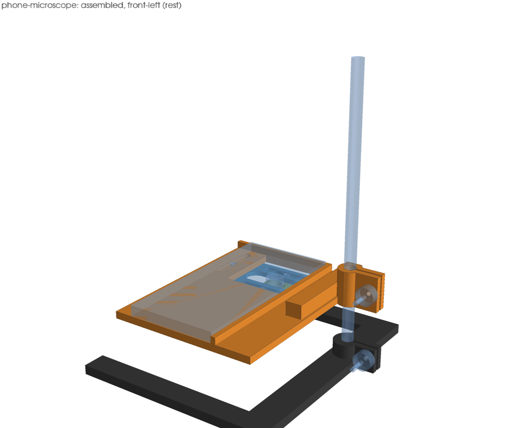

# Phone microscope stand

A 3D-printed stand that turns a phone into an inspection microscope for
solder joints and board faults. The phone lies screen up on a tray. A stock
M12x0.5 board-camera lens sits reversed under its main camera, and the board
lies on the bench under the lens.



| Function | How |
|---|---|
| Fits any phone | The phone rests against a left and a back lip. An X slide and a lens plate under the tray move the lens ±20 mm in each axis, covering a camera 11–51 mm from the phone's left edge and 11–51 mm from its top edge (case included). |
| Coarse focus | The tray's split collar slides on a 10 mm column and locks with an M4 thumb knob. |
| Fine focus | The phone's autofocus. |
| Lens height | The lens slides in a split collar until its front is just under the camera bump, then an M3 screw clamps it. Nothing relies on a printed thread. |
| Board space | U-shaped base: 170 mm clear between the legs, open at the front. Swing the tray aside on the column to reach the board with an iron. |

The design is `design.py` (build123d), gated by `tools/mechanism`: the clash
sweep covers both carriage axes at their limits and the tray at its lowest,
middle and highest positions on the column.

```sh
just mechanism::build packages/bench/phone-microscope      # STEP + STL into this folder
just mechanism::check packages/bench/phone-microscope      # clash sweep + walls -> output/check.json
just mechanism::showcase packages/bench/phone-microscope   # renders -> output/showcase/
```

## Parts

### Printed

| File | Qty | Notes |
|---|---|---|
| `tray.stl` | 1 | Print bottom face down; the collar stands up. 165 × 162 mm footprint. |
| `x_slide.stl` | 1 | Flat, tracks up. |
| `lens_plate.stl` | 1 | Print plate face down, collar up. |
| `base.stl` | 1 | Flat. 210 × 190 mm. Fits a 220 mm bed only diagonally if your bed is smaller. |
| `knob_m3.stl` | 4 | Press an M3 nut into the hex pocket. |
| `knob_m4.stl` | 2 | Press an M4 nut into the hex pocket. |

PLA or PETG on an FDM printer is enough; the thinnest wall in any part is
2.0 mm (`output/check.json`).

### Bought

| Part | Qty | Notes |
|---|---|---|
| M12x0.5 board-camera lens | 1 | 8–25 mm focal length. See [Choosing a lens](#choosing-a-lens). |
| Ø10 mm rod, 250 mm | 1 | Steel or aluminium rod, tube, or M10 threaded rod. |
| M3 × 14 button head (ISO 7380) | 2 | X slide, through the tray tracks. |
| M3 × 12 button head (ISO 7380) | 2 | Lens plate, through the X slide tracks. |
| M3 × 16 socket head + M3 nut | 1 | Lens collar clamp. |
| M3 nut | 4 | In the M3 knobs. |
| M4 × 35 socket head | 2 | Column clamps (tray, base). |
| M4 nut | 2 | In the M4 knobs. |
| Rubber feet, Ø12 | 4 | Optional; 1 mm recesses under the base. |

## Assembly

1. Push the rod into the base socket to the floor and clamp it with an M4
   screw and knob.
2. Put the two M3 × 12 button heads down through the tracks on the X slide's
   top face and through the lens plate, with a knob on each from below.
3. Hold the X slide under the tray. Put the two M3 × 14 button heads down
   through the tray's tracks and the X slide's end holes, and thread a knob on
   each from below.
4. Slide the lens into the collar from below, front first, and fit the M3 × 16
   clamp screw and nut loosely.
5. Slide the tray's collar onto the rod and clamp it with the second M4 screw
   and knob.

## Use

1. Lay the phone screen up against the left and back lips, main camera over
   the window. Open the camera app on the 1x camera; the stand lines up with
   one lens, so a phone that switches to its ultrawide for close focus needs
   the 1x camera locked (or macro mode turned off).
2. Loosen the four M3 knobs. Move the lens under the camera until the image is
   a centred circle, then tighten them.
3. Raise the lens in its collar until its front almost touches the camera
   glass (less vignetting), and clamp it.
4. Put the board under the lens. Loosen the tray collar and lower the tray
   until the board comes into focus, then lock it. The phone's autofocus covers
   the last few millimetres; tap to focus.
5. Use the phone's zoom to fill the screen with the circle.

## Choosing a lens

Reversed, the lens images the board where it would normally image the sensor,
so two numbers from the seller's listing set what you get. Both are rules of
thumb, not measured with this stand:

- **Working distance** (lens rear to board) is about the lens's back focal
  length, the rear-to-sensor distance at infinity focus. M12 lenses list 4–15 mm.
  A longer back focal length leaves more room for an iron tip.
- **Field of view** on the board is about the lens's image circle, the sensor
  size it is made for: about 6 mm for a 1/2.7" lens, about 8 mm for a 1/2"
  lens. Expect a round image that the phone's zoom enlarges.

The tray reaches down to a lens rear face 3.5 mm above the bench (lens length
21 mm assumed); `main()` prints the range for the parameters set.

## Measure before printing

These dimensions are estimates in `design.py`. Measure your parts and change
the parameter before printing:

| Parameter | Value | What it sets |
|---|---|---|
| `LENS_FRONT_D` | 16.0 | Lens body diameter above the thread: the hole in the lens plate and the X slide window. |
| `LENS_FRONT_H` | 6.0 | Height of that wider front section; must sit above the 12.1 mm collar bore. |
| `LENS_L` | 21.0 | Overall lens length; sets the lowest working distance. |
| `CAMERA_BUMP` | 2.0 | How far the camera bump stands below the phone back (with its case). A bump taller than about 6 mm hits the X slide. |
| `ROD_D` | 10.0 | The column's real diameter; both collar bores are `ROD_D + 0.3`. |
| `PHONE` | 160 × 78 × 9 | Stand-in only; any phone that fits on the tray works. |

The camera reach (11–51 mm from the phone's left and top edges) comes from
`LIP_IN` and `TRAVEL`. A phone with its camera centred across its width, at
about 39 mm, is inside that range.

## Gate results

`output/check.json`: no clashes over 27 poses (X and Y at −20, 0, +20; tray
at its lowest, a middle and its highest height), nothing excused. Thinnest
walls: X slide 2.0 mm (the track floors), lens plate 2.3 mm (the collar ear
past its bolt hole).
