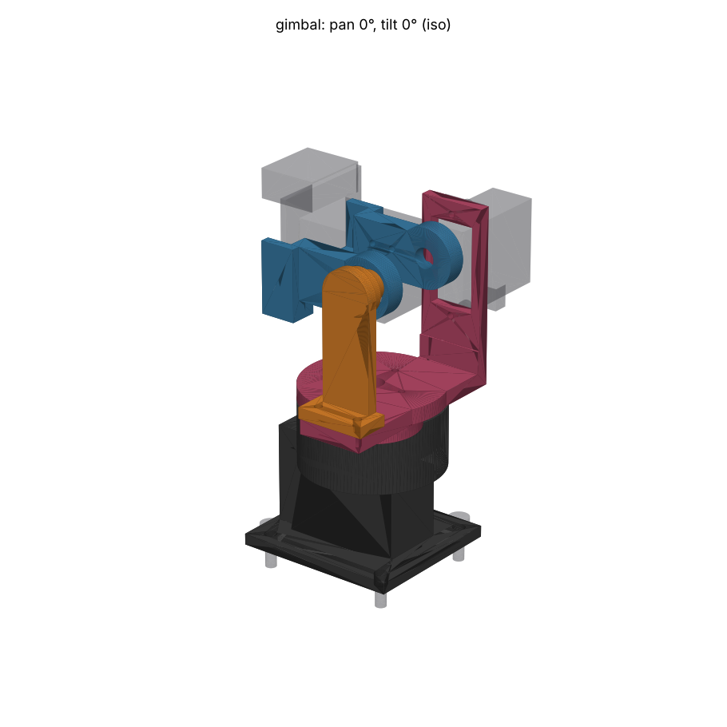
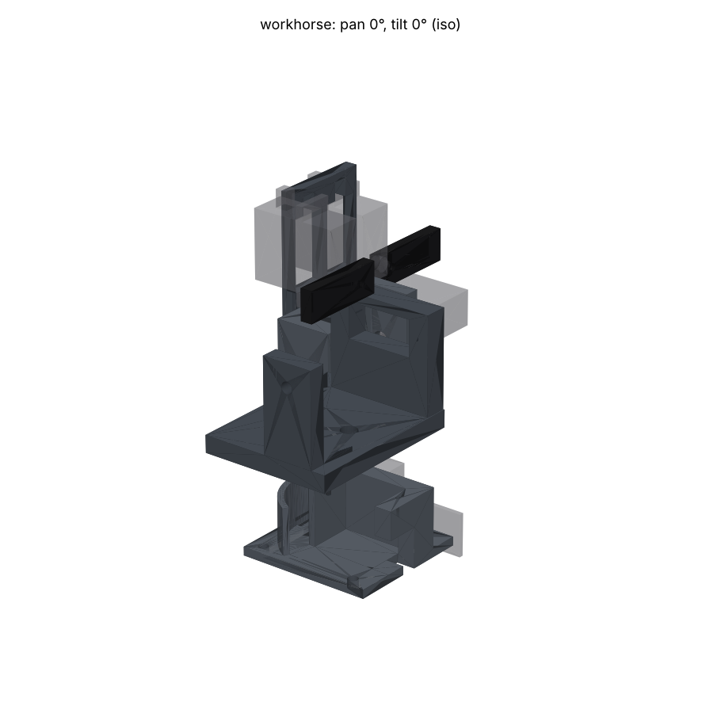
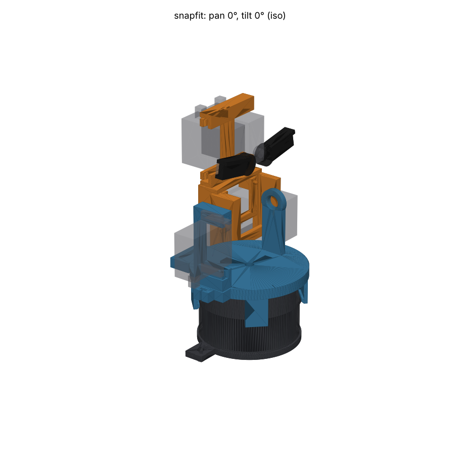

# Pan-tilt for head 1: the tournament record

Today head 1 (29.5 mm board, XIAO ESP32-S3 Sense) sits in a generic
black-plastic 9 g pan-tilt kit. Lauri wants two **TowerPro MG90D** servos
instead: metal gear, double ball bearing. They do not fit the kits, because
they stand 19.8 mm below the tabs against the SG90's ~16. SG90 eyebrows for
Teuvo were an optional extra. Five designs competed. Each was built as
parametric build123d, checked by the same gates (`common/`), inspected
independently, revised, and scored by three judges.

**The design to order is in [`print/`](print/README.md).** It is the winner,
`gimbal`, with the judges' criticisms fixed and three grafts from the
runners-up. The five entries stay in `entries/` unchanged, as the record.

## Shared ground

- `common/fixtures.py`: the stand-in envelopes every entry was checked
  against: MG90D and SG90 (TowerPro's A–F; the rest are marked as estimates),
  stock horns, and head 1 with its XIAO stack and the J2 ribbon keep-out. It
  also fixes the world frame (+X forward, +Z up, mm, chassis plate top at
  z 0).
- `common/check.py`: the clash sweep over pan ±90 × tilt ±45, by groups, with
  every `allow` excuse reported. It also runs the thinnest-wall gate
  (tools/enclosure's ray gate).
- `common/quickview.py`: four matplotlib views per entry.

## The five entries

### `gimbal`: the winner



A nodal gimbal. The tilt axis runs through the camera's estimated entrance
pupil, so tilting adds no parallax, and the pan axis sits under the panned
centre of mass. Pan thrust and tipping moment go into a thin-section 6705ZZ
ring bearing round the pan horn. A printed keeper clamps the yoke to the
inner race, and the cut-down cross horn floats ±1 mm axially in the keeper's
slot, so the pan servo carries torque only. The tilt side opposite the servo
runs in an MR128ZZ on an outrigger. Head 1 mounts upside down so its J2 plug
swings up and back instead of into the pan stage. Five MJF PA12 parts, all M2
holes tapped, lens 76.5 mm above the plate. Zero clashes, zero excuses. No
eyebrows. [README](entries/gimbal/README.md) ·
[inspection](entries/gimbal/INSPECTION.md)

### `workhorse`



A conventional U-bracket. The pan servo stands upright in a base, and the yoke
rides on the pan horn's double arm in a pocket. The tilt cradle is carried on
both sides: the servo spline on +Y, and an M3 screw in a clamped brass sleeve
running in a reamed Ø4.1 MJF bore on −Y. The tilt axis runs through the head's
mass, so the servo carries almost no gravity torque. The ribbon wraps a
fenced drum on the base. An optional bolt-on bracket carries two SG90 brows.
Three structural MJF parts and only a screwdriver.
[README](entries/workhorse/README.md)

### `snapfit`



"Snap & Flex": every joint is a snap, a slide-in groove or a press fit in MJF
nylon, and only two M3 screws need a tool. The pan servo drops into hooks in
the base cup. The yoke snaps under the cup's lip, which forms the pan pivot,
with a nylon ring taking thrust. Both horns float in pockets deeper than the
horn (`HORN_SLACK`), so the MG90D's untrusted heights never set the stack.
Material is chosen by strain (PA11 where it flexes). Optional SG90 brows.
[README](entries/snapfit/README.md)

### `teuvo-face`


The persona entry. A 1950s radio-cabinet face frame with the camera as one
eye that nods inside it. Two SG90 brows hang from a fixed ivory forehead on
the pan stage, so they pan but never tilt, and Robby-style translucent ear
caps finish it. A 683ZZ opposite pivot. Leads are run through floor holes to
a single tie point near the pan axis, modelled as bodies. Mixed processes in
one order: MJF structure, SLA resin face, and SLM aluminium brows with a
resin fallback. [README](entries/teuvo-face/README.md)

### `wildcard`


"Majakka" (lighthouse). Both servos are screwed into a fixed base and never
move. The pan drives a turret on two 6801ZZ bearings through a 1:1 gear pair
under a hood. The tilt goes up the hollow hub as a sliding square rod, pushed
by a shift-fork lever and a crank-link behind the head. No servo lead crosses
a moving joint. Ten MJF parts, a dowel and an E-clip.
[README](entries/wildcard/README.md)

## Scores

Three judges each scored every entry from 0 to 10. The run recorded only the
sums:

| Rank | Entry | Sum of three judges (max 30) |
|---|---|---|
| 1 | `gimbal` | **21.5** |
| 2 | `workhorse` | 21 |
| 3 | `snapfit` | 20.5 |
| 4 | `teuvo-face` | 20 |
| 5 | `wildcard` | 14 |

## Why the gimbal won

The three judges agreed on the reasons:

- **The load path.** The bearing takes the thrust and the overturning moment.
  The yoke, bearing and keeper are clamped as one bench subassembly. The horn
  floats axially, which removes the double axial location that every
  horn-on-spline design carries. The tilt runs on a real idler bearing.
- **Fastener realism.** All M2 holes are drilled and tapped for machine
  screws instead of self-tapped into 1.0 mm webs. The servo fits take
  TowerPro's larger figures. The entry asks for a test coupon before the
  full order.
- **Camera aiming.** The nodal tilt and the CoM-centred pan are what ADR-025's
  head-aim bearing maths wants.

Each judge also deducted:

- The outer race was held only by 0.15 mm crush ribs.
- The horn slot had about ±1° of backlash.
- The 3 mm uprights took the outboard servo's load in their weak direction.
- Service access was poor.
- The ribbon's free spans were sized by chord, not swept.
- The entry had no eyebrows and little Teuvo character.
- The lens sat 76.5 mm high.

The margin over `workhorse` was half a point.

## What the print version changed and grafted

The full table is in [`print/README.md`](print/README.md#what-changed-from-the-tournament-entry).
In short:

- a screwed **bearing cap** clamps the 6705ZZ's outer race;
- **crush ribs** in the keeper slot remove the backlash, and an optional
  **9° keeper** halves the pan-zero error;
- **ribs** stiffen the upright and the outrigger;
- a **pin shoulder** keeps the tilt horn on its spline;
- the pan servo can be **serviced** down the pan axis with the tower in place;
- the ribbon is **tied to the cradle's back** and the post rises above the
  shelf, so both free spans pass the clash gate **taut** at every pose. In the
  entry's routing, a taut tilt span ran through the cradle when the head
  looked down;
- **optional SG90 eyebrows** are added.

**Grafts taken:**

1. **wildcard's undersize-and-sand fit for a printed shaft in a bearing.** The
   MR128ZZ pocket is a slip fit bonded with retainer. The pin is sanded to a
   slide fit and deliberately left unbonded, to keep the cradle's axial float.
2. **teuvo-face's brows on the fixed pan-stage forehead.**
3. **teuvo-face's one-order, material-per-line sheet with a
   same-geometry cosmetic upgrade.**

**Rejected:** workhorse's brass pivots and ribbon drum, teuvo-face's floor
channels, snapfit's `HORN_SLACK` (the keeper's float already does this) and
per-part PA11, and wildcard's twin-bearing hub and fixed servo base. The
reasons are in [`print/README.md`](print/README.md#grafts).

Result: zero clashes over pan ±90 × tilt ±45, with the eyebrows fitted and
both ribbon spans modelled taut. There are two reported excuses: the keeper
ribs' deliberate crush on the horn, and the ribbon touching itself at its
shelf tie. The thinnest wall is 1.0 mm. The lens sits 80.3 mm above the
plate. The required parts cost about $15 at JLC3DP (MJF PA12), and the
optional ones about $5.

## Re-running the gates

From the repo root, with tools/mechanism (`just mechanism::setup` once):

```bash
just mechanism::build packages/robocar/unified/hardware/pan-tilt/print       # print/<part>.step and .stl (the order files)
just mechanism::check packages/robocar/unified/hardware/pan-tilt/print       # print/output/check.json; fails on any clash (~6 min)
just mechanism::showcase packages/robocar/unified/hardware/pan-tilt/print    # print/output/showcase/*.png
just mechanism::check packages/robocar/unified/hardware/pan-tilt/entries/<slug>   # any tournament entry, same gates
```

`python -m common.check|showcase|quickview <dir>` from this folder runs the
same modules; `common/` puts tools/mechanism on the path.

Entries regenerate their own STL/STEP into `entries/<slug>/output/` with
`python design.py` (gitignored). Only `print/` commits its STL and STEP files.
