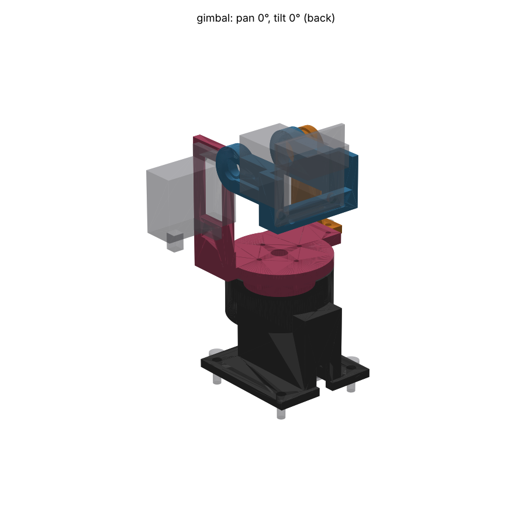

# The Gimbal: a nodal MG90D pan-tilt for Teuvo's head

Tournament entry `gimbal`. Head 1 (29.5 mm board, XIAO ESP32-S3 Sense) on two
TowerPro MG90D servos. Five MJF PA12 parts from JLC3DP, two stock ball
bearings, and M2/M3 screws.

Revised 2026-10-25 after the inspection (`INSPECTION.md`, "Revision" at the
end): the head screws can now be driven, the pan horn installs from above
and couples torque only, the servo windows take TowerPro's larger figures,
the tab holes are tapped, the pan servo clears the chassis plate by 2 mm, and
the ribbon and leads have a modelled path with tie points.

## Concept

The brief put optics and dynamics first, so the geometry follows from three
constraints:

1. **The tilt axis goes through the camera's entrance pupil**, estimated 2 mm
   behind the front of the XIAO stack (`PUPIL_BEHIND_STACK_FRONT`). Tilting
   then turns the view without moving the lens, so the ADR-025 planner's
   pan/tilt pose maps to a bearing with no parallax term. The cradle reaches
   forward past the board on both sides to pivots beside the lens. On the +Y
   side the tilt servo's horn sits sunk in a pocket. On the -Y side the cradle
   runs in an MR128ZZ ball bearing on a pin, so the tilt servo's output shaft
   is not a cantilever.
2. **The pan axis sits under the centre of mass of everything that pans.**
   `design.py` adds up the printed volumes and the stand-in masses and reports
   the CoM. The pan axis is fixed at 8.5 mm behind the lens. The computed CoM
   (48.5 g panned) is 0.24 mm from it in X and 8.2 mm off in Y, toward the
   tilt servo, which has to sit on one side. The pan thrust and the
   overturning moment go into a thin-section **6705ZZ (25 × 32 × 4)** around
   the pan horn. The pan servo carries torque only (see "Pan coupling"). A
   small MR/683/684 or 6×10×3 bearing cannot sit on the pan axis, because the
   servo spline is there. A ring bearing whose bore clears the horn is the
   coaxial option.
3. **Height and swept volume are what's left, and the code computes them.**
   Every part that tilts (the head keep-outs plus the cradle, sampled from its
   real surface) is swept through ±46°. The swept prisms are cut from the yoke,
   and the lens height is set so the swept head stays 2 mm above the yoke's
   flange and arms. The result is a **lens 76.5 mm above the chassis plate**,
   with the panned group reaching about 48 mm from the pan axis.

**The head is mounted upside down** (`HEAD_FLIPPED = True`, rotated 180°
about the camera axis). With the tilt axis at the lens, the board's back edge
and the J2 plug swing on a 30–47 mm radius. With the head the right way up,
the plug drops into the pan stage when the head looks up 45°. Flipped, the
plug sits behind the top edge and swings up and back instead. That saves
about 12 mm of height; `HEAD_FLIPPED = False` re-derives everything at about
88 mm. The cost is one firmware change after `esp_camera_init()`:
`s->set_vflip(s, 1); s->set_hmirror(s, 1);`. The OV3660 driver supports
both. USB-C then faces down.

**Pan coupling (revised).** A stock **cross horn, with its arms cut to Ø20**,
sits on the pan spline under its own centre screw, which is the screw's only
job. The arm stubs drop into a **cross slot cut through the keeper**, a
printed ring under the yoke's spigot. The slot walls carry the torque, and
the horn can slide **±1.0 mm axially** in the slot. Four M2 screws pull the
keeper up against the spigot and clamp the 6705ZZ's inner race between the
keeper and the yoke's land. The spigot is 0.2 mm shorter than the race, so the
clamp lands on the race and not on the spigot. Yoke, bearing and keeper are
assembled on the bench as one unit. The bearing alone then locates the yoke,
and no stack of MJF tolerances can push the yoke off the race or the horn off
its spline.

**Tilt load:** the tilting group (head, cradle, horn, bearing, about 20.4 g)
has its CoM 16 mm behind the tilt axis. That is about 33 g·cm against the
MG90D's 2100 g·cm stall, under 2 %.

**Cable path (revised, modelled).** See "Ribbon and leads" below. The yoke
has a **ribbon shelf** on its rear edge and a **lead gutter** round its rim
from the tilt servo to the shelf. The tower has a **ribbon post** at its rear.
All three have cable-tie slots. The two tied-down ribbon stretches are bodies
in `assembly()`, so the clash gate checks that nothing that moves crosses
them. `python design.py` prints the chord of each free span over the full
sweep.

## Parts (all JLC3DP MJF, PA12-HP)

| Part | Volume | Thinnest (gate) | Est. price* | Notes |
|---|---|---|---|---|
| `tower` (stationary) | 19.9 cm³ | 1.0 mm, web beside a pan tab hole | ~$5.5 | Chassis flange (4 × M3), servo pocket with tab ledge, horn chamber, 6705ZZ seat with 3 crush ribs, ribbon post |
| `yoke` (pans) | 10.2 cm³ | 1.0 mm, web beside a tilt tab hole | ~$2.9 | Spigot through the bearing, land on the inner race, tilt-servo upright, ribbon shelf, lead gutter |
| `keeper` (pans) | 1.25 cm³ | 1.8 mm | ~$1.0 (minimum) | Ø26.6 × 3.6 ring: clamps the inner race, cross slot for the horn arms |
| `outrigger` (pans) | 2.5 cm³ | 2.2 mm | ~$1.0 (minimum) | Ø7.95 pin into the MR128ZZ, bolts onto the yoke |
| `cradle` (tilts) | 5.0 cm³ | 1.5 mm, under the MR128ZZ pocket | ~$1.4 | Insert plate behind the board, cheeks to the pivots, horn pocket, MR128ZZ pocket, driver channels to the head screws |

\*Estimated as $0.275/g × solid volume × 1.01 g/cm³, with a $1.00 floor per
part. Dyeing and shipping are extra. **This rate is not verified**: run the
STLs through JLC3DP's instant quote before ordering.

Why MJF PA12 for every part:

- PA12 takes **M2 heat-set inserts** and resin does not (an enclosure-cad
  skill trap). It also **taps cleanly**: every servo-tab hole, the keeper
  screws and the outrigger screws go into tapped Ø1.6 holes.
- It is tough at 1.0–1.5 mm and does not crack at a crush-rib press fit.
- MJF needs no supports, and no part here has a closed void, so the powder
  blows out.

Colour: **dyed black** for the tower, yoke, keeper and outrigger. The cradle
can be dyed black too, or left PA12 grey as Teuvo's "face plate".

**Thin walls, justified.** JLC3DP recommends 1.0 mm minimum for MJF PA12. The
gate's thinnest readings are as follows:

- **1.0 mm** (tower and yoke): the web between a servo-tab hole and the case
  window. The servo's own drawing puts the tab hole centre 2.15 mm from the
  case end (E/2 − inset − B/2). With 0.35 mm end clearance and a Ø1.6 tap
  drill, 1.0 mm is left. Every mount for this servo has the same web; only
  how the screw loads it differs. These holes are **tapped M2 for machine
  screws**, so the thread is cut out of the web. A self-tapper would push it
  sideways. The servo case sits 0.35 mm from the web and stops it bulging
  further. The screws only stop the servo pulling out of its window. The
  window, not the screws, takes the servo's torque reaction.
- **1.5 mm** (cradle) under the MR128ZZ pocket, where the pivot boss now stops
  at the cheek bottom, clear of the head-screw driver line.

The repo's 2.0 mm `MIN_WALL` is a resin-case convention and does not apply to
these features.

**Print orientation:** MJF has no supports and is nearly isotropic, so
orientation only affects surface finish. Preferred: tower flange-down, yoke
flange-down, keeper flat, cradle insert plate down, outrigger foot down. The
STLs and STEPs in `output/` are in **world pose at pan 0 / tilt 0**
(`printed_parts()`). JLC re-orients them anyway.

## Hardware BOM

| Qty | Item | Where |
|---|---|---|
| 2 | TowerPro MG90D | pan, tilt |
| 1 | **6705ZZ** deep-groove ball bearing, 25 × 32 × 4 mm | pan; inner race clamped to the yoke, outer race in the tower's crush ribs |
| 1 | **MR128ZZ** ball bearing, 8 × 12 × 3.5 mm | tilt idler, pressed into the cradle's -Y cheek |
| 1 | MG90D **cross horn**, arms cut to Ø20, + its centre screw | pan; no arm screws |
| 1 | MG90D **single-arm horn** + its centre screw + 2 arm screws (≤ 4.5 mm) | tilt; into the cradle pocket at 10 and 16 mm |
| 4 | **M2 × 8** machine screw (ISO 7380 or DIN 912) | servo tabs: pan tabs up into the tower ledge, tilt tabs into the upright (tapped) |
| 4 | **M2 × 8** ISO 7380 button head | keeper up into the yoke spigot (tapped) |
| 2 | M2 × 6 machine screw | outrigger foot to the yoke (tapped) |
| 2 | M2 × 3 heat-set inserts (OD ~3.5, hole Ø3.2) | cradle insert plate |
| 2 | M2 × 5 ISO 7380 button head | head board to the inserts (as today) |
| 4 | M3 × 10 socket head + M3 nut + washer | tower flange to the acrylic chassis |
| 6 | 2.5 mm cable ties | 2 on the shelf, 1 at the gutter, 2–3 on the post |
| 1 | Ø1.6 drill + M2 × 0.4 tap | clear and tap the 12 M2 holes |
| — | Medium cyanoacrylate | a film on the bearing seat wall (optional; see Risks) |

**Chassis plate:** drill **4 × Ø3.2 mm on a 35 × 32 mm rectangle** (X × Y),
placed so the pan axis is 20 mm from the rear pair and 15 mm from the front
pair, centred in Y. Hole centres in world XY: (−20, ±16) and (15, ±16). The
tower's footprint is 50 × 40 mm (x −31 to +19, including the post's tongue).
Nothing passes through the plate. The pan servo's base sits **2.0 mm above
the plate**, and `assembly()` now includes the plate as a stand-in, so the
gate would catch a servo that bottoms on it.

## Assembly order

1. **Prepare the holes.** Run a Ø1.6 drill through the 12 M2 holes to clear
   MJF powder and undersize, then tap M2. The holes are: 2 pan-tab holes (tower
   ledge, from below), 2 tilt-tab holes (upright), 4 keeper holes (spigot
   underside), 2 outrigger holes (yoke -Y arm).
2. **Pan servo into the tower.** Centre it electrically (1500 µs). Push it up
   from below until the tabs stop on the ledge. Fit 2 × M2 × 8 up through the
   tabs. Bolt the tower to the chassis any time after this.
3. **Pan horn, from above.** Cut the cross horn's four arms to Ø20 (10 mm from
   the axis) with flush cutters. Press it onto the spline through the open
   bearing seat (Ø28.6 chamber), with the arms on X and Y, and drive its
   centre screw from above. The whole chamber is open, so any driver fits.
4. **Bench subassembly: yoke + 6705ZZ + keeper.** Drop the yoke's spigot
   down through the bearing until the land sits on the inner race. From
   below, fit the keeper with 4 × M2 × 8 button heads into the spigot and
   tighten. This clamps the inner race. Spin it: the yoke must turn freely in
   the outer race.
5. **Yoke into the tower.** Optionally wipe a film of CA on the seat wall.
   Lower the subassembly in, turning it until the keeper's cross slot drops
   over the arm stubs. Press the flange down by hand until the outer race
   bottoms on the seat floor. The crush ribs take a 0.15 mm interference. The
   press force passes through the balls, but it is far below the 6705's
   static rating. Check the yoke still turns and has about 1 mm of free axial
   play against the horn: lift it gently and it should rise with the
   bearing, not with the servo.
6. **Tilt servo.** Centre it. Push it through the yoke upright's window from
   outside, case top inward. Fit 2 × M2 × 8 into the tapped holes.
7. **Cradle.** Press the MR128ZZ into the cradle's -Y pocket. Screw the
   single-arm horn into the +Y pocket, arm pointing back. Push the cradle
   onto the tilt spline with the head level. From the -Y side, put a driver
   **through the MR128ZZ's bore along the tilt axis** to the horn's centre
   screw (outrigger and head still off).
8. **Outrigger.** Slide its pin into the MR128ZZ, drop the foot onto the
   yoke's -Y arm, and fit 2 × M2 × 6 from above.
9. **Head.** Press the two M2 inserts into the cradle plate (soldering iron
   at about 220 °C). Fit the board **upside down** (J2 at the top, USB-C down)
   with 2 × M2 × 5 button heads. **Drive them from the front, along each
   screw's axis**: the bridges stop above the screws, and a Ø3.6 channel runs
   forward through the cradle on each axis. Use a 1.3 mm hex key, or a hex
   driver whose shaft is ≤ Ø3.6 (the -Y screw is 1.85 mm from the XIAO
   stack). The path is clear with everything else assembled (checked against
   the cradle, yoke, outrigger and tilt servo).
10. **Ribbon and leads**, as below.

## Ribbon and leads

The IDC ribbon (14-way, 1.0 mm pitch, 14 mm wide) and the tilt servo's lead
take one path, with two free spans. Each span is sized from the chord lengths
`design.py` prints over the whole sweep:

| Free span | From → to | Chord over the sweep | Leave this much ribbon |
|---|---|---|---|
| Tilt | back of the IDC plug → first tie on the yoke shelf | 18.7–70.1 mm over ±45° (28.6–63.6 over the firmware's ±30°) | **80 mm** |
| Pan | shelf rear edge → top tie on the tower post | 12.2–42.0 mm over ±90° | **60 mm** |

1. **Tilt span.** The plug exits backward from the top-back of the flipped
   head. The ribbon makes a loose loop behind the cradle down to the **shelf**
   on the yoke's rear edge. There, 2 ties through the shelf's slots hold it
   flat. The plug orbits the lens-centred tilt axis, so the chord changes by
   about 50 mm over ±45°. Nose-up moves the plug toward the shelf. The plug
   exits backward, so the spare loop bows backward, away from the cradle. The
   swept head clears the shelf top by ≥ 9 mm at the rear, so the loop is not
   pinched.
2. **Tilt servo lead.** It leaves the bottom of the tilt servo outboard of the
   upright and drops about 20 mm into the **gutter**. The gutter is a straight
   U channel, 3.5 × 3 mm, under the yoke's rim at 100°–148°. One tie through
   the slot in its floor at the start holds the lead. At the gutter's end it
   lies on top of the ribbon under the shelf ties. It never moves relative to
   the yoke, so it needs no loop of its own.
3. **Pan span.** From the shelf's rear edge, ribbon and lead go together in a
   loose loop to the **post** on the tower's rear. They are tied flat to the
   post's rear face at two heights, which is the strain relief before the run
   to the carrier. At pan 0 the spare loop hangs behind the post. At ±90° the
   chord pulls round the tower's rear quarter at z ≈ 38–43 mm. A taut chord
   passes 1.1 mm outside the tower cylinder and well above the tower box,
   the flange and the M3 heads (z ≤ 31 and ≤ 6). It twists 90° over its
   60 mm free length.
4. **Pan servo lead** is stationary. It leaves through the slot at the bottom
   of the tower's rear wall and is tied to the post's lower tie.

What is still not modelled: the free spans themselves. A flexible ribbon has
no single shape for the clash gate to sweep, so the gate checks the two
tied-down stretches and the chord table bounds the rest. Check the loop by
hand over the full travel before closing up the robot.

## Measure before ordering (Lauri, calipers)

All parameters are at the top of `design.py`. The servo envelope lives in the
shared fixture `common/fixtures.py`.

| What | Fixture value | Why it matters here |
|---|---|---|
| MG90D case length B | 22.6 (TowerPro also says 22.8) | Window 23.3 (`FIT_END` 0.35): 0.25 per end even at 22.8 |
| Case width D | 12.0 (headline 12.2) | Window 12.6 (`FIT` 0.3) |
| Tab span E | 31.5 | Tower tab cavity 32.7 (`FIT_TAB` 0.6); takes up to 32.5 with 0.1 per end |
| Tab hole Ø, hole inset from tab end | 2.0 / 2.3 | Tab hole positions. Inset sets the 1.0 mm web: each 0.1 less inset adds 0.1 |
| Base to tab underside F | 19.8 | Tilt upright position; pan ledge height. Up to F + 2.0 still clears the plate |
| Shaft from case end | 6.0 (estimate) | Both axes' position relative to the case pockets |
| Cross horn: arm width, arm height above case top when seated | 5.0 / 2.9–4.5 | Keeper slot 5.3 wide; the ±1.0 float is centred on 2.9–4.5 |
| Single horn: arm length, hole positions | 20 / 10 and 16 mm | Cradle pocket length; pilot positions |
| Horn hub Ø, arm thickness | 7 / 1.6 | Keeper hub hole Ø8; cradle pocket depth 1.8 |
| Camera entrance pupil | 2 mm behind the stack's front | `PUPIL_BEHIND_STACK_FRONT`: the whole point of the design. Check it by turning the head by hand about candidate axes while watching two aligned objects at 0.3 m and 3 m |
| Head mass, XIAO stack mass | 4 + 7 g (estimates) | Pan-axis CoM. Weigh both and re-run `design.py`; it warns if `PAN_AXIS_BEHIND_LENS` should move |
| 6705ZZ OD / ID / inner race OD (d1) | 32 / 25 / 27.6 | Crush ribs inscribe Ø31.7; spigot Ø24.9; keeper Ø26.6 and land Ø27.0 must stay inside d1 so neither touches the shield |

## Risks

- **Lens height 76.5 mm.** A nodal tilt with a 26 mm-deep head costs that
  height. Putting the tilt axis at the head's CoM would save an estimated
  10–15 mm (not modelled) but would give up constraint 1. Check that the car's
  top-heaviness is acceptable.
- **The flipped head needs the two-line firmware flip**, or the planner sees an
  upside-down world. `HEAD_FLIPPED = False` is the fallback, and it is taller.
- **The 6705ZZ's outer race is held only by the crush ribs** (and optionally
  CA). Lifting the robot by its head pulls against that fit and nothing else.
  Lift it by the chassis. A retaining ring over the outer race would need
  the flange raised by its thickness.
- **Pan-zero trim.** The horn goes on the spline in 18° steps (20T, estimate),
  so pan zero can be up to ±9° off. The keeper's slot is four-fold symmetric
  and cannot trim that, so the firmware needs a pan offset.
- **Horn-slot backlash.** At 0.15 mm per side at about 8 mm radius, backlash is
  about ±1°. MJF slots print slightly undersize, so file each slot to a
  sliding fit on the horn you will use. If it is still loose, a strip of
  Kapton on the slot wall takes it up without stopping the axial float.
- **1.0 mm webs beside the tab holes.** Tap them; do not self-tap them. Test
  one coupon (a tab hole beside a window edge, as printed) before ordering the
  set.
- **Fixture estimates** (horn hole radii, shaft offset) move hole positions,
  so caliper before ordering.
- **Width.** The tilt servo hangs outboard to y = +45.7 mm, and the panned
  envelope is about Ø96 mm at servo height. Check it clears the robot's other
  masts over ±90°.
- **Field of view.** With a 120°+ lens, the upright's corner may enter the
  image edge.
- **Servicing the pan servo** still means unbolting the tower from the chassis.
- **Eyebrows:** not included. PCA9685 channels 14 and 15 are still free for
  another entry's brows.

## Fixture notes (common/ not edited)

- `horn()` is a solid hub over the solid spline, so every horn/spline pair
  overlaps by design. This entry subtracts the spline from the horn
  (`bored_horn()`), so the gate needs no excuse for it. The pan horn is also
  cut to `HORN_TRIM_R`, as it is fitted.
- The fixture's MG90D is 22.6 × 12, while TowerPro's headline figure is
  22.8 × 12.2. The windows now take the larger figure. Re-running the
  inspector's `margin.py`: TowerPro's 22.8 × 12.2 gives **no clashes**, and so
  does a servo 1 mm taller below the tabs (F + 1). A ±0.25 mm envelope leaves
  only 26 mm³ per servo, which is the grown tabs overlapping the ledge they
  are screwed against (the margin grows a tab both ways). The case body is
  clear. At ±0.5 mm the case is 13.0 wide against a 12.6 window, past the
  fit clearance, as expected.
- The head keep-out is placed rotated 180° about X. The J2 keep-out goes with
  it, as intended.

## Files

- `design.py`: parametric build123d. `python design.py` writes
  `output/<part>.step/.stl` and prints volumes, the lens height, both CoMs and
  the ribbon span chords.
- `output/check.json`: `common.check`, with **zero clashes and no excuses**
  over pan ±90 × tilt ±45, including the chassis plate and the tied-down
  ribbon.
- `output/render-*.png`: `common.quickview`.
