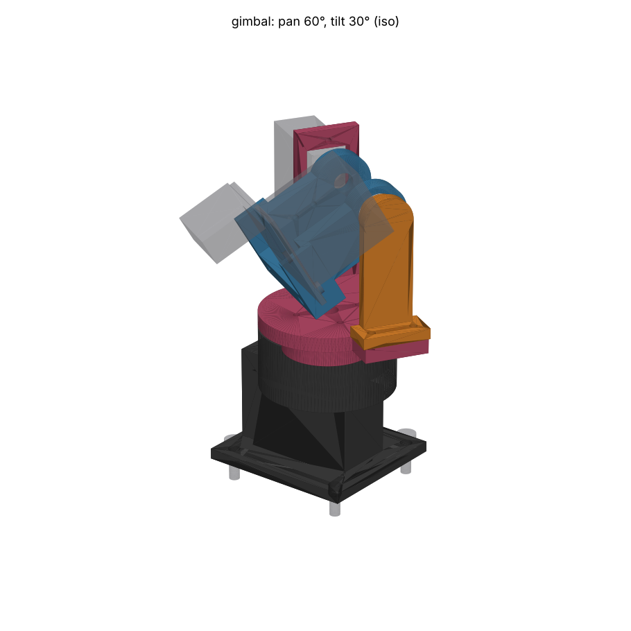

# The Gimbal: a nodal MG90D pan-tilt for Teuvo's head

Tournament entry `gimbal`. Head 1 (29.5 mm board, XIAO ESP32-S3 Sense) on two
TowerPro MG90D servos. Four MJF PA12 parts from JLC3DP, two stock ball
bearings, and screws you already have or can buy anywhere.

## Concept

The brief was optics and dynamics first, so the geometry comes from three
constraints:

1. **The tilt axis goes through the camera's entrance pupil**, estimated 2 mm
   behind the front of the XIAO stack (`PUPIL_BEHIND_STACK_FRONT`). Tilting
   then turns the view without moving the lens, so the ADR-025 planner's
   pan/tilt pose maps to a bearing with no parallax term. The cradle reaches
   forward past the board on both sides to pivots beside the lens. The +Y
   side is the tilt servo's horn, sunk into a pocket. The -Y side runs in an
   MR128ZZ ball bearing on a pin, so the tilt servo's output shaft is not a
   cantilever.
2. **The pan axis sits under the centre of mass of everything that pans.**
   `design.py` totals the printed volumes and the stand-in masses and reports
   the CoM. The axis is frozen at 8.5 mm behind the lens. The computed CoM is
   0.1 mm from it in X and 8.2 mm off in Y (toward the tilt servo, which has
   to sit on one side). The thrust and that overturning moment go into a
   thin-section **6705ZZ (25 x 32 x 4) bearing around the pan horn**, not into
   the pan servo's shaft. A small MR/683/684 or 6x10x3 bearing cannot sit on
   the pan axis because the servo spline is there. A ring bearing whose bore
   clears the horn's spigot is the coaxial option.
3. **Height and swept volume are what's left, and they are computed.** Every
   part that tilts (the head keep-outs plus the cradle, sampled from its real
   surface) is swept through ±46°. The swept prisms are cut from the yoke, and
   the lens height is set so the swept head stays 2 mm above the yoke's flange
   and arms. The flange is never thinned by a cut. Result: **lens 76.5 mm
   above the chassis plate**. The panned group reaches about 48 mm from the
   pan axis.

**The head is mounted upside down** (`HEAD_FLIPPED = True`, rotated 180°
about the camera axis). With the lens-centred tilt axis, the board's
bottom-back edge and the J2 ribbon plug swing on a 30–47 mm radius. Right way
up, the plug drops into the pan stage whenever the head looks up 45°. Flipped,
the plug is behind the top edge and swings up and back instead, and the lowest
swept point is the cradle's insert plate. That alone saves about 12 mm of
height (`HEAD_FLIPPED = False` re-derives everything, and the lens ends up
around 88 mm). It costs one firmware change: `s->set_vflip(s, 1);
s->set_hmirror(s, 1);` after `esp_camera_init()`. The OV3660 driver supports
both. The USB-C port then faces down, and you reach it with the head tilted
nose-down.

The trade I did not make: putting the tilt axis at the head's own CoM, 16 mm
behind the lens, would cut the lens height by an estimated 10–15 mm (not modelled). Doing that would
give up constraint 1. The firmware's ±30° tilt limit is under the ±45° this
design clears.

**Tilt load:** the tilting group (head, cradle, horn, bearing, about 20.7 g)
has its CoM 16 mm behind the tilt axis. That is a gravity torque of about
33 g·cm against the MG90D's 2100 g·cm stall, under 2 %. Pan and tilt both
run on ball bearings, so the PCA9685's 100 Hz updates see almost no friction
hysteresis.

## Parts (all JLC3DP MJF, PA12-HP)

Every part goes to the same process and material, for these reasons:

- **PA12 takes M2 heat-set inserts**, and resin does not (enclosure-cad
  SKILL trap). The head's two M2 screws land in inserts, as the carrier README
  specifies for H5–H10.
- It self-taps cleanly for the servos' own ~2 mm screws, and it does not
  crack at a press fit. The 6705ZZ and MR128ZZ seats are press or slip fits.
- It is tough at 1.1 mm. The servo tab holes sit 2.15 mm from the case wall
  by the servo's own drawing, so no design gets 2 mm of wall beside a tab
  pilot.
- MJF needs no supports and leaves no closed voids here. Every cavity is open,
  so the powder blows out.

Colour: **dyed black** for the tower, yoke and outrigger. The cradle can also
be dyed black, or left PA12 grey to read as Teuvo's "face plate"; a cosmetic
choice.

| Part | Volume | Thinnest (gate) | Est. price* | Notes |
|---|---|---|---|---|
| `tower` (stationary) | 16.9 cm³ | 1.10 mm, beside a pan-servo tab pilot | ~$4.6 | Chassis flange (4 × M3), servo pocket with tab ledge, horn chamber, 6705ZZ seat |
| `yoke` (pans) | 10.4 cm³ | 1.10 mm, beside a tilt-servo tab pilot | ~$2.9 | 25 mm spigot through the bearing, flange on the inner race, tilt-servo upright |
| `outrigger` (pans) | 2.5 cm³ | 2.2 mm | ~$1.0 (minimum) | Ø7.95 mm pin into the MR128ZZ, bolts onto the yoke |
| `cradle` (tilts) | 5.3 cm³ | 1.6 mm | ~$1.5 | Insert plate behind the board, cheeks to the pivots, horn pocket, MR128ZZ pocket |

\*JLC3DP MJF PA12 at **$0.275/g** (its August 2025 price cut) times solid
volume at about 1.01 g/cm³, with JLC's $1.00 floor. Dyeing and shipping are
extra. Run the STLs through the instant quote before ordering.

**Thin walls, justified:** JLC3DP recommends 1.0 mm for MJF PA12, and 1.5 mm
for fastener features. The two 1.10 mm readings are the material between a
servo-tab pilot and the case window. The 2.15 mm from the tab hole centre to
the case wall is fixed by the servo, so I held them above JLC's 1.0 mm by
tightening the case-end fit to 0.15 mm (`FIT_END`). Everything else is 1.6 mm
or more. The repo's 2.0 mm `MIN_WALL` is a resin-case convention and does not
apply to these features.

**Print orientation:** MJF has no supports and is nearly isotropic, so
orientation only affects surface finish. Preferred: tower flange-down, yoke
flange-down, cradle insert plate down, outrigger foot down. The STLs and STEPs
in `output/` are in **world pose at pan 0 / tilt 0** (`printed_parts()`), and
JLC re-orients them anyway.

## Hardware BOM

| Qty | Item | Where |
|---|---|---|
| 2 | TowerPro MG90D | pan, tilt |
| 1 | **6705ZZ** deep-groove ball bearing, 25 × 32 × 4 mm (~$4–8 for 2) | pan, pressed into the tower |
| 1 | **MR128ZZ** ball bearing, 8 × 12 × 3.5 mm | tilt idler, pressed into the cradle's -Y cheek |
| 1 | MG90D **cross horn** + its centre screw | pan; 4 arm screws (bag self-tappers, ~2 × 6) up into the yoke spigot at r = 9 mm |
| 1 | MG90D **single-arm horn** + its centre screw | tilt; 2 arm screws (≤ 4.5 mm long) into the cradle pocket at 10 and 16 mm |
| 4 | servo tab screws (from each servo's bag, ~2 × 6–8) | pan tabs up into the tower ledge; tilt tabs into the upright |
| 2 | M2 × 3 heat-set inserts (OD ~3.5, hole Ø3.2) | cradle insert plate |
| 2 | M2 × 5 ISO 7380 button head | head board to the inserts (as today) |
| 2 | M2 × 6 self-tapping (or M2 × 6 into a tapped Ø1.8 pilot) | outrigger foot to the yoke |
| 4 | M3 × 10 socket head + M3 nut + washer | tower flange to the acrylic chassis |
| 1–2 | 2.5 mm cable ties | ribbon and tilt lead to the yoke upright |

**Chassis plate:** drill **4 × Ø3.2 mm on a 35 × 32 mm rectangle** (X × Y),
positioned so the pan axis sits 20 mm from the rear pair and 15 mm from the
front pair, centred in Y. Hole centres in world XY: (−20, ±16) and (15, ±16).
The tower's footprint is 44 × 40 mm. Nothing passes through the plate. The
pan lead leaves through the slot in the tower's rear wall.

## Assembly order (it matters: the screwdriver goes down the axes)

1. **Tower:** press the 6705ZZ into the top seat until it bottoms on the 2 mm
   lip. Bolt the tower to the chassis **last**, because the pan servo goes in
   from below.
2. **Yoke to horn:** drop the yoke's spigot through the bearing from above,
   so the flange's land sits on the inner race. Turn the tower over. Through
   its open bottom, screw the cross horn to the spigot's underside (4 screws at
   r = 9 mm, arms along X/Y).
3. **Pan servo:** centre it electrically (1500 µs). Push it up from below:
   the spline enters the horn, and the tabs stop against the ledge. Screw the
   tabs up into the ledge pilots, then drive the horn's centre screw from
   above, down through the Ø6 hole on the pan axis. Bolt the tower to the
   chassis.
4. **Tilt servo:** centre it. Push it through the yoke upright's window from
   the outside, case top inward. Screw the tabs into the upright.
5. **Cradle:** press the MR128ZZ into the cradle's -Y pocket. Screw the
   single-arm horn into the +Y pocket, arm pointing back. Push the cradle
   onto the tilt spline with the head level. Then, from the -Y side, put a
   driver **through the MR128ZZ's bore and straight along the tilt axis** to
   the horn's centre screw. That straight line exists only while the head and
   outrigger are off.
6. **Outrigger:** slide its pin into the MR128ZZ (move it +Y), drop the foot
   onto the yoke's -Y arm, and fit 2 × M2 screws from above.
7. **Head:** press the two M2 inserts into the cradle plate with a soldering
   iron at about 220 °C. Fit the board **upside down** (J2 at the top, USB-C
   down) with 2 × M2 × 5 button heads. Plug the ribbon in.

**Ribbon and leads:** the IDC plug exits backward at the top-back. Run the
ribbon back and down behind the cradle in a **loose U of about 40 mm** (the
tilt service loop: the plug orbits the tilt axis at a 30–47 mm radius). Tie it
to the yoke's +Y upright together with the tilt servo's lead, which leaves the
bottom of that servo. Below the yoke, give both a **¾-turn helix around the
tower** before they go to J1 and the PCA9685 column. That is the pan service
loop for ±90°, and it keeps the ribbon twisting about its own long axis
rather than kinking. A flat 14-way ribbon at 1 mm pitch tolerates that over
≥ 150 mm. The pan servo lead is stationary and leaves through the tower's
rear slot. The ribbon cannot pass *through* the pan axis, because the MG90D's
spline occupies it.

## Measure before ordering (Lauri, calipers)

All parameters are at the top of `design.py`. The shared fixture
`common/fixtures.py` holds the servo envelope.

| What | Fixture value | Why it matters here |
|---|---|---|
| MG90D case length B | 22.6 mm (TowerPro also says 22.8) | `FIT_END` is 0.15 per end. At 22.8 the case has 0.05 mm per end in both the tower neck and the tilt window. If yours is 22.8, set `FIT_END = 0.25`: the tab-pilot wall drops to 1.0 mm, still JLC's figure |
| Case width D | 12.0 (headline 12.2) | `FIT` 0.3 per side covers 12.2 |
| Tab span E, tab hole Ø, hole inset | 31.5 / 2.0 / 2.3 | Pilot positions in the tower ledge and the upright |
| Base to tab underside F | 19.8 | Sets where the tilt upright sits, and the pan tab ledge height |
| Shaft from case end | 6.0 (estimate) | Both axes' position relative to the case pockets |
| Spline top above case (A − C) | 4.0 | Horn seating height; the cross horn must sit 0.5–4.5 mm above the case |
| Cross horn: arm length, hole radius used | 16 / 9 mm (estimates) | Horn chamber Ø33.6; spigot pilots at r = 9 |
| Single horn: arm length, hole positions | 20 / 10 and 16 mm (estimates) | Cradle pocket length; pilot positions |
| Horn hub Ø and arm thickness | 7 / 1.6 | Pocket depth 1.8 |
| Camera entrance pupil | 2 mm behind the stack's front | `PUPIL_BEHIND_STACK_FRONT`: the whole point of the design. Check by rotating the head by hand about candidate axes while watching two aligned objects at 0.3 m and 3 m |
| Head mass, XIAO stack mass | 4 + 7 g (estimates) | The pan-axis CoM calculation. Weigh both; re-run `design.py`, which prints a warning if `PAN_AXIS_BEHIND_LENS` should move |
| 6705ZZ actual OD/ID | 32 / 25 | Seat Ø32.0 (press) and spigot Ø24.9 (slip) |

## Risks

- **Lens height 76.5 mm** is an estimated 10–15 mm taller than a CoM-pivot design. That
  is what a nodal tilt costs with a 26 mm-deep head. Check the camera still
  clears the robot's front and that the car's top-heaviness is acceptable.
- **Flipped head needs the two-line firmware flip.** If it is forgotten, the
  planner sees an upside-down world. `HEAD_FLIPPED = False` is the fallback,
  and it is taller.
- **Pan stack-up:** the yoke rests on the 6705ZZ inner race, and the horn is
  screwed to the spigot. Spline engagement absorbs the tolerance (the horn can
  sit 0.5–1 mm higher or lower on the spline). If the stack is off by more, the
  centre screw either preloads the servo shaft upward or leaves the yoke
  rocking on the shaft. Check that the land touches the race before you drive
  the centre screw home.
- **Servo-tab pilot walls are 1.1 mm.** Self-tap gently, or open the pilot to
  Ø1.9.
- **Fixture estimates** (horn hole radii, shaft offset) move pilot positions,
  so caliper before ordering.
- **Width:** the tilt servo hangs outboard to y = +45.7 mm. The panned
  envelope is about Ø96 mm at servo height. Check it clears the robot's other
  masts over ±90° (the firmware limit is ±60°).
- **The tilt servo's body hangs down (not forward) outside the camera's
  FOV.** With a 120°+ wide lens the upright corner may enter the image edge.
- **MJF tolerance ±0.3 mm** on the 6705ZZ seat: order with the seat as
  modelled. If the press is loose, a drop of CA fixes it. If it is too tight,
  ream it.
- Eyebrows: not included. This entry spent its volume on the optics brief.
  PCA9685 channels 14 and 15 are still free for another entry's brows.

## Fixture notes (common/ not edited)

- `horn()` is a solid hub over the solid spline, so every horn/spline pair
  overlaps by design. This entry subtracts the spline from the horn
  (`bored_horn()`), so the check needs no excuse for it.
- MG90D B/D are 22.6 × 12 in the fixture, but TowerPro's headline figure is
  22.8 × 12.2. For this design B matters most (see above).
- The head keep-out is placed rotated 180° about X. The J2 keep-out comes
  along with it, and that is the intended behaviour.

## Files

- `design.py`: parametric build123d. Running `python design.py` writes
  `output/<part>.step/.stl` and prints volumes, the lens height and both CoMs.
- `output/check.json`: `common.check`, with **zero clashes and no excuses**
  over pan ±90 × tilt ±45.
- `output/render-*.png`: `common.render`.
