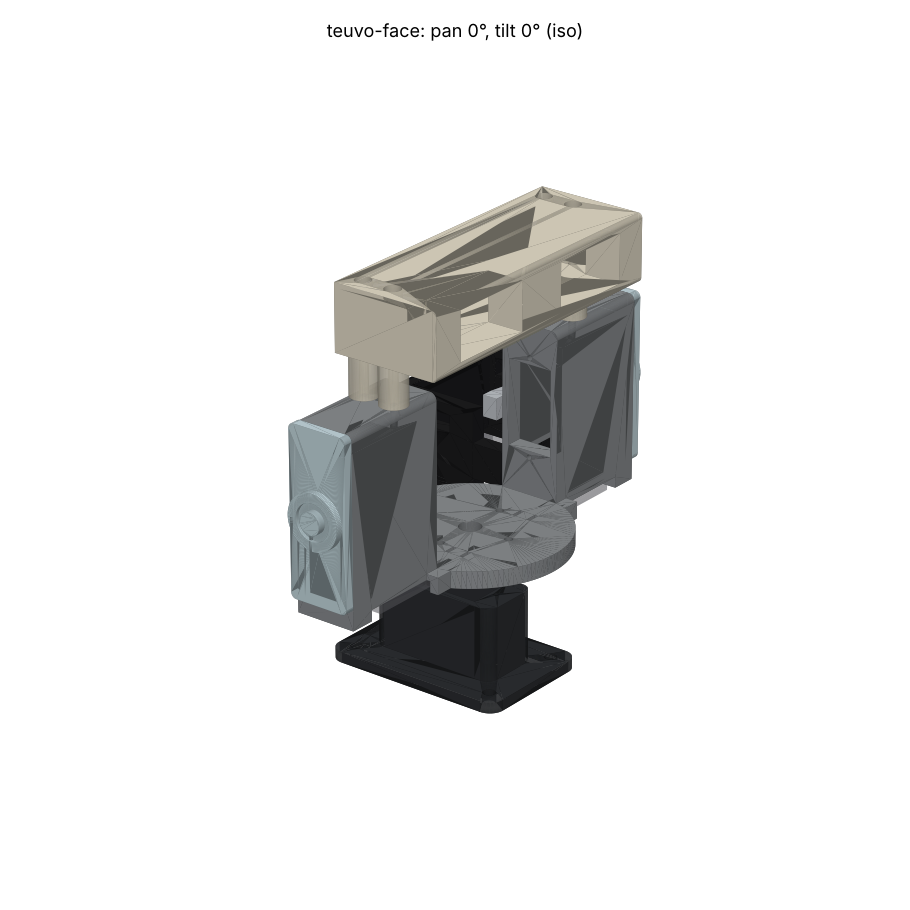
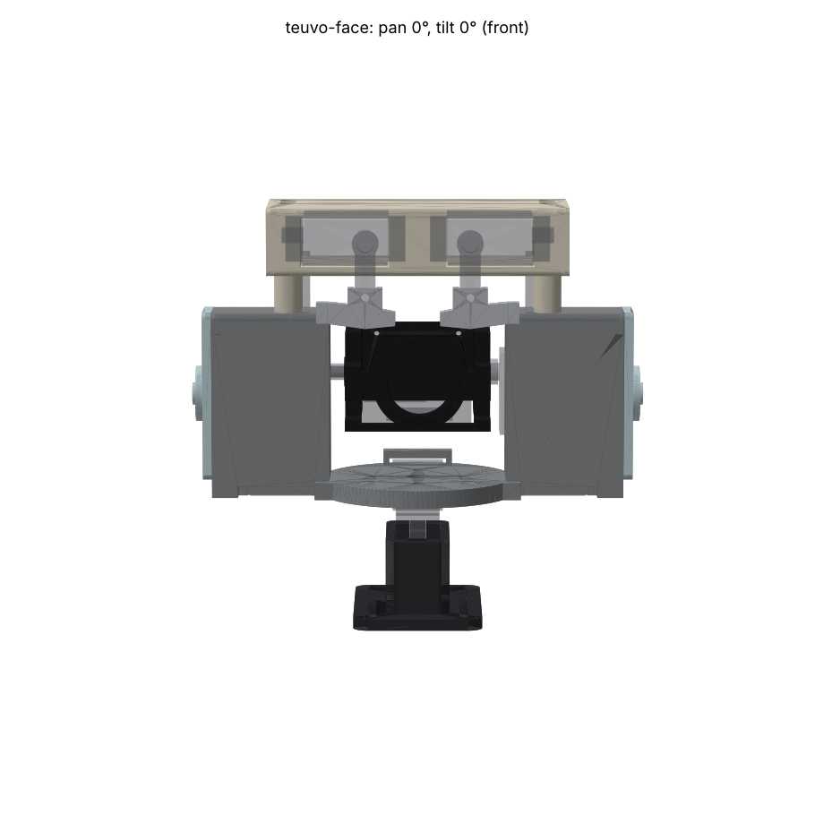
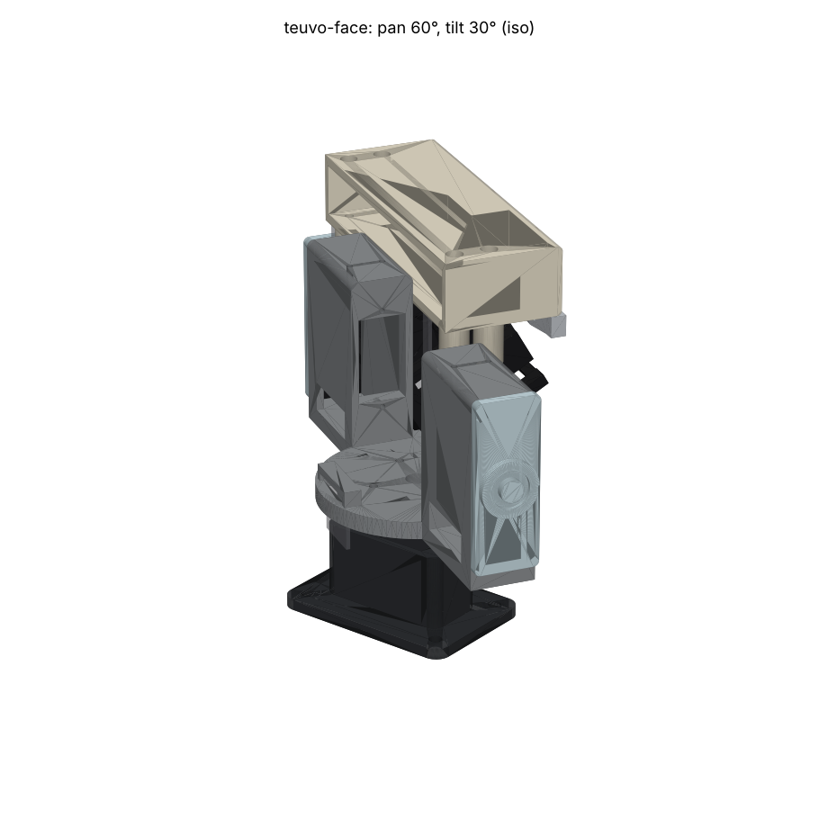
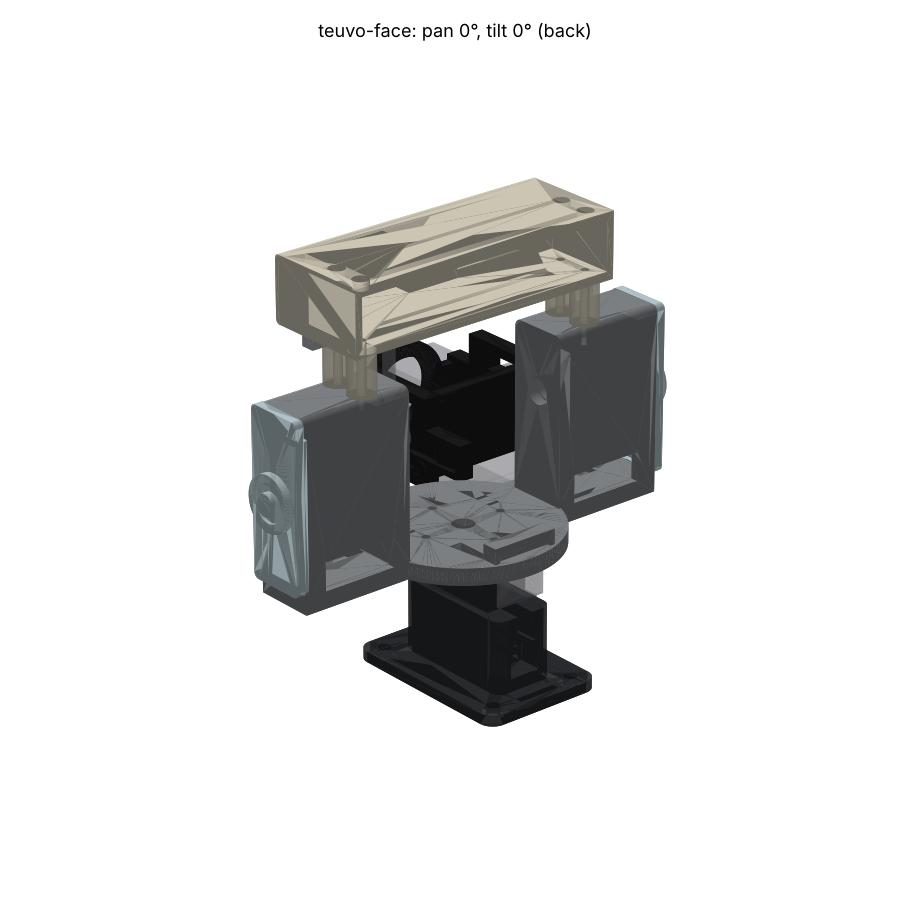

# Teuvo's Face

A pan-tilt head for robocar-unified that is also Teuvo's face: a 1950s
radio-cabinet robot with one eye. The camera is the eye, and it nods (tilt,
MG90D) inside a fixed face frame the way an eyeball turns in a skull. Two
SG90 eyebrows hang from a fixed ivory forehead above it. The whole face turns
on a black neck (pan, MG90D). The ear pods take Robby-style translucent ear
caps.

 
 

## Concept

- **The brows ride the pan stage, not the eye.** The tilt servo carries only
  the eye cradle and head 1. The brow servos' 18 g and their two leads never
  cross the tilt joint, so the only cable through the tilt is the ribbon. Faces
  work the same way: brows are on the skull, and the eye rolls under them.
- **The tilt axis runs through the camera stack**, 6 mm in front of the board
  at lens height, not behind the board. The lens sits 21.6 mm from the axis, so
  a 30° nod moves it about 11 mm. The head's centre of mass is 6 mm from the
  axis.
- **There is a pivot on the opposite side.** The tilt horn drives the +Y arm.
  The -Y arm turns on an M3 screw in a 683ZZ bearing pressed into the -Y cheek.
  The output shaft carries no cantilever, and the pivot holds the cradle on the
  spline axially.
- **The eyebrows are split, like a monobrow over one eye.** Each brow hangs on
  its SG90 horn 19 mm below the shaft. Turning a brow tilts it, and the inner
  end rises or falls. Both turned positive (inner ends down) gives a stern or
  angry look. Both negative (inner ends up) gives a worried look. One of each
  gives a skeptical look. The brows can also wave together.
- **Palette** (Finnish restraint plus one 1950s flourish):
  - graphite-black neck, Salora-grey face frame and ivory forehead
  - matte black eye cradle, which also cuts flare round the lens
  - polished-aluminium brows and translucent ears

## Parts

Volumes come from `output/check.json`. Prices are estimates; get a JLC3DP
upload quote before ordering. The MJF figure is JLC3DP's published
$0.275/g PA12 rate (August 2025). JLC3DP's pages list "from $1.00" per part
with no per-gram rate for the resins, so the resin figures are guesses.

| Part | Qty | Process / material | Colour | Volume | Est. price | Why |
|---|---|---|---|---|---|---|
| `base` | 1 | MJF PA12S-HP | black | 10.6 cm³ | ~$2.9 | Takes the front tab screw and M3 clamping; tough against knocks; no supports |
| `keeper` | 1 | MJF PA12S-HP | black | 0.29 cm³ | ~$1 (part minimum) | Slides into the base from behind after the pan servo is in, refills the lead slot and carries the rear tab's pilot. Same line as the base |
| `frame` | 1 | MJF PA12-HP | natural grey | 29.6 cm³ | ~$8.1 | The structural part: holds the press-fit bearing, the servo tab screws, the horn screws, the forehead's four M2 in its 6 mm pod roofs and the lead channels. Nylon does not crack at a press fit where resin would |
| `eye` | 1 | MJF PA12S-HP | black | 8.6 cm³ | ~$2.4 | The M3 pivot screw self-taps into it; horn screws; matte black round the lens |
| `forehead` | 1 | SLA JLC 9600 resin | ivory/white | 19.0 cm³ | ~$2–4 | Cosmetic face with a smooth finish; SG90 tab screws self-tap into resin, which holds a thread |
| `brow_l`, `brow_r` | 1 each (mirror pair) | SLM AlSi10Mg, polished | aluminium | 0.52 cm³ | ~$5–10 each | 1950s chrome; 1.4 g each on a 1.8 kg·cm servo. **Fallback:** JLC Black Resin (under $1) |
| `ear_cap` | 2 | SLA 8001 translucent resin | clear | 2.7 cm³ | ~$1–2 | Robby's lit ears; room behind for an LED later; press fit |

The total is about $27–42 with aluminium brows or about $19–24 with resin
brows, before shipping. All eight STLs go in one JLC3DP order with a material
per line.

**Wall thickness.** Gate result, then the process minimum and the
justification:

- **`base`, `keeper`, `frame`: 1.0 mm.** This is the band between a Ø1.5 servo
  tab pilot and the servo pocket or window. The servo's own tab-hole inset and
  `CASE_CLR_L` (0.4 mm at the case ends) fix it. MJF PA12 minimum is 1.0 mm,
  and the band is a 3–5 mm long web beside a self-tapping hole, not a free
  wall. The lead channel's roof is 1.6 mm. Everything else is 2.0 mm or more.
- **`forehead`: 1.2 mm.** Same kind of band at the SG90 tab pilots. The SLA
  minimum is 0.8 mm, and JLC asks for 1.5 mm at fasteners. If the upload check
  complains, move the pilots 0.2 mm out (`SG90.tab_hole_inset`).
- **Case clearance** is 0.5 mm a side across the servo's width
  (`CASE_CLR_W`) and 0.4 mm at its ends (`CASE_CLR_L`). A sweep with every
  servo 0.45 mm wider and 0.3 mm longer than published is clash-free. Over
  that, file the pocket ends rather than reprint.
- **`eye` 1.5 mm, `brow_*` 1.35 mm, `ear_cap` 1.6 mm.** These clear their
  process minimums: SLA 0.8, SLM about 1.0.

**Print orientation.** Parts are exported in their world pose at pan 0 / tilt
0. MJF and SLM need none from us. (`keeper` goes on the MJF line with the base.)
- **SLA:** print `forehead` front face up with the open back down; there are
  no supports on the face and the windows are vertical through-holes. Print
  `ear_cap` outer face up, `brow_*` flat on the back.

## Hardware

| Item | Qty | Where |
|---|---|---|
| TowerPro MG90D, with its horn bag | 2 | pan, tilt |
| TowerPro SG90, with its horn bag | 2 | brows (PCA9685 ch 14, 15) |
| MG90D cross horn + its spline screw | 1 | pan, captured in the frame's floor pocket |
| MG90D double-arm horn | 1 | tilt, in the eye's +Y arm pocket (no spline screw, see assembly) |
| SG90 single-arm horn + spline screw | 2 | brows |
| 683ZZ bearing, 3 × 7 × 3 | 1 | -Y cheek, pressed in from the inside against a Ø6 lip |
| M3 × 14 socket head (ISO 4762) | 1 | tilt pivot, self-taps into the eye's Ø2.5 boss |
| Shim, 3 × 5 × 0.5 | 1 | under the pivot screw head, bears on the inner race only |
| Spacer, ID 3.2, OD ≤ 4.5, 4.0 long (brass tube, or a nylon M3 spacer turned down) | 1 | between the inner race and the eye boss. It must not touch the outer race or shields |
| Servo tab screws (from the servo bags, ~2 × 8 self-tapping) | 8 | 2 per servo, into Ø1.5 pilots (the pan servo's rear one goes into the keeper) |
| Horn screws (servo bag, ~ST2.0 × 5) | 4 + 2 | cross horn into the frame floor from above (4); tilt horn into the eye arm bosses (2) |
| ST2.2 × 6.5 pan-head self-tapping | 2 | one per brow, through the brow into its horn arm (drill the horn arm Ø1.5 if no hole lines up with the brow's Ø2.3 hole, 14 mm from the axis) |
| M2 × 20 pan head, self-tapping (ST2.0 × 20 or a thread-forming M2) | 4 | forehead posts into the 6 mm pod roofs: Ø1.6 pilots, 5.9 mm of thread each, tips 0.65 mm above the tilt servo's tab. Not longer than 20 |
| M2 × 5 button head (ISO 7380) | 2 | head 1 to the eye's back plate (Ø1.6 pilots; replaces the kit's screws) |
| M3 × 12 + nut + washer | 4 | base flange to the acrylic chassis plate |
| Cable ties, 2.5 mm wide | 4 | one per side round the lead bundle in the neck's front pockets (through the two floor slots); one for the pan lead and ribbon at the base flange's rear slot; one spare |
| Kapton or cloth tape, 6 mm | 10 cm | brow leads to the back of each pod, and the bundle into its channel under the floor plate. None of these runs moves relative to the frame |
| **14-way 1.0 mm-pitch flat ribbon, 200 mm, with two 2 × 7 2.0 mm IDC sockets** | 1 | replaces the 10–15 cm ribbon: tilt loop ~40 mm, drop to the gate ~25, gate to plinth ~15, pan service loop ~50, plinth to J1 ~60 (with the base where *Mounting* says). Crimp it the same way round as the old one (see the carrier README, "The ribbon survives a reversed plug") |

No heat-set inserts: every thread is a self-tapping screw in PA12 or resin.

## Mounting to the chassis

The base flange carries four Ø3.4 holes on a **42 × 25 mm** rectangle centred
5.3 mm behind the pan axis. With the camera facing forward, drill the acrylic
**Ø3.2–3.5** at the four holes, using the printed base as the template. The
flange is 52 × 35 mm, and the 2 × 12 mm slot at its back takes a cable tie for
the pan lead and the ribbon. The pan axis is the servo's spline, 6 mm from the
front end of the plinth's pocket.

**Where on the plate.** Put the base on the chassis centre line, in front of
the main board, with the flange's rear edge no more than about 40 mm from J1
(J1 is in the main board's front row, 21–33 mm in from its right edge). That
keeps the plinth-to-J1 run inside the 60 mm the 200 mm ribbon allows. The
ribbon and the pan lead leave the base at its rear; leave the 25 mm behind the
flange clear of standoffs so the pan service loops can lie flat there.

## Assembly

1. **Pan servo into the base.** With the keeper out, lower the servo straight
   in: the lead boot drops down the open slot behind the pocket and the lead
   leaves through the rear window. The servo hangs from its tabs with 1 mm of
   air under its base. Drive the front tab screw. Slide the keeper in from the
   rear until it is flush with the plinth (its two ribs run in the slot's
   grooves, so it cannot lift), then drive the rear tab screw through the tab
   into the keeper. That screw also stops the keeper sliding out.
2. **Centre the pan servo** (`servo pan 0`) and press the cross horn on with
   its arms along X and Y. Drive the spline screw.
3. **Frame onto the pan horn.** The horn drops into the floor's cross pocket.
   Drive the four horn screws down through the floor at radius 12 mm, with
   the frame empty so a screwdriver reaches them straight down.
4. **Tilt servo.** Slide it in from the +Y pod's open end, shaft first: the case
   top passes the bulkhead window and the tabs land on the bulkhead. Nothing
   hangs from the pod roof, so the upper tab has a clear path. Drive both tab
   screws through the open pod end. Let the lead fall to the pod floor and push
   the plug down through the floor hole (see step 9a).
5. **Press the 683ZZ into the -Y cheek from the inside** until it seats on the
   lip.
6. **Eye on the bench.** Screw the double-arm horn into the +Y arm's pocket
   (two horn screws, from outside, into the bosses). Plug the ribbon into J2.
   Push head 1 up into the cradle **from below**: J2 passes under the back
   plate, and the stack slides up between the arms. The bar under the bezel
   starts in front of the lens plane, so nothing is under the stack. Drive the
   two M2 × 5 into the back plate.
7. **Eye into the frame from above** (forehead off). Lower it 4 mm toward -Y
   so the horn hub clears the spline. Centre the tilt servo (`servo tilt 0`),
   then slide the eye +Y onto the spline with the cradle level. Fit the spacer
   in the 4 mm gap. From the -Y pod's open end, put the shim and the
   M3 × 14 through the bearing and spacer into the eye's boss, and tighten.
   - **The tilt spline screw is omitted on purpose.** Once head 1 is in, no
     screwdriver can reach it. The pivot stack already fixes the eye axially,
     so the horn cannot walk off the spline.
8. **Forehead.** Stand its four posts on the pod roofs. Drive the four
   M2 × 20 through the top-wall access holes; the heads sit on the cavity floor
   and each screw threads 5.9 mm into the 6 mm roof. Then slide each SG90 in
   from the open back, shaft forward: the case top fills the window and the
   tabs bear on the plate. Drive the tab screws from behind.
9. **Brows.** Centre the brow servos (PCA9685 ch 14/15 at their neutral pulse).
   Fit each horn pointing straight down and drive its spline screw. Press the
   brow onto the horn arm's tip and drive one ST2.2 × 6.5 through it.
9a. **Leads** (modelled as `lead_*` bodies, so the gate checks the route at
    every pose). Each brow lead runs back along the forehead cavity floor, out
    of its open back, and straight down the back of its own pod (tape it there).
    It enters the pod through the low slot in the rear wall, crosses the pod
    floor, and its plug goes down the floor hole. The tilt lead drops from its
    boot to the same hole on the +Y side. Under the plate, press the bundle
    (two leads on +Y, one on −Y) into the channel and run it inward into the
    neck's front pocket. Tie it through the two floor slots at r ≈ 12 mm. From
    there it hangs straight down beside the pan servo to the plinth top and off
    its side to the main board. Leave about 40 mm of slack between the tie and
    the plate. Only that hanging span moves with pan: the tie point travels
    about 12 mm at ±60°, and at the firmware limits it never passes over the
    servo case.
10. **Ribbon.** Thread it under the bridge at the back of the neck ring,
    leaving a loop of about 40 mm between J2 and the bridge for the tilt. Turn
    it straight down through the floor slot under the bridge. It leaves the
    turning stage at r ≈ 21 mm inside the neck, not over the ring's back edge.
    It lands on the plinth's rear end behind the pan servo. Leave about 50 mm
    of service loop there for ±60° of pan, then tie it with the pan lead at the
    base flange slot and run it to J1.
11. **Ear caps** press into the pod ends; a drop of CA holds them.

## Torque budget

`python design.py` prints this budget:

| Quantity | Value |
|---|---|
| Moving mass | 22.7 g: eye 8.7 g at PA12 density, head 13 g estimated, horn and screws 1 g |
| Centre of mass from the tilt axis | 5.7 mm |
| Tilt load | 0.043 kg·cm: gravity at worst-case orientation plus 0.03 kg·cm estimated for the ribbon's bend |
| MG90D stall torque | 2.1 kg·cm at 4.8 V (TowerPro) |

The MG90D stall torque is **49× the tilt load**, and still more than 15× if
only a third of stall is usable. The brows (aluminium, 1.4 g at 19 mm) load
an SG90 to about 0.003 kg·cm.

## Brow travel (firmware)

Clash-checked with `python design.py --brows`; it sweeps the brows at tilt
−45/0/+45, which `common.check` does not.

| Brow angle from neutral | Result |
|---|---|
| +45° (inner ends down, stern) | clear, and clear to +60 |
| −15° (inner ends up, worried) | clear |
| −18° | the inner ends touch. This is the sweep's control |

Set the brow travel limits to **−15° … +45°**. Positive means the inner end
goes down on both sides. On the PCA9685 the +Y (left) brow and the −Y (right)
brow turn opposite ways for the same expression, so negate one channel in
firmware.

## Measure first, before ordering

These are the parameters at the top of `design.py`. Each one moves only the
features derived from it.

1. **MG90D F (base to tab underside)** sets the base ledge and the tilt
   bulkhead. Published as 19.8 mm, which is why the stock kits do not fit. The
   base allows 1 mm of slack under the servo, and the pods are long enough for
   the tilt servo's base to clear the ear-cap rim by 1.6 mm. A sweep with
   F = 20.8 (C = 29.5) is clash-free. A shorter F leaves the servo hanging,
   which is fine.
2. **MG90D tab thickness** (estimated 2.5 mm), **tab hole inset** (estimated
   2.3 mm) and **E**, the tab span (31.5 mm). Together they set all four MG90D
   pilots.
3. **MG90D shaft offset from the case end** (estimated 6.0 mm). This sets where
   the tilt case sits relative to the axis, and therefore the window.
4. **SG90 F** (estimated 15.9 mm) and **SG90 tab inset**. These set the
   forehead's plate depth and its pilots.
5. **Horn sizes**: cross-horn arm length and width (pocket 32.6 × 5.6 mm),
   double-horn length (40.6 mm pocket), the hub diameter (Ø7.6 pocket) and
   where the horn screw holes are (14 mm on the tilt horn; 12 mm on the pan
   horn arms).
6. **683ZZ outside diameter** against the Ø7.0 pocket. MJF shrinks holes, so if
   the bearing will not press in, ream the pocket rather than reprinting.
7. **MG90D lead exit**: where the lead leaves the case end (height above the
   base, width of its strain relief). The fixture assumes a 4 × 4 mm boot,
   4–8 mm above the base, 6 mm long. The keeper slot is 4.8 mm wide and open
   from 12.9 mm up; the lead window under it is 9 mm wide, 6.5–13 mm up. A boot
   wider than 4.8 mm means widening `KEEPER_HY`.
8. **Lens position on the XIAO Sense** relative to the stack centre. The bezel
   aperture is Ø17 centred on the fixture's estimate. Also measure the
   camera's vertical field of view (see risks).

## Risks

- **The head is tall and heavy for a small car.** The forehead top is 115 mm
  above the plate and the face is 123 mm wide over the ear caps. With servos it
  weighs about 140 g, which raises the car's centre of gravity. A lighter
  variant: skip the ear caps and print the forehead in resin with 1.5 mm walls.
  The tilt axis height (68 mm) is forced by the fixture's rigid J2 keep-out
  sweeping to tilt +45 (see fixtures). With firmware tilt held at ±30 it could
  come down about 8 mm (`TILT_Z`).
- **Above about +40° tilt the forehead edge enters the top of the frame**,
  estimated from the unmeasured FOV. The brows stay out of view at every
  tilt. At the boot limit of +30° the view is clear.
- **The tilt horn has no spline screw** (assembly step 7). The pivot stack
  carries the axial load. If it loosens, the horn can slip a spline tooth
  under a hard knock. Use threadlocker (blue) on the M3.
- **The pan stage is asymmetric.** The 13 g tilt servo sits in the +Y pod and
  the -Y pod is empty. The pan stage (about 107 g with servos and head) has its
  centre of mass about 4 mm toward +Y and 4 mm forward of the pan axis. The MG90D's double bearing takes the moment easily, but a
  counterweight or LED in the -Y pod would balance it.
- **The servo tab pilots leave 1.0 mm webs**, from the servo's tab geometry
  and the 0.4 mm end clearance. Do not overtighten the tab screws; PA12
  forgives this better than resin.
- **The pan servo's rear tab screw holds the keeper.** If it is left out, the
  keeper can slide out backwards, and the rear tab then rests on the slot's
  two shoulders with nothing holding it down.
- **The lead bundle's hanging span is the one flexing lead.** At pan +90 the
  +Y tie point (r ≈ 12 at 54° from the front) swings over the edge of the pan
  servo's case top, 2.9 mm under the frame. The firmware's ±60° keeps it
  clear (114° at most). Widening the pan limit past about ±85° needs the bundle
  dressed down beside the case.
- **A 20 cm ribbon is longer than the bus the carrier's I2C pull-ups were
  checked for** (carrier README, N-4: 10–15 cm). Probe SDA/SCL rise time on J12
  at first power-up as that README already asks, and drop to 100 kHz if it is
  over 300 ns.
- **SLM brows** add cost and a separate metal print line. Resin brows are a
  drop-in fallback with identical geometry.
- **Only the rigid parts of the cable routes are modelled.** The `lead_*` and
  `ribbon` bodies cover every run that is fixed to the pan stage. The tilt loop,
  the pan service loops and the hanging spans below the tie points bend and
  are not bodies. The bridge gate stops a tug from reaching J2.
- **The SG90 case tops show** through the forehead's two windows, like gauge
  faces. This is cosmetic.

## Fixture notes

- `fixtures.J2_KEEPOUT` is a rigid 16 × 18 × 8 mm box that tilts with the head.
  At tilt +45 it is the lowest point of the tilting group, 27.8 mm below the
  axis. It sets `TILT_Z`. A real ribbon bends, so the true clearance need is
  smaller.
- No fixture error was found. The MG90D values marked "estimate" are carried
  through as the parameters above.

## Gates

```
cd packages/robocar/unified/hardware/pan-tilt
/tmp/claude-0/b123/.venv/bin/python entries/teuvo-face/design.py --brows
/tmp/claude-0/b123/.venv/bin/python -m common.check entries/teuvo-face    # 0 clashes
/tmp/claude-0/b123/.venv/bin/python -m common.render entries/teuvo-face
```

`check.json` excuses eight interfaces, each deliberate:

- `pan_servo / pan_horn`, `tilt_servo / tilt_horn`, `brow_servo_l / brow_horn_l`,
  `brow_servo_r / brow_horn_r`: each spline in its horn hub.
- `bearing / pivot_stack`: the M3 shank through the inner race, which it
  clamps.
- `lead_tilt / tilt_servo`, `lead_brow_l / brow_servo_l`,
  `lead_brow_r / brow_servo_r`: each lead stand-in starts 0.1 mm inside its
  servo's boot, where the lead comes out of it.

The lead and ribbon runs are in their own `leads` group, not the frame's. So
the gate also proves each run sits in its slot, hole and channel, clear of the
frame, and clear of the eye, head and pan servo at every pose.

**Assembly paths, not only end poses.** The gate tests where parts end up.
A probe (session scratchpad, not committed) also swept each stand-in along
its insertion path: 0 mm³ at every 2 mm step for head 1 up into the eye, the
tilt servo along −Y into its pod, the pan servo down into the base with the
keeper out, the keeper in from the rear, and each SG90 into the forehead from
behind.

The servos and head 1 are in their own groups, not their holders' groups. So
the gate also proves each servo fits its pocket or window, and head 1 fits
the eye cradle, at every pose.
