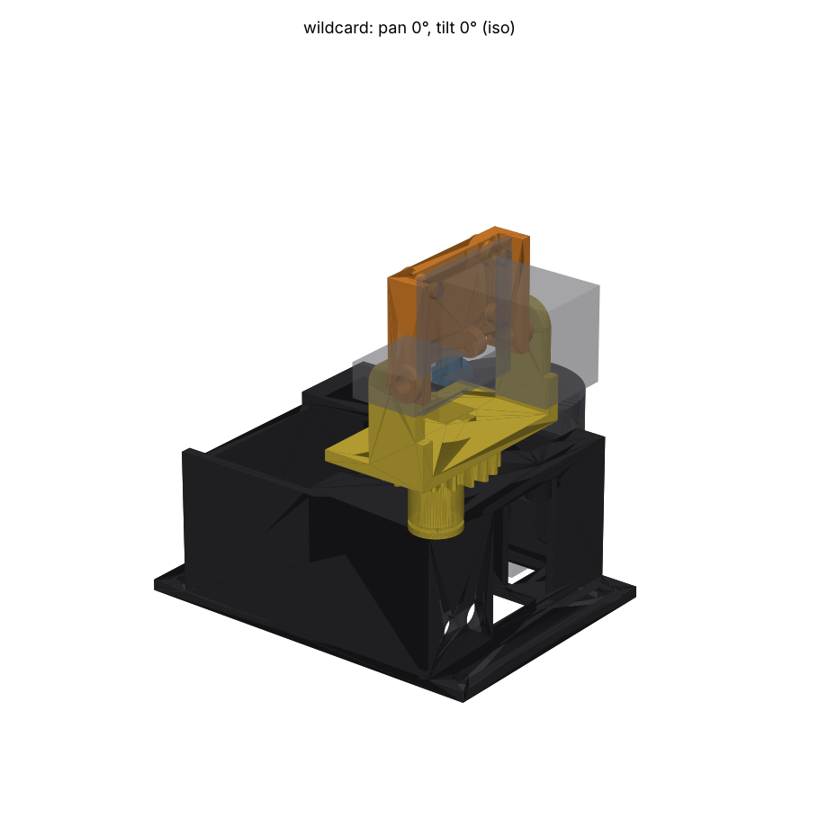
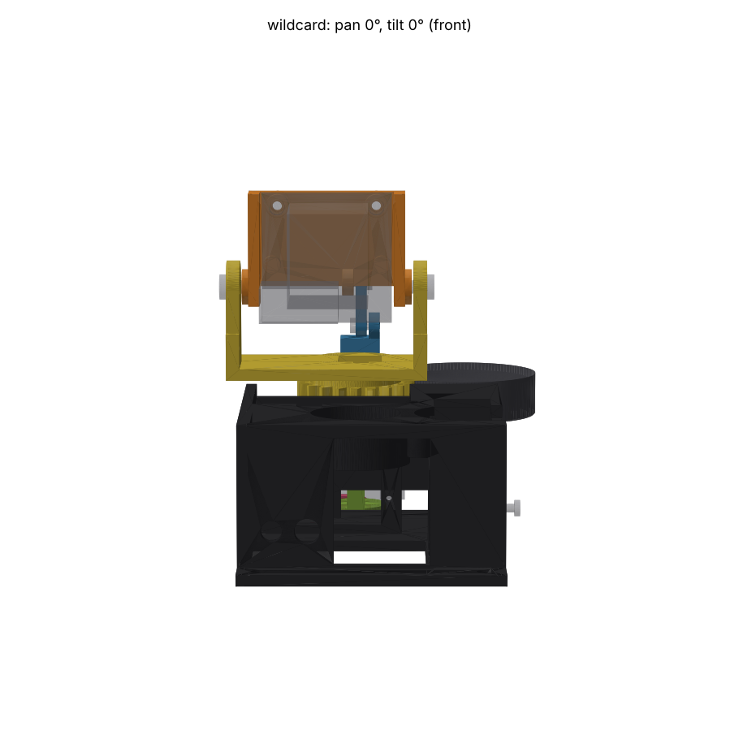
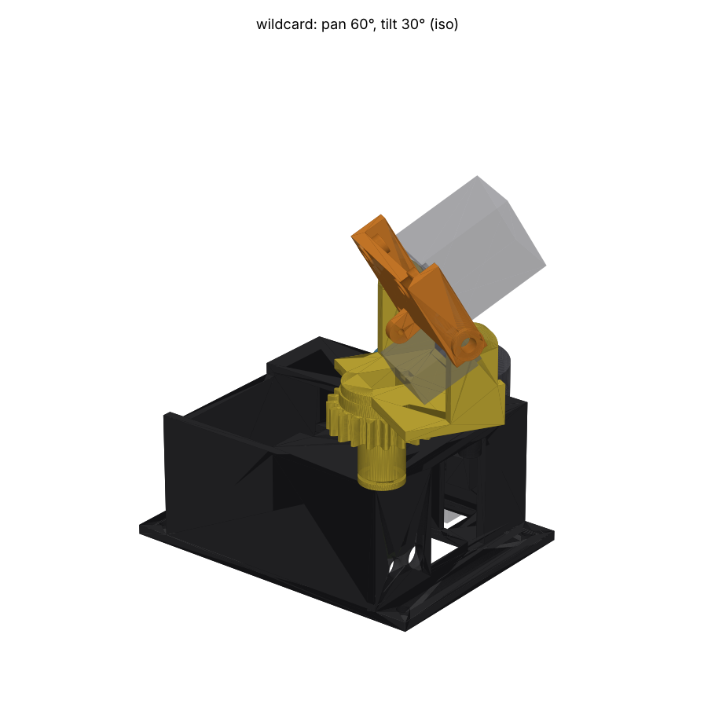
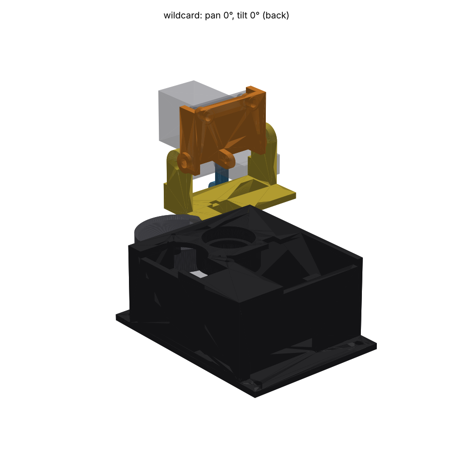

# Majakka: a pan-tilt where neither servo moves

Tournament entry `wildcard`, revision 2. Head 1 (29.5 mm board, XIAO
ESP32-S3 Sense) on two TowerPro MG90D servos. Both servos are screwed into a
fixed base and never move. Only the head turns, like the lamp in a lighthouse
(*majakka*). Ten MJF PA12 parts from JLC3DP, two 6801ZZ bearings, one steel
dowel, one E-clip, and small screws.

Revision 2 answers the inspection (`INSPECTION.md`, "Revision" at the end).
The main change: the two-sided tilt fork could not be assembled. It is now a
one-sided **lever** with a single dowel, and the collar is a separate part
that goes in after it. Every part now has an assembly path, checked by moving
it out along that path (see [Assembly](#assembly)).

 
 

Gates (`output/check.json`): **zero clashes** over pan -90..90 and tilt -45..45.
Two excuses, both the stock horn on its own servo's spline (`pan_horn /
pan_servo`, `tilt_horn / tilt_servo`). The gear mesh needs no excuse: the
involute teeth have 0.3 mm of backlash and do not intersect at any swept pose.
The gear hood is in its own group, so the gate tests it against the base, both
servos and every moving part. Every part is a valid solid, and the thinnest
wall is 1.0 mm (see [Walls](#walls)).

## Concept

In every kit-style pan-tilt, and in the other entries, the tilt servo rides on
the pan stage. Its 13 g swings with every pan move, and its 25 cm lead flexes
through the pan joint all day. Here the tilt goes **up the pan axis** instead:

```
            head 1 on the cradle, pivots on 2 x M3 in the turret cheeks
                 \__ crank (9 mm) __ link (10 mm) __ bracket
                                                       |
   turret (pans) ===[gear]=== hub in 2 x 6801ZZ  [ square rod slides
        ^           (hood over the pinion)          |  up and down inside
   pinion on the pan MG90D (1:1)                    |  the hollow hub ]
                                                    |
                                        grooved collar screwed to the rod
                                        one dowel in the groove, on a lever
                                        on the tilt MG90D's horn
   ----------------------- fixed base ------------------------------------
```

- **Pan.** The pan MG90D stands upright off-axis. A 20-tooth module 1.25
  pinion on its disc horn drives an identical gear on the turret, so the turret
  turns 1:1, **the opposite way** (see [Firmware](#firmware-changes-needed)).
  The turret's hub runs in two 6801ZZ bearings pressed against a lip in the
  base, and an E-clip holds it down. The bearings carry the head's weight and
  its tipping moment. The pan servo's spline sees only the tooth force. A fixed
  **hood** covers the pinion and the mesh, so the head ribbon cannot be drawn
  into the gears.
- **Tilt.** The hub has a 4.4 mm square bore. A 4 mm square rod slides in it
  and turns with the turret. Below the hub the rod is screwed into a collar with
  a groove. A lever on the tilt MG90D's horn holds one 3 mm steel dowel in that
  groove, like a gearbox shift fork. When the turret pans, the collar turns over
  the dowel and nothing else happens, so **pan and tilt are fully decoupled**.
  When the tilt servo turns, the lever lifts or lowers the rod. At the top, a
  bracket on the rod pushes a 10 mm link up to a 9 mm crank behind the head,
  and the head nods.
- **The head is carried on both sides.** The cradle swings on two M3 screws in
  the turret's cheeks. No servo shaft holds the head. The tilt servo's spline
  carries only the rod's push through the dowel: the head's out-of-balance
  moment over the crank and the friction, well under 1 N (about 0.07 kg·cm
  against the servo's 2.2).

What this buys:

| | Majakka | Tilt servo on the pan stage |
|---|---|---|
| Servo leads crossing the pan joint | none (only the head's ribbon) | the tilt lead, flexed on every pan |
| Mass that pans | head + cradle + turret (~25 g) | the same plus a 13 g servo |
| What holds the head's weight | ball bearings (pan), two pivots (tilt) | the servo shafts |
| Pan travel limit | the ribbon's slack | the tilt lead's slack and the ribbon |

What it costs: a bigger base (66 x 61 mm, 35 mm tall, 84 mm long with its
ears, both servos inside it), more parts, a tilt that is not 1:1, and firmware
work. The base is the price of keeping both servos still.

**Geometry.** World frame of `common/fixtures.py`, z 0 on the chassis plate,
the pan axis at x = y = 0. The tilt axis is at x 11.5, z 66.1, in the plane of
the board's back face and 8 mm above its bottom edge. **The lens is 74.9 mm
above the chassis plate** (4.3 mm higher than revision 1, for the pinion's
vertical clearance and the hood) and 39 mm ahead of the pan axis. The head is
6.5 mm to the right of the pan axis (-Y), which keeps its J2 ribbon keep-out
clear of the rod on the pan axis. Every height is computed in `_layout()` from
the part stack and the J2 keep-out's lowest point over ±46° tilt.

## Firmware changes needed

These are **code changes in `main/servo_controller.c`**, not console settings.
The console's `servo` command has no direction option. Until they are made,
`head_aim` pans the wrong way. That is positive feedback: the head winds to its
limit. It also tilts about 20 % too far near centre.

1. **Pan sign.** The turret turns opposite to the pan servo, 1:1. Negate the
   pan angle before it becomes a pulse.
2. **Tilt lookup.** The crank and link make the tilt non-linear. The servo turns
   about 0.82° per degree of head tilt near centre, and less toward look-up.
   `tilt_to_servo()` in `design.py` gives the table. Put it in as a lookup with
   linear interpolation:

   | head tilt (deg, + = look up) | -45 | -30 | -15 | 0 | +15 | +30 | +45 |
   |---|---|---|---|---|---|---|---|
   | tilt servo (deg) | +37.6 | +24.6 | +12.3 | 0 | -12.2 | -23.7 | -33.1 |

Both changes belong in one place, `servo_angle_to_count(servo_id_t id, int16_t
angle)`. It ignores `id` today. With them in place, `servo pan|tilt <deg>`, the
travel limits and `head_aim` all work in head degrees. The header comment
"Angles are real servo degrees" then needs rewording. Gate the mapping behind a
build-time switch for this mount, so the old kit keeps working. I have not
written this code: the entry touches nothing outside its folder.

## Parts (JLC3DP)

All parts are **MJF PA12-HP (nylon)**. Why MJF for all of them:

- The base takes two **press-fit ball bearings** and **self-tapping screws**,
  and the cradle takes **heat-set inserts**. PA12 does all three. Resin cracks
  under a press fit and does not hold a heat-set insert (the `enclosure-cad`
  skill's trap).
- The rod, the collar's groove and the cradle pivots are **sliding surfaces**.
  PA12 on steel and PA12 on PA12 wear well with a dry PTFE lube.
- The gears: MJF PA12 is the usual material for small printed spur gears. The
  module 1.25 teeth are tipped 0.15 m short, which widens the tip land.
- MJF needs no supports, so print orientation is free. JLC3DP recommends 1.0 mm
  walls for MJF nylon ([design guideline](https://jlc3dp.com/help/article/3D-Printing-Design-Guideline)).

Colour: MJF PA12 comes grey. Order the base, the turret and the hood **dyed
black** for Teuvo's 1950s cabinet look, and the cradle grey. The prices are
estimates. They use JLC3DP's MJF-PA12 rate of $0.275/g ([Aug 2025 price cut](https://jlc3dp.com/blog/drastic-material-price-cuts-and-adjusted-post-processing-service-fees)),
PA12 at about 1.01 g/cm³, and an assumed floor of about $1 per part. Get a real
quote from the STLs before ordering.

| Part | Volume | Thinnest | Est. price | Print orientation | Notes |
|---|---|---|---|---|---|
| `base` | 34.7 cm³ | 1.05 mm | ~$9.60 | floor down | Box with bearing housing, lintels, Y datum and bulkhead for the servos, 4 x M3 ears |
| `turret` | 9.4 cm³ | 1.13 mm | ~$2.60 | gear down (teeth in XY) | Hub (Ø11.85), 7 mm-face gear, plate, two cheeks with M3 journals |
| `pinion` | 2.2 cm³ | 1.13 mm | ~$1.00 | flat | 5 mm face; screws to the pan servo's disc horn |
| `hood` | 2.3 cm³ | 1.23 mm | ~$1.00 | lid down | Fixed guard over the pinion and the mesh, 2 x M2 to the deck |
| `cradle` | 3.4 cm³ | 1.40 mm | ~$1.00 | back face down | Holds head 1 on four 2 mm standoffs, carries the crank |
| `lever` | 0.4 cm³ | 1.15 mm | ~$1.00 | plate flat | One plate on the tilt horn; the dowel presses into its boss |
| `collar` | 0.6 cm³ | 1.23 mm | ~$1.00 | flat | Grooved collar with the rod's square socket |
| `plunger` | 0.6 cm³ | 1.20 mm | ~$1.00 | lying flat | The 4 mm square rod |
| `bracket` | 0.3 cm³ | 1.00 mm | ~$1.00 | tab flat | Socket on the rod's top, tab for the link pin |
| `link` | 0.15 cm³ | 1.35 mm | ~$1.00 | flat | Two Ø2.3 holes 10 mm apart |
| **total** | 54 cm³ | | **~$20** + shipping | | |

`printed_parts()` returns every part in its **world pose at pan 0, tilt 0**,
and `python design.py` writes `output/<part>.step` and `.stl` in that pose.
Rotate to the orientation above in JLC3DP's viewer if you care; MJF does not
need it.

## Hardware

| Qty | Item | Where |
|---|---|---|
| 2 | TowerPro MG90D, with its horn bag and screws | pan (upright) and tilt (on its side) |
| 1 | MG90D **disc horn** (Ø21) and its horn screw | pan servo, under the pinion |
| 1 | MG90D **double horn**, both arms cut to **8 mm** from the centre, and its horn screw | tilt servo, under the lever |
| 2 | **6801ZZ** ball bearing, 12 x 21 x 5 | base housing, pressed in from each side against the lip |
| 1 | **Loctite 638** (or 641) retaining compound | hub to the bearing inner rings |
| 1 | **DIN 6799 E-clip, size 9** (groove Ø9, for a 12 mm shaft) | hub groove under the lower bearing |
| 1 | Steel dowel **Ø3 x 8**, ISO 2338 m6 | the lever's pin in the collar groove (press fit, 2.9 mm hole) |
| 2 | M3 heat-set insert, 4 mm long (Ø4.0 bore) | cradle pivot bosses |
| 2 | M3 x 8 button head (ISO 7380) + low-strength threadlocker | pivots: through the cheek journals (Ø3.3) into the inserts |
| 2 | M2 heat-set insert, 3 mm long (Ø3.2 bore), **pressed in from the back** | cradle back plate, behind head 1's H5/H6 holes |
| 2 | **M2 x 8** button head (2 mm longer than the head's own screws: the standoffs) | head 1 to the cradle |
| 2 | M2 x 6 pan head, self-tapping into Ø1.6 pilots | crank pin and bracket pin (the link turns on the shank) |
| 1 | M2 x 8 pan head, self-tapping | bracket down into the rod's top |
| 1 | M2 x 6 pan head, self-tapping | up through the collar's counterbore into the rod's bottom |
| 1 | M2 x 6 pan head + M2 nut | pan servo **jack screw**, through the base's +Y wall (the nut locks it) |
| 2 | M2 x 8 pan head, self-tapping | hood to the bosses under the deck |
| 3 | M2 x 5 self-tapping | pinion to the disc horn (drill the horn's holes 1.5 mm at r 7, 120° apart) |
| 2 | M2 x 5 self-tapping | lever to the cut double horn (holes at r 6) |
| 4 | MG90D tab screws (in the servo bag, ~2 x 8 self-tapping) | 2 per servo into Ø1.6 pilots |
| 4 | M3 x 12 + nut + washer | base ears to the acrylic chassis plate |
| — | Dry PTFE lube | rod, collar groove, cheek journals, gear teeth |

**Chassis.** The four M3 holes are at x -51.5 and +23.5, y -22.0 and +29.3. That
is a **75.0 x 51.3 mm** rectangle: the pan axis is 23.5 mm in from the front
pair and 22 mm from the right pair. Drill **3.4 mm** holes in the acrylic plate
with a step drill or a sharp brad-point at low speed, backed with wood. Bolt
from above, with nuts underneath. Nothing passes through the plate, but the
lever's lowest point is about 0.6 mm above it. Keep the area under the base's
floor pit clear of wiring and nut heads: x ±14.5 mm and y -24.5..16.3 mm
around the pan axis.

## Assembly

Each step's path was checked by moving the part out along it in CAD, against
the parts already in place. All of them clear (0 mm³ at every step).

1. **Bearings.** Press one 6801ZZ into the housing from below and one from
   above, each against the lip. MJF holes run ±0.3 mm. If one is loose, use a
   drop of retaining compound; if one is tight, warm the housing with a hot-air
   gun.
2. **Tilt servo.** Lower it **straight down** through the deck opening, shaft
   forward (+X), lead end down. Its tabs land against the bulkhead's front
   face. The opening now runs to x -14.4, past the case's spline end at x -15,
   with a notch for the spline. Drive the two tab screws from the front: the
   +Y one through the service window, the -Y one through the Ø5 hole.
3. **Lever.** On the bench, press the Ø3 x 8 dowel into the lever's boss from
   behind. Cut the double horn's arms to 8 mm and screw the horn to the lever's
   back (two M2 x 5, from the lever's front). Centre the tilt servo (1500 µs),
   then press the horn onto the spline from the front, with the lever level and
   the dowel pointing at the pan axis. The collar is not in yet, so the 4 mm of
   travel onto the spline is free. Drive the horn screw through the front
   wall's Ø6 hole and the lever's Ø4.6 hole.
4. **Pan servo.** Lower it straight down into its opening, spline up, tabs on
   the two lintels. Push it toward the turret (-Y) against the datum face. Turn
   the jack screw in through the +Y wall until it just bears on the case, then
   lock it with its nut. Drive the two tab screws from above. Route both leads
   out through the slot in the rear wall.
5. **Pinion.** Centre the pan servo. Screw the disc horn to the pinion's
   underside (three M2 x 5), press it onto the pan spline from above, and drive
   the horn screw through the pinion's Ø5.2 centre hole.
6. **Turret.** First check the hub (Ø11.85 nominal) in a loose bearing: sand it
   to a slide fit. Wipe Loctite 638 on the hub's two bearing seats. Hold the
   turret facing forward (pan 0) and lower the hub through both bearings. The
   7 mm gear slides down into mesh over the 5 mm pinion. From below, through
   the floor pit, snap the E-clip into the hub's groove. Turn the turret by hand
   before the compound sets.
7. **Collar and rod.** From below, push the collar up through the floor pit at
   y +9.5 (1.5 mm to the right of the pan servo's datum wall), groove level with
   the dowel. Slide it -Y until it is centred on the pan axis: the dowel enters
   the groove from the side. From above, drop the square rod down through the
   hub's bore into the collar's socket. Drive the M2 x 6 up through the collar's
   counterbore into the rod's end. Screw the bracket onto the rod's top (M2 x 8,
   from above). The bracket's tab points left (+Y).
8. **Hood.** Turn the turret to about pan -90, so its plate is clear of the
   pinion. Lower the hood straight down over the pinion: its lid passes above
   the turret gear, and its skirt is open where the gear runs. Drive the two
   M2 x 8 screws into the bosses under the deck.
9. **Cradle and head.** Press the two M2 inserts into the cradle from the back,
   and melt in the two M3 inserts. Screw head 1 on with M2 x 8 button heads. It
   sits on four 2 mm standoffs, so the XIAO's socket pins stand in clear air.
   Put the link on the bracket tab (M2 x 6, from the head's right side, -Y).
   Hold the cradle between the cheeks and fit the two M3 x 8 pivots through the
   cheeks into the inserts. Put threadlocker on the threads and back them off to
   0.1 mm of end play. Join the link to the crank (M2 x 6, from the left, +Y,
   past the cheek).
10. **Ribbon.** Plug the 14-way IDC onto J2 last. Let it drop behind the turret
    plate, leave a loop of about 30 mm, and tie it to the base's rear wall with
    a cable tie through the lead slot. The hood keeps the loop off the pinion
    at every pan angle. The loop sets the pan travel: check ±90 by hand before
    powering up.

## Measure first (calipers on the parts in hand)

The shared fixtures carry estimates. Each of these is a parameter at the top of
`design.py` or in `fixtures.MG90D`. Re-run `python design.py` and the gates
after changing one.

1. **Pinion height: F (19.8), C (28.5) and the disc horn's seat (4.5).** The
   lintels sit at F below the tabs. The case rises C - F above them. The horn
   seat puts the pinion 4.5 mm above the case. The sum sets the pinion's height,
   which now has **±1.5 mm** of clearance to the deck and the hood
   (`PINION_Z_CLEAR`). It stays in full engagement within ±1 mm inside the
   7 mm turret gear. Measure all three. If the sum is more than 1 mm off,
   change `fixtures.MG90D` and rebuild rather than shim.
2. **MG90D case width D (12.0) and the shaft's centring in it.** The gear centre
   distance is the datum face plus half the case width. 0.3 mm of backlash
   allows about 0.4 mm of centre-distance error before the gears bind. A case
   that is 0.2 mm narrower than 12.0 opens the backlash by 0.15 mm.
3. **Tab span E (31.5) and tab hole spacing.** The lintel pilots and the
   bulkhead pilots are placed from `servo_tab_holes()`. The pan servo's pilot
   is 1.05 mm from the lintel's inner face (the thinnest wall in the base), so a
   hole that is really further out splits the lintel.
4. **Shaft offset from the case end (6.0, estimate).** It places both servo
   bodies around fixed shafts. Nothing is now coaxial with the tilt shaft, so an
   error here only shifts the lever's zero, which centring fixes, and the tilt
   servo's body in its 0.3 mm window.
5. **Horns.** The disc horn's hole radius (the pinion's three screws are at
   r 7). The double horn's holes (the lever's two screws are at r 6, on arms cut
   to 8). The horn screw head's diameter, which must pass the lever's Ø4.6 hole.
6. **6801ZZ inner-ring OD.** The turret's thrust boss is r 7.0 and must bear
   on the inner ring only, not the shield.
7. **Fit checks after printing.** The hub in a bearing (sand to a slide fit,
   then compound). The rod in the hub's square bore (0.2 mm per side). The
   dowel in its 2.9 mm hole. The bearings in Ø21.0. MJF is ±0.3 mm, so sand or
   ream rather than reprint.

## Risks

- **Base size.** 66 x 61 mm on the chassis and 35 mm tall, plus a 9 mm ear at
  each end (84 mm overall). It has to fit on the acrylic plate beside the main
  board. This is the cost of keeping both servos still.
- **Pan backlash.** 0.3 mm at the pitch circle is about 1.4° of pan. With the
  centre-distance tolerance it can be anywhere from about 0.6° to 2.4°. The
  executor re-aims every plan. If it measures large, put a 0.1 mm tape shim on
  the datum face.
- **Tilt slop.** The play stacks: the dowel in the 3.4 mm groove (0.2 mm per
  side), two link pins (Ø2.0 screw in Ø2.3), and the rod in its bore. My
  estimate is ±2–3° of head tilt. The fixes are reaming the link holes to
  2.1 mm, and an O-ring under the collar for a light preload.
- **One-sided dowel.** The single dowel pushes the collar 5.5 mm off the rod's
  axis. That puts a small moment on the rod, which the 14 mm-long square bore
  carries. With the lube it slides. Without it, the rod may stick-slip.
- **Firmware.** Until the [changes](#firmware-changes-needed) are made, the
  head pans the wrong way under `head_aim` and winds to its limit.
- **Hub fit.** It relies on sanding and retaining compound, not on the print.
  An oversize hub that is forced in will crack the inner housing.
- **Thin features.** See below. The pan servo's tab pilots sit 1.05 mm from the
  lintel face, because the MG90D's tab hole is that close to its case.
- **Assembly through the floor.** The E-clip and the collar go in from below,
  so the base must come off the chassis to service them.
- **Ribbon.** It is the only cable crossing the pan joint. It is not modelled
  beyond the 16 mm keep-out, and its loop decides the real pan travel.
- **E-clip in PA12.** The Ø9 groove is printed, at ±0.3 mm. If the clip does not
  seat, or pops off, cut the groove true with a file, or replace the clip with
  an M2 screw and washer under the hub's end.
- **No eyebrows.** Brows would have to ride the turret, and their two leads
  would cross the pan joint, which is the one thing this design removes. If
  Teuvo needs brows, there are two options. One is to mount two SG90s on the
  turret's cheeks (above the pivots, horns facing forward) and accept those
  leads. The other is the `teuvo-face` brow bar, which carries them on a fixed
  forehead.

## Walls

The repo's MIN_WALL of 2.0 mm is for resin cases. This is an MJF nylon
mechanism, and JLC3DP's MJF guideline recommends 1.0 mm walls. Every part meets
1.0 mm:

| Part | Thinnest | Where |
|---|---|---|
| base | 1.05 | pan servo tab pilot to the lintel's inner face |
| turret, pinion | 1.13 | gear tooth tip land (backlash now 0.3) |
| hood | 1.23 | the 1.5 mm lid, measured on a slant at its edge |
| collar | 1.23 | square socket corner to the groove core |
| cradle | 1.40 | crank root |
| bracket | 1.00 | the link-pin pilot through the tab |
| lever, plunger | 1.15, 1.20 | dowel boss; around the M2 pilots |
| link | 1.35 | link end around its hole |

## Fixture notes

- `fixtures.head()` does not model the **back-side through-hole pins** of the
  XIAO's two 1x7 socket headers (`seeed-xiao-esp32s3-socket.toml`). They stand
  1–2 mm proud of the back face. A part that sits flat on the board's back face
  passes the gate and bows the board in reality. Here the cradle's back plate
  sits 2 mm back on standoffs. The pins were checked separately as Ø2
  cylinders, 2 mm long: 0 mm³ of overlap.
- `fixtures.horn()` models the hub and arms but not the **horn screw head**,
  which stands about 1–2 mm proud of the hub. Here it sits in the lever's Ø4.6
  hole and the pinion's Ø5.2 hole.
- The fixtures do not include the **chassis plate**. The check cannot see that
  the lever's ends come within about 0.6 mm of it; that clearance comes from
  `_layout()`.
- `tab_hole_inset` (2.3, estimate) decides whether a tab pilot fits in a
  printed lintel at all. It is worth measuring with calipers before any entry
  is ordered.
- `common.check` never tests a servo against its own pocket: they share the
  group `base`. Here the servo-to-base fits were probed separately. Each servo
  lifts straight out with 0 mm³ of overlap. Moving the pan servo 0.1 mm into
  its datum gives 19 mm³, so the datum face is real.
