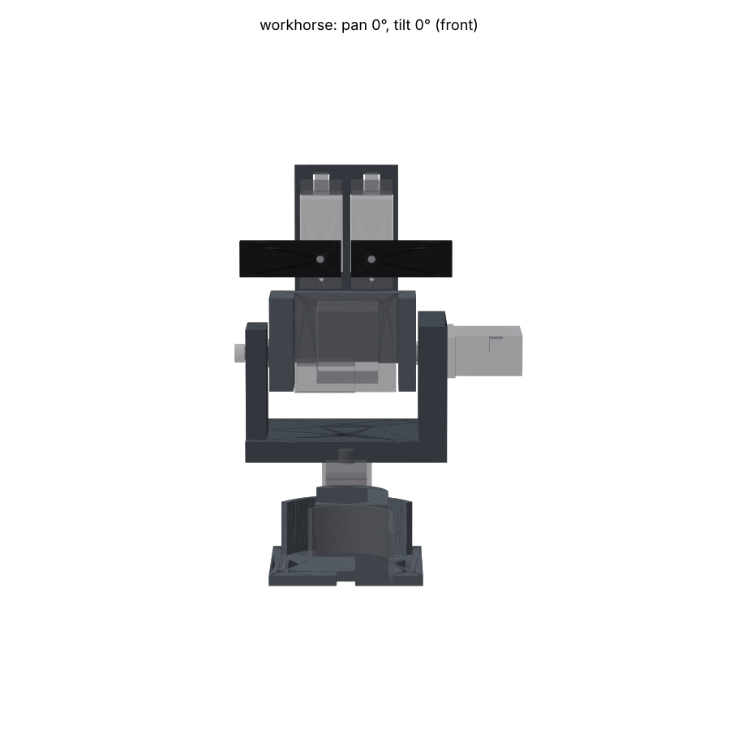
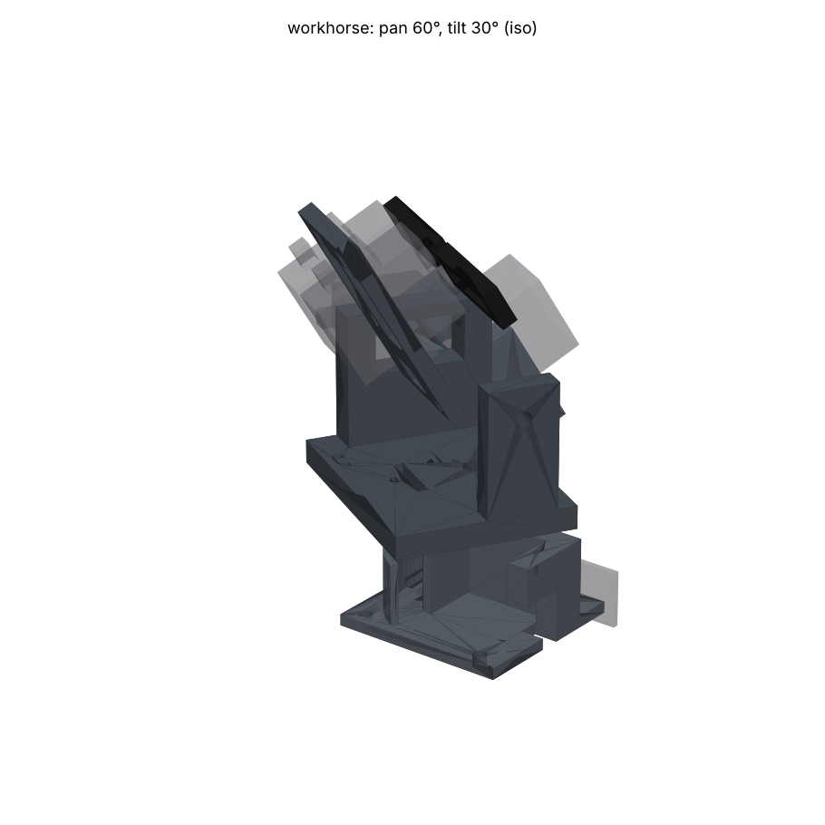
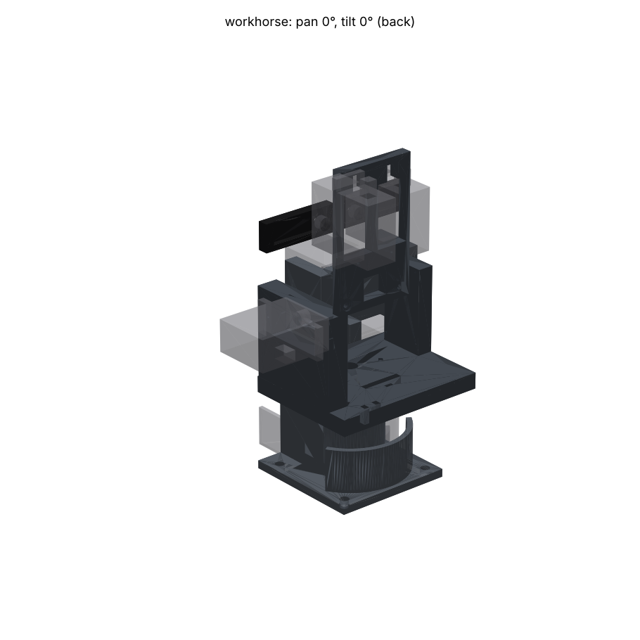

# The Workhorse: a U-bracket pan-tilt for two MG90D servos

A conventional two-axis pan-tilt sized for the TowerPro MG90D. The tilt cradle
is carried on **both** sides: the servo spline on +Y, and an M3 screw in a brass
sleeve running in a nylon plain bearing on -Y. It has three structural parts,
all MJF PA12-HP, and needs only a screwdriver to assemble. It holds head 1 by its
two existing M2 holes, so it replaces the kit without changes to the board.
An optional bolt-on bracket carries two SG90s as **Teuvo's eyebrows**.

 
 

Gates: `output/check.json` shows **zero clashes** over pan -90..90 and tilt
-45..45, with the eyebrows fitted. Four excuses, each a deliberate interface:
the pan horn on the pan servo's spline, and the tilt horn on the tilt servo's
spline.

## Concept

```
            brows (SG90 x2, optional)
          [==]  [==]
           |bracket|
     +-----+-------+-----+       tilt axis: world Y at z 65.5
  -Y | pin |  head |horn | +Y    (4 mm behind the board face,
cheek|  )==| cradle|==(  |cheek   12 mm above its bottom edge)
     |     +-------+     |[MG90D tilt, outboard]
     +=========yoke======+       yoke rides on the pan horn
              | base |           MG90D pan, upright in the base
          ====+======+====       4 x M3 to the chassis plate
```

- **base**: the pan servo stands upright in a pocket with its tabs on the rim,
  held by its own two screws. It is turned **shaft-rearward**: the case and its
  lead point forward, so the base's rear end can be a **drum** of radius 12.4 mm
  round the pan axis. The pocket is **open on the -Y side**, so the servo
  slides in sideways and the lead's root never has to pass a wall. The lead
  leaves through a slot in the front wall and the floor. A 2 mm **ribbon fence**
  stands round the rear 112° at r 20-22 mm (19 mm tall, with short straight
  tails). The flange takes four M3 screws.
- **yoke**: a U. Its 6 mm plate has a pocket in the underside that captures the
  stock **double horn** (both arms along Y, so torque goes through the pocket
  walls, not the screws). There is a Ø5.6 hole on the axis for the horn
  screw. The +Y cheek (8.1 mm) holds the tilt servo in a closed window, with the
  body outboard and the tabs on the outer face. The -Y cheek (6 mm) is a Ø4.1
  plain bearing.
- **cradle**: a back plate behind the board, which starts above the J2 plug,
  and two side arms. The +Y arm has a pocket for the stock **single horn**,
  pointing rearward. Its two arm screws are driven **from inside the cradle**
  (heads in 1 mm counterbores on the arm's inner face, tips flush with the
  horn), so nothing stands in the 1 mm gap to the cheek. The -Y arm has a
  0.5 mm boss (the sleeve's seat), an M3 clearance hole, and a captive M3 nut
  in a hex pocket on its inner face. The back plate has a **2.5 mm relief
  pocket** under the XIAO's two socket rows, so the board bears on the plate
  only outside the rows and along the top band by its M2 screws, never on the
  14 pin tails and their solder fillets.
- The tilt axis runs through the head's mass (x 4, z 12 in head coordinates),
  so the servo carries almost no gravity torque, and the camera lens sits only
  ~24 mm from the axis, which keeps parallax small for ADR-025's aiming.
- **Eyebrows (optional)**: `brow_bracket` is a flat plate that screws to the
  back of the cradle with two M2 x 6. Two SG90s pass through its windows with
  their shafts pointing forward, above the board's top edge. Each `brow` is a
  black resin bar that slips over an SG90 single horn: a 10 x 29.5 mm brow
  that the servo rotates in the face plane, so it can scowl, lift or tilt. Set
  `EYEBROWS = False` in `design.py` to drop them. The cradle's two blind M2
  pilots for the bracket are always printed, so the brows can be added later.
  PCA9685 channels 14 and 15.

Envelope: the tilt axis is 65.5 mm above the chassis plate and the head top is
about 83 mm. The brow bracket top is about 118 mm. The assembly is about 85 mm
wide (-Y pivot screw head to the tilt servo's outer end) and swings in a
~54 mm radius. The base's footprint is 46.5 x 45 mm.

### Ribbon path (designed, and modelled in the clash sweep)

```
  top view, pan 0                     the ribbon, in order:
                 +Y                   1  J2 plug -> free loop -> yoke-plate slot
        fence  .--------> to J1       2  vertical drop, flat face to the axis,
       (r20-22)|  run along +Y side      r 16.4 mm behind the axis (pans WITH the yoke)
      .--.     |  ====base==== +X     3  45 deg fold just above the flange
     /drum\ 2  |                      4  edgewise run (width vertical) wrapped
  --|  +  |----+                         round the drum toward +Y
     \    /    (pan servo body         5  tangent off the drum at +Y, forward along
      '--'      and lead forward)        the base's flat +Y side, then to J1
```

- **Near the axis, never across the base.** Turning the pan servo
  shaft-rearward put the base's rear end inside r 12.4 mm, so the drop sits
  16.4 mm behind the axis (it was 27.5) and the slot never passes over the base
  in the whole ±90° sweep. Its sideways travel at ±60° is 16 mm, not 27.
- **Wrap, do not drag.** Below the drop the ribbon runs edgewise round the
  drum like a belt. Panning changes only how much of it lies on the drum: from
  0 mm (pan -90) through 7 mm (pan -60) and 21 mm (pan 0) to 34 mm (pan +60)
  and 41 mm (pan +90). The extra length slides in and out along the base's
  +Y side. Nothing twists, and there is no corner to chafe on: the drum is
  round and the +Y side carries on tangent from it.
- **Contained.** The flange is the floor, the fence the outer wall round the
  rear, the drum the inner wall. The fence leaves the -Y side open, because the
  pan servo slides in from there.
- **Modelled.** `ribbon_drop` (2 mm thick, the fold's two layers, 15 mm wide,
  panning with the yoke) and `ribbon_wrap` (the wrapped band and the forward
  run, static) are bodies in `assembly()`. The sweep checks both against every
  rigid part: zero clashes, no excuses. The free loop above the plate is not
  modelled: it lives inside J2's keep-out and the space the keep-out sweeps.
- **Length.** About 28 mm of free loop for tilt, 6 mm through the plate, 31 mm
  of drop, up to 41 mm on the drum, 23 mm along the base, then the run to J1
  plus a 30 mm slack loop on the chassis plate for the wrap's 27 mm of travel over ±60° (41 mm over ±90°).
  That is about 160 mm plus the distance from the base's front to J1. **Order a
  20-25 cm 14-way 1.0 mm ribbon**: Lauri's 10-15 cm one is too short.

## Printed parts

The parts are exported in their **world pose** (pan 0, tilt 0). MJF is a powder
bed process: there are no supports and JLC3DP chooses the orientation, so the
pose in the file does not matter. Prices use JLC3DP's MJF-PA12 rate of
**$0.275/g** (JLC3DP price cut, 2025-08-13) and ~1.0 g/cm³. They are estimates:
quote the STLs before ordering, and expect a per-part minimum.

| Part | Qty | Process / material | Colour | Volume | Thinnest | Est. price | Why |
|---|---|---|---|---|---|---|---|
| base | 1 | MJF PA12-HP | grey (or dyed black) | 14.2 cm³ | 1.1 mm | ~$3.9 | Takes the servo's self-tapping screws without cracking, and its isotropic strength suits an upright cup |
| yoke | 1 | MJF PA12-HP | grey (or dyed black) | 26.7 cm³ | 1.1 mm | ~$7.4 | Nylon is a self-lubricating bushing for the brass sleeve. Stiff 6-8 mm cheeks. The closed servo window and cheeks need no supports |
| cradle | 1 | MJF PA12-HP | grey (or dyed black) | 9.0 cm³ | 1.2 mm | ~$2.5 | Holds the M2 board screws, the horn screws and a captive nut. Tough enough to survive a knock to the head |
| brow_bracket | 1 (optional) | MJF PA12-HP | grey | 3.3 cm³ | 1.2 mm | ~$0.9 | Flat plate that takes the SG90 screws |
| brow | 2 (optional) | SLA, JLC black resin | black | 0.9 cm³ each | 1.4 mm | ~$1 each | Cosmetic. Smooth, crisp, and black like 1950s film-star eyebrows. No load on them |

About $14 for the three structural parts, plus about $3 for the brows.
The base grew by 4.9 cm³ in revision 2 (the drum, the flat +Y side and the
ribbon fence).

Why not resin for the mechanism? It is brittle under self-tapping screws and
impact, and it wears in a pivot. The repo's enclosure work found it "takes a
thread, not a heat-set insert", which is fine for a case and marginal for a
servo mount. Why not FDM? Its layer lines run across the cheeks in any upright
orientation.

**Wall thickness.** The ray gate's thinnest readings are **1.1 mm**, on the
base and the yoke: the ligament between each servo-tab pilot (Ø1.5) and the
servo pocket or window. This is below the repo's 2.0 mm resin-case convention,
on purpose:

- JLC3DP states a 1.0 mm minimum wall for MJF PA12-HP and ±0.3 mm tolerance up
  to 100 mm.
- The ligament is local, beside a hole. It is not a free-standing wall.
- Its position follows the tab-hole estimate. It moves outward by however much
  the real tab hole sits farther from the case.

Every other wall is at least 1.2 mm: the cradle's blind pilots stop 1.2 mm
short of the board, and the ligament between the socket relief and each
board-screw pilot is about 1.1 mm at its corner.

## Hardware BOM

| Item | Qty | Where |
|---|---|---|
| TowerPro MG90D | 2 | pan (in base), tilt (+Y cheek) |
| Stock double horn (bag) | 1 | pan, captured in the yoke's underside pocket |
| Stock single horn (bag) | 1 | tilt, captured in the cradle's +Y arm pocket |
| Horn centre screw (bag, M2/PB2 x 4) | 2 | one per servo spline |
| Servo tab screws (bag, 2 mm self-tapping, ~8 mm) | 4 | 2 into the base rim, 2 into the +Y cheek's outer face |
| PB2 x 4-5 mm self-tapping pan head (DIN 7981 ST2.2) | 2 | through the double horn's holes (drilled to 2.2) up into the yoke's Ø1.5 pilots |
| PB2 x 4 mm self-tapping pan head (DIN 7981 ST2.2, head Ø4.0 x 1.6) | 2 | **from inside the cradle**, through the +Y arm's Ø2.2 holes, tapping into the single horn's arm holes (drilled to Ø1.6). Not longer than 4 mm: the tip ends flush with the horn |
| M3 x 14 socket head, ISO 4762 | 1 | tilt pivot |
| Brass tube 4.0 OD x 0.45 wall (3.1 ID), cut to **7.0 mm** | 1 | pivot sleeve: turns in the -Y cheek's Ø4.1 bore |
| M3 hex nut, ISO 4032 | 1 | captive in the cradle's -Y arm |
| M2 x 6 button head, ISO 7380 | 2 | head 1 to the cradle (self-tap into Ø1.7 pilots) |
| M3 x 10 + M3 nut (or M3 x 8 into a tapped plate) | 4 | base to the chassis plate |
| Small cable ties (2.5 mm) | 3 | ribbon to the bar behind the yoke's ribbon slot, tilt lead to the cheek's rear foot |
| Kapton or cloth tape, 10 mm | 5 cm | holds the ribbon's 45° fold at the bottom of the drop |
| *Eyebrows:* SG90 | 2 | brow bracket, PCA9685 ch 14 and 15 |
| *Eyebrows:* SG90 single horn (bag) | 2 | brows press over them |
| *Eyebrows:* PB2 or M2 x 6 horn screw | 2 | through the brow's Ø2.4 hole into the spline: the bag's ~4 mm screw is too short with 2 mm of brow on top |
| *Eyebrows:* M2 x 6 socket or button head | 2 | brow bracket to the back of the cradle (1 mm counterbore; tip ends 2 mm short of the board). **Not M2 x 8**, which reaches the PCB |
| *Eyebrows:* 2 mm self-tapping (bag) | 2 | lower SG90 tabs |

If you cannot get a shoulder-type sleeve, an ISO 7379-style 4 mm shoulder bolt
with an M3 thread works in place of the tube and screw. Its thread must be long
enough to reach the nut, about 7 mm.

## Assembly (screwdriver: PH0 x 60 mm or longer, 3 mm shaft; 2.5 mm hex)

1. **Ream** the yoke's -Y bore with a 4.1 mm drill (MJF ±0.3 mm). Check the
   brass sleeve turns freely in it. Clear the M2 and M3 holes if powder remains.
2. **Centre both MG90Ds** electrically (`servo pan 0`, `servo tilt 0`) before
   fitting any horn.
3. **Base**: slide the pan servo in from the open -Y side, shaft toward the
   rear (the drum), lead into the front slot, tabs gliding over the rim. Fit both tab screws. Screw the base to
   the chassis (see "Mounting").
4. **Yoke**: drill the double horn's holes at r 14 to 2.2 mm. Drive two PB2
   screws up through them into the yoke's underside pilots (horn arms along Y). Press the yoke onto
   the pan spline facing forward (+X). Drive the horn centre screw down through
   the Ø5.6 hole on the axis.
5. **Cradle** (on the bench, before the yoke): drill the single horn's arm
   holes at r 11 and 17.5 to 1.6 mm. Lay the horn in the +Y arm's pocket, arm
   pointing rearward. Drive the two PB2 x 4 **from inside the cradle**: the
   PH0 comes in from the -Y side, behind the -Y arm, along Y at head x -7 and
   -13.5 (the shaft clears the back plate by 0.5 mm). Push the M3 nut into the
   -Y arm's hex pocket. Put the tilt horn's centre screw loose in the horn hub
   now, from inside: its head will not pass the Ø3.4 M3 hole later.
6. Drop the cradle between the cheeks. Push the **tilt servo** into the +Y
   cheek window from outside, shaft first, so the spline enters the horn hub
   with the cradle level. Fit the two tab screws into the cheek's outer face.
7. **Tilt horn screw**: pass the PH0 through the empty -Y bore, the -Y arm's
   M3 hole and the empty cradle (no head yet) to the horn centre screw, and
   drive it.
8. **Pivot**: put the brass sleeve in the bore. Pass the M3 x 14 through it
   into the nut, and tighten until the sleeve is clamped to the boss. Then the
   sleeve turns with the cradle and the cradle swings freely with 0.5 mm of
   end play.
9. **Ribbon and head**: plug the ribbon into J2, fold it down, and pass it
   through the yoke-plate slot (15 mm wide) flat face toward the axis. Tie it
   to the bar behind the slot with ~28 mm of free loop above the plate. Below
   the plate, at the flange, make a 45° fold so the ribbon turns toward +Y
   (round the rear of the base) with its width standing vertical, and tape the
   fold. Lay it round the drum inside the fence, then forward along the base's
   +Y side. Fit head 1 to the cradle with two M2 x 6 button heads from the
   front. Its socket tails sit over the relief pocket.
10. *Eyebrows*: fit the SG90s through the bracket windows from the front, lead
    first through the notch. Screw the lower tab, and put a dab of hot glue on
    the upper tab. Screw the bracket to the back of the cradle with 2 x M2 x 6.
    Centre the SG90s, fit their horns pointing outward and press the brows on.
    The PB2/M2 x 6 horn screw goes through the Ø2.4 hole in the brow.

**Cables**

- **Ribbon**: see "Ribbon path" above. Tilt flexes only the free loop above
  the plate; pan only changes how much ribbon lies on the drum.
- **Tilt servo lead**: it exits the outboard end. Run it rearward along the
  cheek's outer face, round the cheek's rear end, and tie it in the two slots
  at the cheek's rear foot. From there it crosses the plate to the ribbon slot
  and follows the ribbon down, round the drum and out along the +Y side (tie it
  to the ribbon every 30 mm).
- **Pan lead**: static. It leaves through the base's front slot, toward the
  main board.
- **SG90 leads**: they run down behind the bracket, then follow the ribbon in
  the same way.

**Mounting**: 4 x M3 on a **35 x 37 mm** rectangle (35 mm along X, 37 across),
at x -19 and +16, y ±18.5. Its centre is 1.5 mm behind the pan axis. Drill
3.2-3.4 mm in the acrylic plate where the head should stand, and add a 6 mm
hole under the front slot (x +20, y 0) if the pan lead should go below the
plate. Leave about 25 mm clear of the base on the +Y side for the ribbon's run
and slack, and put J1 on that side if you can.

## Measure before ordering (calipers on the parts in hand)

All of these are parameters at the top of `design.py`. Change them and rerun
`python design.py` and the two gates.

| Parameter | Now | Source | Why it matters |
|---|---|---|---|
| `tab_underside` (F) | 19.8 | TowerPro page | Base pocket depth: the servo's tabs must sit on the rim, and the case must not bottom out |
| `tab_span` (E) | 31.5 | TowerPro page | Tab pilot spacing on the base and the cheek |
| `tab_hole_inset` | 2.3 | estimate | Tab pilot position, which sets the 1.1 mm ligament |
| `shaft_from_end` | 6.0 | estimate | Shaft position in the pocket and window. Wrong by 1 mm, the spline misses the axis |
| `tab_thickness` | 2.5 | estimate | Where the tilt servo's case top sits relative to the cradle arm |
| Case B x D | 22.6 x 12 | TowerPro (headline 22.8 x 12.2) | Covered by `FIT` 0.3 per side. If yours measures 22.8 x 12.2, the fit is 0.2 |
| Horn hub height, arm thickness | 4.0 / 1.6 | fixture estimate | Pocket depths, and the 1 mm arm-to-cheek gap |
| Horn arm hole radii | 14 (double), 11 and 17.5 (single) | guess (`PAN_HORN_SCREW_R`, `HORN_SCREW_R`) | The double horn's set the yoke pilots; the single horn's set the cradle's Ø2.2 clearance holes and counterbores. Keep the single-horn pair at least 6 mm apart (the counterbores) and the inner one at r 11 or more (screwdriver clearance past the back plate) |
| XIAO socket pin-tail rows on head 1's back | y 0.5 ± 7.62, z 9.2-24.4, tails Ø ≤ 2.6 with fillets | `SOCKET_ROW_Y/Z`, `TAIL_R`, from the fixture's XIAO position | The relief pocket under them. Check the tails stand less than 2.5 mm proud (`RELIEF_D`) |
| Ribbon width | 14 mm | 14-way 1.0 mm ribbon | Slot length and the drop's keep-out |
| SG90 shaft offset, tab span | fixture | estimate | Brow bracket windows |

## Risks

- **Ligament at the tab pilots (1.1 mm)**. A 2 mm self-tapping screw could split
  it toward the pocket. Drive the screws gently, or open the pilots to 1.6 mm.
  If the tab holes measure farther out than 2.3 mm from the tab ends, this
  improves.
- **MJF tolerance ±0.3 mm** on the Ø4.1 bore, the horn pockets and the hex
  pocket. Ream the bore. A tight horn pocket can be scraped, and a loose one is
  shimmed by the horn screws.
- **Height**. The J2 plug and ribbon keep-out (16 mm behind the board) swing
  23 mm below the tilt axis at ±45°, so the plate sits 24.5 mm under the axis.
  Firmware limits tilt to ±30°: with that, `HEAD_DROP` could drop to about 20 mm.
- **The ribbon's wrap is unproven on the bench.** It is modelled as rigid
  keep-outs; the real ribbon must slide 27 mm along the drum and the +Y side
  over ±60° of pan. Pushed (panning toward -), a loose ribbon may bow out
  against the fence rather than slide; the fence is there to stop it, but
  check it on the bench with `servo exercise` and add a light rubber band or
  tape tab to keep the run against the drum if it bows. The tape on the fold
  is a wear point: replace it if it lifts.
- **The pan servo is turned round.** Shaft rearward, lead forward. The pan
  horn and yoke are unaffected, but `servo pan` limits keep their sign.
- **The upper SG90 tab is glued, not screwed**. The lead's root has to pass a
  notch exactly where the upper tab's screw would go.
- **The pivot screw can loosen** if the sleeve slips in the bore. Use a
  nylon-insert nut if it does. There is room: the pocket is 3 mm deep against
  the nut's 2.4.
- The **eyebrows** add about 22 g, mostly high on the tilt stage. That is
  ~60 g·cm against the MG90D's ~2100 g·cm, so it is fine. They do make Teuvo
  about 37 mm taller.

## Fixture notes (common/ not edited)

- `servo()` models the lead as a rigid 6 mm "boot" beyond the end face. That is
  why the base is open on one side and the brow windows have notches. A real
  lead bends, but its root does protrude, so the design treats it as real.
- `head()`'s J2 keep-out (16 x 18 x 8 mm) is the dominant constraint on height.
  If the IDC plug is replaced by a low-profile right-angle plug, measure it and
  the tilt axis can come down.
- The carrier README says head 1's M2 holes go "through the cradle into
  heat-set inserts". This cradle uses Ø1.7 self-tapping pilots in PA12 instead.
  M2 x 6 ISO 7380, as the courtyard requires.
- `head()` does not model the through-hole pin tails of the XIAO's sockets on
  the board's back face, and the gate only tests pairs from different groups,
  so neither the tails nor a servo in its own pocket is ever checked. This
  entry handles the tails with the relief pocket. Screw heads that the gate
  can see are now modelled (`tilt_horn_screws`, `pan_horn_screws`), and I
  checked every same-group pair at four poses by hand: only the intended
  interfaces overlap (splines in hubs, horns in pockets, the board on the
  cradle).

## Revision 2 (after INSPECTION.md)

- Tilt horn arm screws driven from inside the cradle (counterbored PB2 x 4),
  modelled and swept.
- Brow bracket screws are M2 x 6, moved to y ±12, z 18 (head coordinates),
  clear of the new relief pocket. The bracket now starts at z 14.5, above the
  horn screw heads.
- 2.5 mm relief pocket in the cradle's back plate under the XIAO socket tails.
- Ribbon: pan servo turned shaft-rearward, round drum at the base's rear,
  slot moved to 16.4 mm behind the axis, ribbon fence, and the ribbon modelled
  in the sweep. See "Ribbon path".

## Regenerate

```sh
cd packages/robocar/unified/hardware/pan-tilt/entries/workhorse
/tmp/claude-0/b123/.venv/bin/python design.py           # output/*.step, *.stl
cd ../.. && /tmp/claude-0/b123/.venv/bin/python -m common.check entries/workhorse
/tmp/claude-0/b123/.venv/bin/python -m common.render entries/workhorse
```
