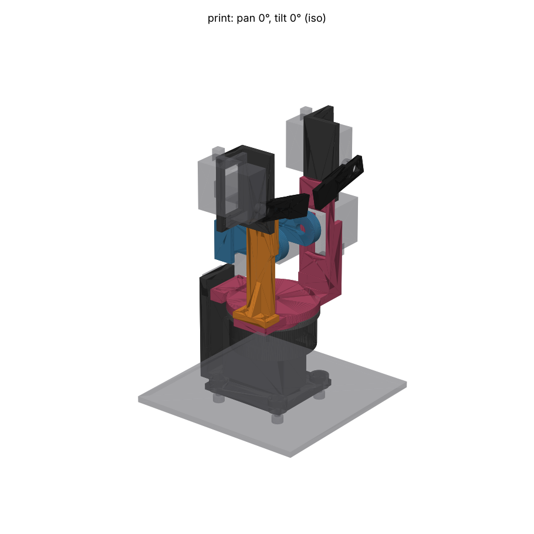
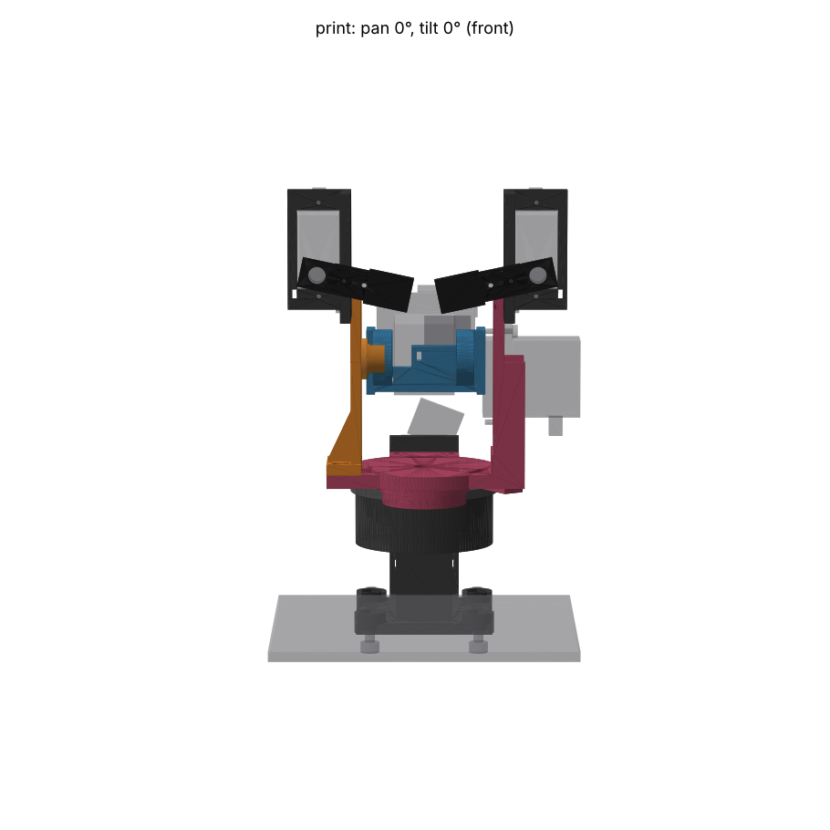
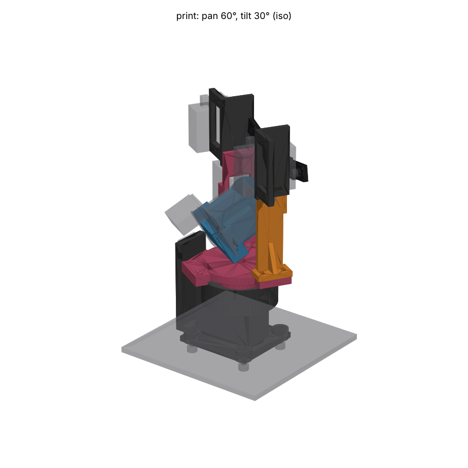
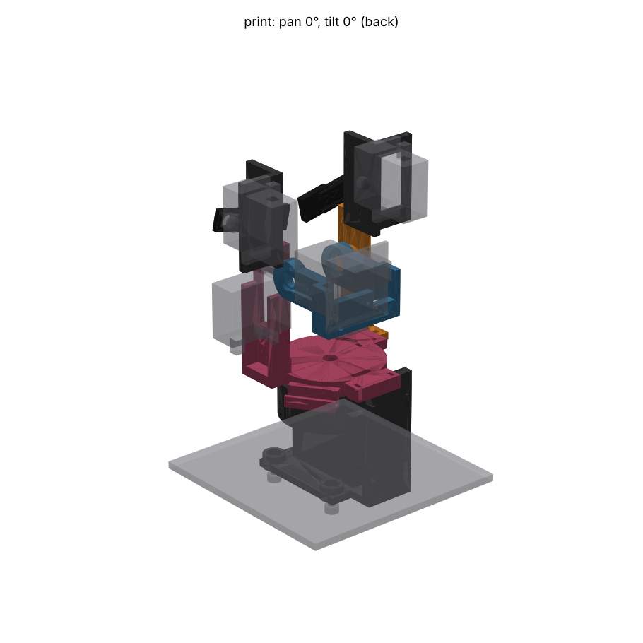

# Pan-tilt for head 1: the order sheet

This is the pan-tilt to order for robocar-unified head 1 (29.5 mm board with
the XIAO ESP32-S3 Sense) on two TowerPro MG90D servos, plus optional SG90
eyebrows for Teuvo. It is the tournament winner, `gimbal`
(`../entries/gimbal/`, kept unchanged as the record), with the judges'
criticisms fixed and three ideas taken from the runners-up. `../README.md`
tells the tournament story. This file is what you need at the JLC3DP upload
page and at the bench.






**Gates** (`output/check.json`): **zero clashes** over pan ±90 × tilt ±45
between rigid parts, with the eyebrows fitted. What the gate proves about the
ribbon is narrower: the tilt span is modelled as a taut 14 × 1.2 mm strip, but
the pan span only as its taut **Ø1.5 centre line**. The 14 mm-wide pan ribbon
twisting over the cap, gutter and flange at ±90°, and the slack loops
(40–50 mm of spare ribbon at the short-chord poses, near the tilt-servo lead
and the brow pods), are **not** modelled. Do the hand sweep with a real 55 mm
ribbon before closing up (Assembly step 11). Two excuses, both deliberate:

- `keeper / pan_horn`: the keeper's slot ribs crush 0.1 mm into the horn's arm
  stubs. That interference is what removes the backlash.
- `ribbon_tilt_taut / ribbon_pan_taut`: one ribbon, either side of its shelf
  tie, touching itself at pan +90.

The gate checks the outrigger **as fitted**, with its pin sanded to the 8.0 mm
bore. The STL is printed Ø8.25, so it would read as a 0.125 mm interference
with the MR128ZZ, which is the sanding allowance. The eyebrow pods' mount
screws have a clash group of their own, so they are checked against the
SG90, its horn and the pod.

Every part is a valid solid. The thinnest wall is 1.0 mm (see "Walls").

## Review fixes in this revision

| Finding | Fix |
|---|---|
| The cradle's ribbon strap crossed the board's back face, over the +Y insert hole, and the insert-to-slot web was 1.15 mm | The strap now lies in a 1.2 mm groove in a **tie block** that rises behind the board above the insert holes (lens z −4 to −1, where nothing sits between the board and the ribbon). The board seats flush over the recessed strap. Slots and groove are ≥ 4 mm from both insert holes. The lens height is unchanged |
| Ø7.7 pin "sanded to a slide fit" in an 8.0 bore | Pin printed **Ø8.25** and sanded or reamed **down** to a slide fit. It stays above 8.0 even at MJF −0.3 |
| 0.4 mm shoulder gap smaller than the axial tolerance stack, with no adjustment | Gap printed at **1.0 mm**. The outrigger's foot holes are **slotted ±1 mm in Y**, and the gap is set to about 0.3 mm with a feeler on assembly. Tab thickness and the single horn's arm height were added to the measure list |
| Steps 5–6 impossible: the cap screw tips reach the tower top 4.2 mm before the bearing reaches its seat | Steps 4–6 rewritten. The screws now draw the bearing into its seat |
| Brow-pod screw at x −4.5 collided with the SG90's tab and the pod, and the gate missed it | Mount screws moved to **x 0 and +6**. They are now their own clash group, so the gate checks them against the SG90, its horn and the pod. Step 12 bolts the pod on first |
| The front M3 chassis screws could not be reached once the yoke was on | All four M3 holes now have **captive-nut pockets** in bosses. The M3 × 10 goes in **from under the acrylic**, so the tower can be bolted down at any time |
| The coupon (keeper + cap) did not contain the critical 1.0 mm web | New **`coupon.stl`**: a slice of the tower's servo ledge (tab hole beside the case window), plus the cradle plate round an insert hole and a tie slot |
| "Tapped, so nothing pushes the web sideways" | Claim removed. Tighten those screws by feel, then wick in thin CA |
| Measure list missing estimates | Rows added: tab thickness, single horn arm height and hub, J2 plug keep-out, MR128ZZ shield ID |
| Loctite 641 into MJF PA12 | The pocket is now Ø12.4 with **three crush ribs** (0.15 mm per side), like the pan seat. If a bearing is loose anyway, use 638 with activator SF 7649, or a thin 2-part epoxy |
| Brow-pod lead slot only 0.9 mm wide | Now 1.5 × 3 |
| Step 4 cap orientation contradictory | Rewritten for a yoke turned flange-down on the bench |
| README / code mismatches and stale comments | Fixed: tilt chord, ribbon lengths, flip note, brow sides, SG90 shaft end |
| "CoM on the pan axis" | Holds in X only. The CoM sits **8.0 mm toward +Y** (the tilt-servo side), and the 6705ZZ carries that moment |

`python design.py` regenerates every STEP and STL in this folder in about
20 s. The STLs are what you upload.

## What changed from the tournament entry

| Judges' or inspector's criticism | Fix in this revision |
|---|---|
| The 6705ZZ's outer race is held only by 0.15 mm crush ribs, so lifting the robot by the head pulls it out | New **bearing cap**: a ring screwed to the tower top with 3 × M2 that clamps the outer race onto the seat floor. The ribs now only centre the race. The tower grows to Ø40.8 to carry the cap's tapped holes, and the lens rises 3.8 mm, to 80.3 mm |
| Horn slot backlash of about ±1°, to be filed or shimmed with Kapton | 8 vertical **crush ribs** in the keeper's cross slot, 0.1 mm interference on the arm stubs. The horn still slides ±1 mm axially, so the bearing alone locates the yoke |
| Pan zero lands on an 18° spline step, so it can be up to ±9° off, and the firmware has no trim | A second, optional keeper, **`keeper_9deg`**, with its slot turned 9°. Fitted either way up it gives ±9°, so one of the two keepers always puts pan zero within ±4.5° |
| The 3 mm uprights take the outboard servo's load in their weak direction | Two 2.4 × 6 mm **ribs** beside the tilt servo's case, carried down to an extended flange arm. One rib, foot to plate, on the outrigger |
| Re-tightening the tilt horn screw means removing the outrigger and the head | It no longer needs re-tightening. A **shoulder** on the outrigger pin's root, set on assembly to about 0.3 mm from the MR128ZZ's inner race (slotted feet, feeler gauge), stops the cradle walking, so the horn cannot leave its spline even with the centre screw loose. The screw's only remaining job is retention |
| Servicing the pan servo means unbolting the tower | A path now exists with the tower in place (see "Servicing"): remove the head, take the horn screw out down the pan axis through the yoke's Ø6 access hole (probed clear), then drop the servo out through an optional window in the chassis plate |
| Free ribbon spans sized by chord, not swept | The ribbon is now **tied to the cradle's back**, so the free tilt span starts near the tilt axis: its chord is 14.1–44.1 mm (was 18–70). The **post rises above the shelf**, so the pan span passes over the cap and gutter instead of wrapping round them. Both free spans are in the clash gate taut at every pose: the tilt span as a 14 mm strip, the pan span only as its centre line. The taut tilt chord in the entry's routing went through the cradle and the board when the head looked down. The gate now proves it cannot |
| No eyebrows, little Teuvo character | Optional **SG90 eyebrows** on the fixed pan-stage forehead (see "Eyebrows") |
| Inspector minors: firmware flip, placement on the robot, MJF hole practice | See "Firmware notes" and "Mounting on the robot". All M2 holes are tapped, as before |

The second review's findings, and what changed for each, are in "Review fixes
in this revision" above.

## Order sheet (JLC3DP, one order)

All parts are **MJF, PA12-HP**, from the STL in this folder. MJF needs no
supports and every part is an open shell, so powder clears. Estimated price:
$0.275/g × volume × 1.01 g/cm³, with a $1.00 minimum per part. That rate is
JLC3DP's published MJF PA12 rate (August 2025, as quoted by the `teuvo-face`
entry). **Re-quote at upload.** Dyeing and shipping are extra.

Put every part on **one order, one line per part, with the material per
line**. Graft from `teuvo-face`: the cosmetic brows have a drop-in upgrade
line with identical geometry, so styling never holds up the structural
parts.

### Required

| File | Process / material | Colour | Qty | Volume | Est. price | Orientation note for the JLC description |
|---|---|---|---|---|---|---|
| `tower.stl` | MJF PA12-HP | dyed black | 1 | 25.4 cm³ | ~$7.1 | "Flange down preferred. Do not fill holes; small holes are tapped after printing." |
| `yoke.stl` | MJF PA12-HP | dyed black | 1 | 14.6 cm³ | ~$4.1 | "Flange down preferred. Tapped holes, keep as modelled." |
| `bearing_cap.stl` | MJF PA12-HP | dyed black | 1 | 1.9 cm³ | $1.0 (minimum) | "Flat. Counterbores up." |
| `keeper.stl` | MJF PA12-HP | dyed black | 1 | 1.2 cm³ | $1.0 (minimum) | "Flat. Slot ribs are functional, do not smooth." |
| `outrigger.stl` | MJF PA12-HP | dyed black | 1 | 3.4 cm³ | $1.0 (minimum) | "Foot down. Pin is oversize on purpose; it is sanded to fit." |
| `cradle.stl` | MJF PA12-HP | dyed black (or natural grey as Teuvo's face plate) | 1 | 5.4 cm³ | ~$1.5 | "Insert plate down. Pocket ribs are functional, do not smooth." |

Required total: about **$16**, before dyeing and shipping.

### Optional (same order, or later)

| File | Process / material | Colour | Qty | Volume | Est. price | Note |
|---|---|---|---|---|---|---|
| `coupon.stl` | MJF PA12-HP | dyed black | 1 | 1.2 cm³ | $1.0 | Bench coupon of the two thinnest webs (see "Print the coupon first"). Order it first, with the keeper and the cap |
| `keeper_9deg.stl` | MJF PA12-HP | dyed black | 1 | 1.2 cm³ | $1.0 | The pan-zero vernier. Order it with the set: it costs $1 and saves a second order |
| `brow_pod_l.stl`, `brow_pod_r.stl` | MJF PA12-HP | dyed black | 1 each | 2.8 cm³ each | $1.0 each | Each holds one SG90. `_l` bolts to the yoke's upright (+Y, Teuvo's left) and `_r` to the outrigger |
| `brow_l.stl`, `brow_r.stl` | MJF PA12-HP | dyed black | 1 each | 0.85 / 0.81 cm³ | $1.0 each | Default line. **Upgrade with identical geometry:** SLM AlSi10Mg, polished (about 2.3 g each, fine on an SG90), roughly $5–10 each, unverified |

Optional total: about $6 (all MJF).

**Print pose.** Every STL is in its world pose at pan 0, tilt 0, in mm
(+X forward, +Z up; the chassis plate top is z 0), except `coupon.stl`, which
has a pose of its own. JLC re-orients MJF parts
anyway. The notes above give the face to put down only where a finish
matters.

**Why one material.** PA12 takes M2 heat-set inserts (resin does not, an
enclosure-cad trap) and taps cleanly. It is tough at 1.0–1.5 mm, and it takes
crush-rib press fits without cracking. Snapfit's graft (PA11 for parts that
flex) was considered: here only crush ribs strain, and they crush once, so
the extra order line buys nothing.

### Walls

Gate readings (thinnest, mm): tower 1.0, yoke 1.0 (see below), bearing cap 1.1,
keeper 1.8, outrigger 2.0, cradle 1.3, brow pods 1.2, brows 1.2, coupon 1.0. JLC3DP's MJF
guidance is about 1.0 mm minimum, rising with part size
([design guideline](https://jlc3dp.com/help/article/212-3D-Printing-Design-Guideline),
[MJF](https://3d.jlcpcb.com/3d-printing/multi-jet-fusion)). The two 1.0 mm
readings are the same feature as in the entry: the web between an MG90D tab
hole and the case window, in the tower (pan) and the yoke (tilt). The servo's
own drawing sets it: the hole centre is 2.15 mm from the case end, so the web
is 1.0 mm to the Ø1.6 pilot and about **0.8 mm** once the M2 tap cuts to its
2.0 mm major diameter. Tapping avoids a self-tapper's forming load, but a
loaded 60° thread still pushes outward at about tan 30° ≈ 0.58 of the screw's
axial load. So **tighten these four screws by feel only** (snug, then stop),
and wick a drop of thin CA into each hole after tapping to harden the thread.
`coupon.stl` has this exact web: break one on the bench before the real
parts arrive.

`check.json` reports the yoke at **0.01 mm** at (−5.85, 21.0, 47.1). That is
a ray-cast artefact, not a wall. The point lies on the flange's top rim, at
r 21.8 from the pan axis, and its inward ray grazes the rim's tessellated
cylinder. The B-rep has only the flange's cylinder and its top plane there.
With seeds 2 and 3 the same gate reads 1.00 mm, at the tilt-tab web. The
cradle's former 1.15 mm insert-to-slot web is gone: the slots now sit 4 mm
from the inserts, and the cradle's thinnest reading is 1.3 mm: the floor
of the −Y cheek under the MR128ZZ pocket, now Ø12.4 to carry its crush ribs. The repo's 2.0 mm `MIN_WALL` is a resin-case convention and does
not apply to these features.

## Hardware BOM

| Qty | Item | Where |
|---|---|---|
| 2 | TowerPro MG90D | pan (ch 6), tilt (ch 7) |
| 1 | **6705ZZ** ball bearing, 25 × 32 × 4 | pan: inner race clamped by the keeper, outer race clamped by the cap |
| 1 | **MR128ZZ** ball bearing, 8 × 12 × 3.5 | tilt idler, pressed onto the three crush ribs in the cradle's −Y pocket |
| 1 | MG90D cross horn, arms cut to Ø20, + its centre screw | pan; no arm screws |
| 1 | MG90D single-arm horn + its centre screw + 2 arm screws (≤ 4.5 mm) | tilt |
| 4 | M2 × 8 machine screw (ISO 7380 or DIN 912) | MG90D tabs (pan into the tower ledge, tilt into the upright) |
| 4 | M2 × 8 ISO 7380 button head | keeper up into the yoke's spigot |
| 3 | **M2 × 6 ISO 7380** button head | bearing cap into the tower (new) |
| 2 | M2 × 6 machine screw (+ M2 washer) | outrigger foot into the yoke, through the slotted foot holes |
| 2 | M2 × 3 heat-set insert (OD ~3.5, hole Ø3.2) | cradle plate |
| 2 | M2 × 5 ISO 7380 button head | head board to the inserts (as today); must not be longer than 5 |
| 4 | M3 × 10 socket head + **M3 hex nut (ISO 4032, 5.5 AF)** + washer | from **under** the acrylic into the nuts captive in the tower's four bosses |
| 6–8 | 2.5 mm cable ties (about 1.0 mm thick) | cradle back 1, shelf 2, gutter 1, post 2–3 |
| — | Ø1.6 drill + M2 × 0.4 tap | clear and tap the 17 M2 holes in the required parts |
| — | Feeler gauge, 0.3 mm | set the outrigger's shoulder gap |
| — | Thin CA (cyanoacrylate) | wick into the four MG90D tab holes after tapping |
| — | 240 then 400–600 grit paper, or an 8.0 mm H7 reamer | bring the Ø8.25 outrigger pin **down** to a slide fit in the MR128ZZ |
| — | Only if the MR128ZZ is loose on the pocket ribs: Loctite 638 + activator SF 7649, or a thin 2-part epoxy | **Not** on the outrigger pin |
| **Eyebrows (optional)** | | |
| 2 | TowerPro SG90 | brows (ch 14, 15) |
| 2 | SG90 single-arm horn + centre screw + 2 arm screws | one per brow |
| 4 | M2 × 6 machine screw | SG90 tabs into the pods (tapped) |
| 4 | M2 × 6 ISO 7380 button head | pods onto the upright and the outrigger (tapped) |
| 2–3 | 2.5 mm cable ties | brow leads (pod slot, yoke slot) |

## Measure before ordering (calipers)

The parameters are at the top of `design.py`. The servo envelopes are in the
shared fixture `../common/fixtures.py`, and several of its values are
estimates.

| What | Value used | Why it matters |
|---|---|---|
| MG90D case length B / width D | 22.6 / 12.0 (TowerPro also says 22.8 / 12.2) | Windows 23.3 × 12.6 take the larger figure |
| MG90D tab span E | 31.5 | Tower tab cavity is 32.7 |
| MG90D base to tab underside F | 19.8 | Pan ledge and tilt upright position. Up to F + 2.0 still clears the chassis plate |
| MG90D tab hole Ø and its inset from the tab end | 2.0 / 2.3 (estimates) | Hole positions. The inset sets the 1.0 mm web |
| MG90D shaft from the case end | 6.0 (estimate) | Both axes, relative to the case pockets |
| MG90D tab thickness | 2.5 (estimate) | The datum face on the tower ledge (`tab_top`) and on the upright (`TAB_IN_Y`), so the pan height and the tilt servo's Y place, and with it the outrigger's shoulder gap |
| MG90D single horn: arm-top height above the case top; hub OD | 4.5; Ø7 (fixture estimates) | The arm top sits on the cradle's pocket floor (`TILT_SERVO_TOP_Y`), which sets the cradle's Y place and the shoulder gap. The hub sits in the cradle's Ø7.5 hub recess (`_cyl_y(3.75, …)` in `build_cradle`) |
| MG90D spline Ø, tooth count | 4.8, 20T (estimates) | 20T means 18° steps, which the 9° keeper halves |
| Cross horn arm width; arm height above the case top; hub OD | 5.0; 2.9–4.5; Ø7 | Keeper slot 5.6 wide with ribs to 4.8. The ±1 mm float is centred on 2.9–4.5. The keeper's hub clearance is Ø8 (`build_keeper`) |
| Single horn arm length; hole radii | 20; 10 and 16 mm | Cradle pocket; pilot positions |
| 6705ZZ: OD / ID / inner race OD d1 / **outer race inner diameter** | 32 / 25 / 27.6 / ≤ 30.4 | The cap bears on r 15.2–16.0. If the outer race is narrower than 0.8 mm, or the shield stands proud of the race face, raise `CAP_BORE_R` |
| MR128ZZ inner race OD, and the **shield's ID** | ≥ 9.2 race; shield ID > 9.2 | The pin shoulder, `TB_SHOULDER_R` (Ø8.9, ±0.3 as printed), must bear on the inner race only and clear the shield. If the shield ID is under 9.3, lower `TB_SHOULDER_R` |
| J2 header + IDC plug keep-out behind the board | 16 × 18 × 8 mm (`J2_KEEPOUT`, estimate) | The yoke's sweep cut and the lens height are built round it. Measure the plug fitted, with the ribbon's first bend |
| **Head board holes** | M2 (Ø2.2) at 4.0 and 26.5 mm from the left edge, 3.05 below the top | Cradle inserts and driver channels |
| SG90 (brows) B × D × E, F, shaft offset | 23 × 12.2 × 32.3, 15.9, 6 (F and offset are estimates) | Pod window and tab holes |
| SG90 single horn: arm width, hole radii | 5.5; 8 and 14 mm (estimates) | Brow lips and pilots |
| Camera entrance pupil | 2 mm behind the stack front (estimate) | The tilt axis is meant to pass through it. Check by turning the head by hand while watching two aligned objects at 0.3 m and 3 m |
| Head and XIAO masses | 4 + 7 g (estimates) | Pan-axis CoM. Weigh them and re-run `design.py`, which warns if `PAN_AXIS_BEHIND_LENS` should move |

**Print the coupon first.** Before ordering the full set, order
`coupon.stl`, `keeper.stl` and `bearing_cap.stl` (each at the $1 minimum).
`coupon.stl` is cut from the real parts. It holds the 1.0 mm web between an
MG90D tab hole and the case window (the tower ledge; the yoke's tilt-tab
holes are the same geometry), and the cradle plate round an insert hole with
the ribbon tie slot and strap groove. The keeper has the slot ribs, and the
cap its counterbores. Check that:

- the Ø1.6 drill and M2 tap go into the coupon's ledge hole cleanly;
- an MG90D tab screwed down **by feel**, then a quarter turn more, does not
  split the web;
- an M2 insert set with the iron does not bulge the plate;
- a 2.5 mm tie passes both slots and lies below the plate face;
- the keeper ribs grip a cut-down horn arm;
- the cap sits flat on a 6705ZZ.

If the web splits, reduce `FIT_END` to 0.15 on the hole side and re-run the
gates.

## Assembly

1. **Prepare the holes and the pin.** Run a Ø1.6 drill through all **17 M2
   holes**, then tap them M2 × 0.4: tower 5 (2 pan tabs from below, 3 cap holes
   in the top), yoke 10 (2 tilt tabs, 4 keeper holes under the spigot, 2
   outrigger foot holes, 2 brow-pod holes at the upright's top), outrigger 2
   (brow pod). The outrigger's two foot holes are Ø2.2 clearance slots: do not
   tap them. For the eyebrows, also tap each pod's 2 tab holes. Wick a drop of
   thin CA into the **four MG90D tab holes** (tower 2, yoke 2), let it cure, and
   chase the tap through once more. The outrigger pin is printed **Ø8.25**:
   sand it evenly (240, then 400–600 grit, turning it), or ream it, until the
   MR128ZZ slides on without play and without force. Try the bearing often,
   because you cannot add material back. Do not bond it.
2. **Captive nuts, then the pan servo.** Press an M3 nut into each of the four
   hex pockets on top of the tower's bosses. Centre the pan servo electrically
   (1500 µs). Push it up from below until the tabs stop on the ledge, then fit
   2 × M2 × 8 up through the tabs, snug by feel only. The M3 × 10s go in from
   **under the acrylic** into those nuts, so the tower can be bolted down now
   or at any later step. Nothing from above is needed (see "Mounting on the
   robot").
3. **Pan horn, from above.** Cut the cross horn's arms to Ø20 (10 mm from the
   axis), press it onto the spline with the arms on X and Y, and drive its
   centre screw from above through the open seat.
4. **Choose the keeper.** Drop the plain `keeper` alone onto the horn's arm
   stubs. Its four screw holes should sit at 45° to the tower's X axis (the
   tower's front face). If they are off by more than about 4.5°, try
   `keeper_9deg`, either way up, and use whichever lands closest. Lift it off.
5. **Bench subassembly: yoke + cap + 6705ZZ + keeper.** Put the yoke on the
   bench **flange down**, spigot up. Set the 3 × M2 × 6 button heads into the
   bearing cap's counterbores first. Then lay the cap over the land with its
   **counterbores facing the flange (down)**, so the screw heads sit against
   the flange and the shanks point up. Drop the 6705ZZ over the spigot onto the
   land, and screw the chosen keeper onto the spigot with 4 × M2 × 8. The cap
   now rides captive between the flange and the bearing, and turns freely on
   the yoke. Spin the bearing: the yoke must turn freely. Turn the
   subassembly upright. The cap drops onto the bearing's outer race, and the
   screws hang 4.9 mm below it.
6. **Yoke into the tower, drawn down by the cap screws.** The screw tips reach
   the tower top while the yoke is still about 4.2 mm high, before the
   bearing enters its seat (at 4.0 mm) and before the keeper meets the horn (at
   2.6 mm). So:
   1. Lower the subassembly over the horn until the three screw tips rest on
      the tower top.
   2. Look through the yoke flange's three arc slots. Turn the **cap** with a
      1.3 mm hex key in one screw head, through its slot, until all three tips
      sit on the tower's three holes. The yoke stays where it is.
   3. Start each screw two turns by hand.
   4. Drive them **alternately, half a turn each**. The cap pushes the outer
      race down into the crush-rib seat.
   5. As the yoke passes about 2.6 mm high, turn the **yoke** so the keeper's
      slot lines up with the arm stubs. The ribs grip, so push straight.
   6. Keep going, half a turn each, until the outer race bottoms on the seat
      floor and the cap is flat on the tower top. Then snug the screws evenly.
   The slots run ±10°, so they line up whatever spline step the horn took. The
   yoke must turn freely, with about 1 mm of axial play against the horn and
   none against the bearing.
7. **Tilt servo.** Centre it, push it through the upright's window from
   outside, case top inward, and fit 2 × M2 × 8 into the tapped holes, by
   feel only.
8. **Cradle.** Press the MR128ZZ into the cradle's −Y pocket, onto its three
   crush ribs (0.15 mm). Push straight on the **outer** race, in a vice with a
   12 mm socket. If it is loose, bond it with Loctite 638 and activator SF 7649,
   or a thin epoxy (see the BOM). Screw the single horn into the +Y pocket (arm
   pointing back) with its 2 arm screws. Push the cradle onto the tilt spline
   with the head level, and drive the horn's centre screw through the
   MR128ZZ's bore along the tilt axis.
9. **Outrigger, and set the shoulder gap.** Slide its pin into the MR128ZZ
   (dry, slide fit). Drop the foot onto the yoke's −Y arm, and fit 2 × M2 × 6
   with washers through the **slotted** foot holes, loose. Put a 0.3 mm feeler
   between the pin's shoulder and the MR128ZZ's inner race, slide the
   outrigger in until it closes on the feeler, and tighten the two screws.
   Pull the feeler out. The shoulder is printed 1.0 mm off, and the slots give
   ±1 mm, which covers the stack of tab thickness, horn height, case and MJF
   tolerances. Check the cradle turns freely over ±45° and walks no more than
   about 0.3 mm.
10. **Head.**
    1. Press the 2 M2 inserts into the cradle plate (soldering iron at about
       220 °C).
    2. **Before the board goes on**, thread a 2.5 mm cable tie through the
       plate's two tie slots: in at one slot from the back, along the groove in
       the plate's **front** face, and out of the other slot. Leave it open at
       the back. Check that the tie lies below the front face in its groove.
    3. Fit the board **upside down** (J2 at the top, USB-C down), flat over the
       groove, with 2 × M2 × 5, driven from the front along each screw's axis
       through the Ø3.6 channels (1.3 mm hex key).
11. **Ribbon**, as below. Then do the **hand sweep**: with the real 55 mm
    loops, turn the head slowly through pan ±90° at tilt −45, 0 and +45, and
    watch that the pan ribbon's edges clear the cap, gutter and flange, and
    that no slack loop catches the tilt-servo lead or a brow pod. The gate
    does not cover this (see "Gates").
12. **Eyebrows (optional).** Bolt `brow_pod_l` to the upright's outer face
    and `brow_pod_r` to the outrigger's outer face first, with 2 × M2 × 6 each.
    Drive them along Y from outboard. Their heads sit forward of the SG90's
    tab, so do this **before** the servo goes in. Then screw each SG90 into its
    pod by its tabs (case through the window, shaft forward, shaft at the
    **bottom** end of the case). Centre each SG90, and screw its single horn to
    the back of its brow with the horn's 2 arm screws (driven from behind,
    through the arm into the brow's pilots). Press the horn on so the brow's
    inner end sits 12° below horizontal, and drive the centre screw through the
    brow's front hole.

### Ribbon and leads

The 14-way IDC ribbon (1.0 mm pitch, 14 mm wide) has two free spans. The
lengths come from `design.py`'s chord table over the full sweep (pan ±90,
tilt ±45), plus about 10 mm for bends.

| Free span | From → to | Chord over the sweep | Leave |
|---|---|---|---|
| Tilt | where the ribbon leaves the cradle plate's bottom edge → the first tie on the yoke's shelf | 14.1–44.1 mm | **55 mm** |
| Pan | the shelf's rear edge → over the post's top | 4.4–43.0 mm | **55 mm** |

1. **On the head.** Plug J2. The ribbon leaves the plug backward, turns down
   the back of the head, and lies flat on the cradle plate's back. Close the
   tie threaded in step 10 round it: the tie passes through the plate's two
   slots, and on the front it lies in the groove under the board, above the
   insert holes. From here to the plug the ribbon moves with the head and never
   flexes. In the model this stretch is part of what tilts, so the yoke is cut
   clear of it.
2. **Tilt span.** From under the cradle plate's bottom edge, a loose 55 mm
   loop runs down to the shelf on the yoke's rear edge, where 2 ties hold it
   flat. The gate checks this span taut at every tilt. The cradle tie is close
   to the tilt axis, so the slack at the short-chord poses is only about
   40 mm.
3. **Tilt servo lead.** It drops from the servo into the gutter under the
   yoke's rim (one tie at its start) and lies on the ribbon under the shelf
   ties. It never moves relative to the yoke.
4. **Pan span.** From the shelf's rear edge, ribbon and lead go together in a
   55 mm loop over the top of the tower's post. They are tied flat down the
   post's rear face at two heights, which is the strain relief before the
   carrier. The post now stands above the shelf. At ±90° the taut span's
   **centre line** passes over the cap, gutter and flange (in the gate)
   instead of round them. The ribbon still twists 90° along its length, and
   the gate does not model its 14 mm width or the twisting edges. Check them
   in the step 11 hand sweep.
5. **Pan servo lead** is stationary. It leaves through the slot at the bottom
   of the tower's rear wall and is tied to the post's lower tie.
6. **Brow leads (optional).** Each SG90 lead leaves the top of its case. Run
   it down the pod's outboard edge and tie it through the pod's slot. The
   left (upright side) lead follows the tilt servo's lead into the gutter.
   The right lead runs under the yoke's -Y arm, through the tie slot there,
   and along the flange to the shelf. Neither crosses the tilt joint.

Still not modelled: the slack shapes of the loops (40–50 mm of spare ribbon at
the short-chord poses), and the pan span's width. Do the step 11 hand sweep
before closing up the robot.

## Mounting on the robot

- **Drill 4 × Ø3.2 on a 35 × 32 mm rectangle (X × Y)**, centred in Y on the
  pan axis: hole centres at (−20, ±16) and (+15, ±16) mm from the pan axis (+X
  forward). M3 × 10 socket heads go in **from under the acrylic** (with a
  washer) into M3 nuts held captive in hex pockets on top of the tower's four
  bosses. From above, a hex key could not reach the front pair past the cap
  and flange (r 21.8), nor the +Y rear one past the gutter. From below, all
  four can be reached at any stage, so the tower can be bolted down or removed
  with the head assembled.
- **Footprint:** the tower base covers x −35.5 to +20.4, y ±20.5 (the post's
  tongue is at the rear, the M3 bosses Ø9 at the corners). The pan servo hangs 2.0 mm above the plate, so
  nothing passes through it unless you cut the service window below.
- **Swept envelope:** everything that pans stays within **r 48 mm** of the pan
  axis (the tilt servo's outer corner) above z 45. Keep other masts out of
  that circle over ±90°. The lens sits **80.3 mm** above the plate, 8.5 mm in
  front of the pan axis. With the eyebrows fitted, the top of the brow pods is
  129.5 mm above the plate.
- **Where on the plate:** as far forward as the four holes and the plate's
  edge allow, so that the camera's lower field at tilt −30° clears the
  chassis front. The camera FOV is unmeasured, so check with `snap` before
  drilling. A cardboard template of the four holes is enough.
- **Optional service window:** a 34 × 14 mm cut-out at x −22 to +12, y −7 to
  +7 from the pan axis, under the tower's servo cavity, so the pan servo can
  leave downward (see "Servicing"). The M3 holes are clear of it.

### Servicing

- **Pan servo, tower in place:** remove the head (2 screws from the front).
  The pan axis is then clear from above down to the pan horn's centre screw,
  through the yoke's Ø6 access hole (probed with a Ø3 shaft at tilt −30, 0 and
  +30: no part in the way). Take the screw out, undo the 2 tab screws from
  below through the service window, and pull the servo down off the spline.
  The horn stays in the keeper. Without the window, unbolt the tower.
- **Tilt horn:** with the outrigger's shoulder, it cannot leave its spline, so
  its centre screw needs attention only when the horn or the servo is
  replaced (outrigger off, then the driver goes through the MR128ZZ bore as
  in assembly step 8, head off).

## Firmware notes

- **Channels:** pan = PCA9685 ch 6 (`SERVO_PAN_CHANNEL`), tilt = ch 7
  (`SERVO_TILT_CHANNEL`), at the chip-wide 100 Hz. **Eyebrows: ch 14 and 15
  are free.** There is no brow driver in the firmware yet, so brows are a
  firmware feature to add after the hardware. The 2026-09-18 bench found that
  this build's SG90s track cleanly at 100 Hz.
- **Travel the mechanism allows** (clash gate, eyebrows fitted, both ribbon
  spans taut): **pan ±90°, tilt ±45°**. The boot limits (pan ±60°, tilt ±30°)
  can be widened with `servo limit pan -90 90` and `servo limit tilt -45 45`.
  Whether the MG90D itself reaches ±90° at the firmware's pulse mapping is not
  checked here. With the eyebrows at rest, they may enter the top of the frame
  above about +30° nose-up (estimate; the FOV is unmeasured). Keep tilt ≤ +30°
  if they show in `snap`.
- **Brow travel:** checked clear from **−40° to +40°** about their rest pose
  (inner end 12° down) at every tilt, at pan 0 (scratch sweep, not in
  `common.check`). Rest + 40° puts the inner end 28° up; −40° puts it 52°
  down, beside the face.
- **Image orientation.** The head is mounted rotated 180° about the camera
  axis compared with the fixture's USB-C-up orientation. The firmware already
  boots with `CAMERA_VFLIP_DEFAULT` and `CAMERA_HMIRROR_DEFAULT` true, because
  the camera is inverted in today's kit. If today's kit holds head 1 USB-C
  **up**, this mount turns the image 180° relative to today: turn both off
  (`cam flip` / `cam mirror` live, then the two defaults in `camera.h`). If
  the kit holds it USB-C down, nothing changes. Check with one `snap`.
  (The entry's README said the firmware needed `set_vflip(1)` and
  `set_hmirror(1)` added. They are already there.)
- **Pan zero:** with the right keeper it is within ±4.5°. The firmware has no
  pan trim, so that residual becomes a fixed bearing offset in ADR-025's
  aiming until a trim is added.
- **Tilt sign:** the model's positive tilt is nose-up. Check the firmware's
  sign with `servo tilt 10` before widening limits.

## Grafts

Three ideas were taken from the runners-up:

1. **wildcard: an undersize printed shaft, sanded to a slide fit, with
   retaining compound** instead of trusting MJF's ±0.3 for a bearing fit. It
   is applied where it fits this design, and was revised after review. The
   outrigger pin is now printed **oversize** (Ø8.25) and sanded or reamed
   **down** to a slide fit, because sanding cannot enlarge an undersize pin. It
   is **not** bonded. Bonding it would locate the cradle axially twice (spline
   and pin), which is the over-constraint the entry removed on the pan axis.
   The pin shoulder only limits the walk. The MR128ZZ pocket dropped the
   compound: anaerobic retainers cure poorly on inactive plastic. It now uses
   three crush ribs, like the pan seat.
2. **teuvo-face: brows on the fixed pan-stage forehead, not on the tilting
   cradle.** The pods bolt to the yoke's upright and the outrigger, which pan
   but do not tilt. The tilt servo carries only the camera, no brow lead
   crosses the tilt joint, and the eye rolls under the brows.
3. **teuvo-face: one JLC3DP order with a material per line, and a cosmetic
   upgrade with identical geometry**, so styling never blocks the structural
   order. Brows default to MJF black; SLM aluminium is the optional upgrade
   line.

Rejected:

- **workhorse's brass-sleeve plain pivot and brass-tube idler.** The MR128ZZ
  already does the job, better.
- **workhorse's ribbon drum.** It needs a fenced drum round the tower and adds
  height. Moving the ribbon tie onto the cradle, and the post above the shelf,
  fixed the snag it addresses, and the gate now proves that.
- **teuvo-face's floor channels to a tie point 12 mm from the pan axis.** The
  6705ZZ and the pan horn occupy the axis, so there is no floor path.
- **snapfit's `HORN_SLACK`**, both entries for it. The keeper's ±1 mm
  `KEY_FLOAT` already does this.
- **snapfit's per-part PA11.** Only crush ribs strain here, and they strain
  once.
- **wildcard's twin-6801ZZ hub and fixed servo base.** That is a different
  architecture, and adopting it would derail this one.

## Risks

- **Lens height 80.3 mm** (the entry's 76.5 + 2.6 for the cap + 1.2 for the
  ribbon stretch on the head's back). It is top-heavy on a small 2WD plate.
  The eyebrows add 22 g and bring the top to 129.5 mm.
- **Crush fits on MJF**: the 6705ZZ seat ribs (0.15) and the keeper slot ribs
  (0.1) depend on MJF's ±0.3. That is why the coupon comes first. File the
  keeper ribs if the horn will not slide in under thumb pressure.
- **The cap must not touch the 6705ZZ's shield.** Caliper the outer race's
  face width (see the table).
- **The MG90D tab-hole web** is about 0.8 mm after tapping. Tighten those
  screws by feel only, harden the threads with thin CA, and break the coupon
  first.
- **Shoulder gap:** the slotted outrigger feet set it, but a foot that slips
  lets the cradle walk. Re-check the gap with the feeler after the first
  hour of running.
- **Ribbon loops** are checked taut, not slack. A slack loop could still catch
  on the tilt servo's lead or a brow pod. Check by hand.
- **Fixture estimates** (MG90D tab inset, shaft offset, horn holes; SG90 F,
  horn holes) move holes. Caliper first.
- **The camera entrance pupil is an estimate**, so the "no parallax" claim is
  unproven until benched.
- **Field of view:** a 120°-class lens might see the upright's corner or the
  brows. The FOV constant is unmeasured.
- **No brow firmware yet.** The brows are hardware-ready only.

## Re-running the gates

From `hardware/pan-tilt/`, with the build123d venv:

```bash
/tmp/claude-0/b123/.venv/bin/python print/design.py     # STEP + STL into print/
/tmp/claude-0/b123/.venv/bin/python -m common.check print   # output/check.json, about 6 min
/tmp/claude-0/b123/.venv/bin/python -m common.render print  # output/render-*.png
```

`BROWS = False` at the top of `design.py` checks the head without the
eyebrows. The taut ribbon spans are left out of the renders only: in
matplotlib a long translucent strip washes the head out of every view.
`common.check` always includes them.
