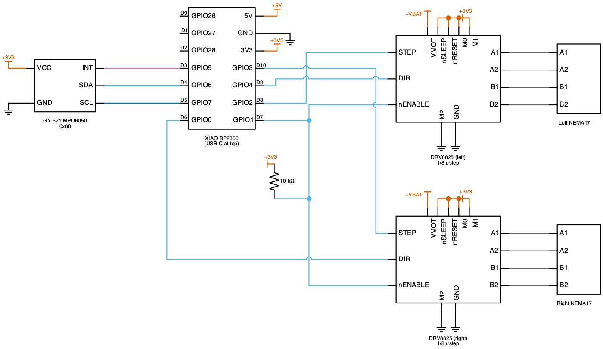
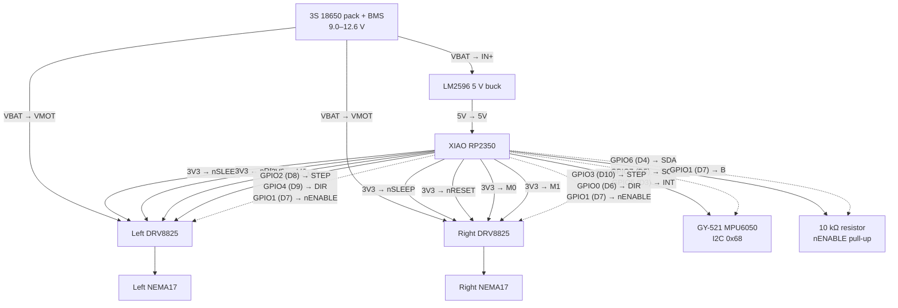

# Balancebot Wiring

Board: Seeed XIAO RP2350. Pin-map source of truth: `src/pin_config.h`.
The pin table and the power diagram marked `GENERATED` are emitted from
[`hardware.toml`](hardware.toml), the header and the board reference by
`just hardware::gen` (ADR-021), and CI fails when they are stale — change
those sources, not the generated blocks.



Schematic source: [`docs/schematics/circuits/balancebot.py`](../../../docs/schematics/circuits/balancebot.py). Re-render with `just schematics::render-one balancebot` after pin changes.

## Overview

```
            3S 18650 pack + BMS (9.0–12.6 V)
                     │
        ┌────────────┼───────────────┐
        │            │               │
   VMOT (left    VMOT (right    LM2596 5 V buck
   DRV8825)      DRV8825)           │
   + 100 µF      + 100 µF           └─→ XIAO 5V pin
                                        (NOT the battery pads — the
                                         onboard charger is ~370 mA
                                         and must not power motors)

   All grounds common: battery −, both DRV8825 GND, buck GND, XIAO GND.
```

### Power and signal topology

Solid edges are supply rails, labelled with the rail and the pin it lands on;
dotted edges are the XIAO's signal nets, each with its GPIO and header pad;
unlabelled edges are loads a part drives from its own terminals. Ground is not
drawn: every part shares it.

<!-- BEGIN GENERATED: power-diagram -->
<!-- Generated from hardware.toml, src/pin_config.h and the board reference by `just hardware::gen` — edit those, not this block. -->



<!-- END GENERATED -->

## XIAO RP2350 connections

<!-- BEGIN GENERATED: pin-table -->
<!-- Generated from hardware.toml, src/pin_config.h and the board reference by `just hardware::gen` — edit those, not this block. -->

| Pin | GPIO | Macro | Wired to | Notes |
|-----|------|-------|----------|-------|
| D0 | GPIO26 | `PIN_PACK_SENSE` | — | only the carrier PCB has the pack divider (R2/R3/C3); the hand-wired harness leaves D0 free |
| D1 | GPIO27 | — | *unassigned* |  |
| D2 | GPIO28 | — | *unassigned* |  |
| D3 | GPIO5 | `PIN_IMU_INT` | GY-521 MPU6050 INT | Data-ready, active high, push-pull; no internal pull (RP2350-E9) |
| D4 | GPIO6 | `PIN_IMU_SDA` | GY-521 MPU6050 SDA | I2C1 SDA |
| D5 | GPIO7 | `PIN_IMU_SCL` | GY-521 MPU6050 SCL | I2C1 SCL |
| D6 | GPIO0 | `PIN_DIR_RIGHT` | Right DRV8825 DIR |  |
| D7 | GPIO1 | `PIN_MOTOR_NENABLE` | Left DRV8825 nENABLE, Right DRV8825 nENABLE, 10 kΩ resistor B | Active low, shared by both drivers; the pull-up holds the drivers disabled while the XIAO boots, resets or sits in BOOTSEL |
| D8 | GPIO2 | `PIN_STEP_LEFT` | Left DRV8825 STEP | PIO0 SM0 |
| D9 | GPIO4 | `PIN_DIR_LEFT` | Left DRV8825 DIR |  |
| D10 | GPIO3 | `PIN_STEP_RIGHT` | Right DRV8825 STEP | PIO0 SM1 |

<!-- END GENERATED -->

The power pads are not in the table: **3V3** feeds the MPU6050 VCC, the
DRV8825 nSLEEP/nRESET/M0/M1 straps (see below) and the nENABLE pull-up; **5V**
takes the buck converter's output; **GND** is the common ground. D0
(GPIO26, `PIN_PACK_SENSE`) carries the carrier PCB's pack-voltage divider
(R2/R3/C3); the hand-wired harness leaves it free, and the firmware does not
read it yet (#747). D1–D2 (GPIO27–28) are spare and ADC-capable.

The GY-521 MPU6050 breakout has an onboard 3.3 V regulator and works fed
from 3V3 directly (bypassing the regulator) — INT is push-pull 3.3 V,
safe for the RP2350.

## DRV8825 carriers (each)

| DRV8825 pin | Connect to |
|-------------|-----------|
| VMOT / GND MOT | battery + / − (100 µF electrolytic across, close to the pins) |
| B2 B1 A1 A2 | stepper coils (one coil pair per letter; swap one pair to reverse a motor in hardware — firmware also mirrors the right motor) |
| GND LOGIC | common ground |
| STEP / DIR | XIAO, per table above |
| nENABLE | shared GPIO1 line with 10 kΩ pull-up to 3V3 |
| nSLEEP + nRESET | tie both to 3V3 (or bridge nSLEEP–nFAULT on carriers with that route) |
| M0 M1 M2 | 1/8 microstep strap — M0=HIGH, M1=HIGH, M2=LOW |

**Why the nENABLE pull-up matters**: the DRV8825 EN input has an internal
pulldown, i.e. a floating nENABLE means *enabled*. During boot, reset and
BOOTSEL the XIAO's GPIOs are hi-Z — without the pull-up the motors would
be live while nothing is in control. Verify strapping against the TI
DRV8825 datasheet table when assembling.

**Do not substitute the RP2350's internal pulls for external resistors
anywhere in this harness**: on the A2 stepping the internal pull-downs
cannot hold an undriven pin low (silicon erratum RP2350-E9 — a floating
input latches at ~2.2 V). The firmware assumes the MPU6050 INT line is
actively driven (push-pull) and uses no internal pull on it.

### Current limit (Vref)

Set per driver, motors connected, before first `arm`:

1. Power VMOT (logic too), drivers disabled (default).
2. Measure Vref between the trim pot wiper and GND.
3. DRV8825: `I_limit = 2 × Vref`. For a typical 1.5 A/phase NEMA17 at 1/8
   microstep, start conservative: Vref ≈ 0.4 V → 0.8 A/phase. Increase
   only if steps are skipped under load (with cooling as needed).

## MPU6050 mounting

- Rigidly mounted (no foam) at **axle height**, near the wheel axis.
- **X axis pointing forward**, Z up — the filter computes pitch as
  `atan2(accel_x, accel_z)` and integrates gyro Y.
- If the robot drives *into* the fall on first arm, flip `IMU_PITCH_SIGN`
  in `src/config.h` (or rotate the sensor 180°).

## Bring-up checklist

1. No motor power: flash, `just balancebot::monitor`, `stat` shows
   `imu: ok`; `stream on`, tilt → angle tracks, level ≈ 0°.
2. `cal` with the robot still; verify no drift over a minute.
3. Motor power, wheels off the ground: `rate l 400`, `rate r 400` — both
   spin the same direction (as the robot would drive); reverse cleanly
   with `rate l -400`.
4. `disarm`, robot upright on the ground, `arm` (or hold upright 3 s) —
   tune per the README procedure.
